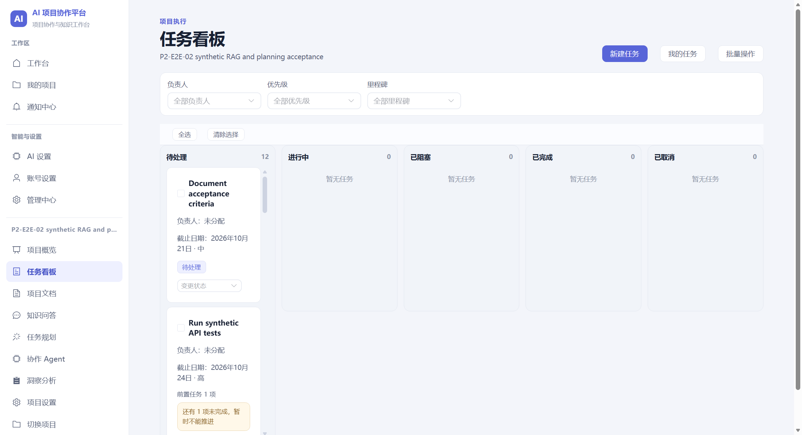
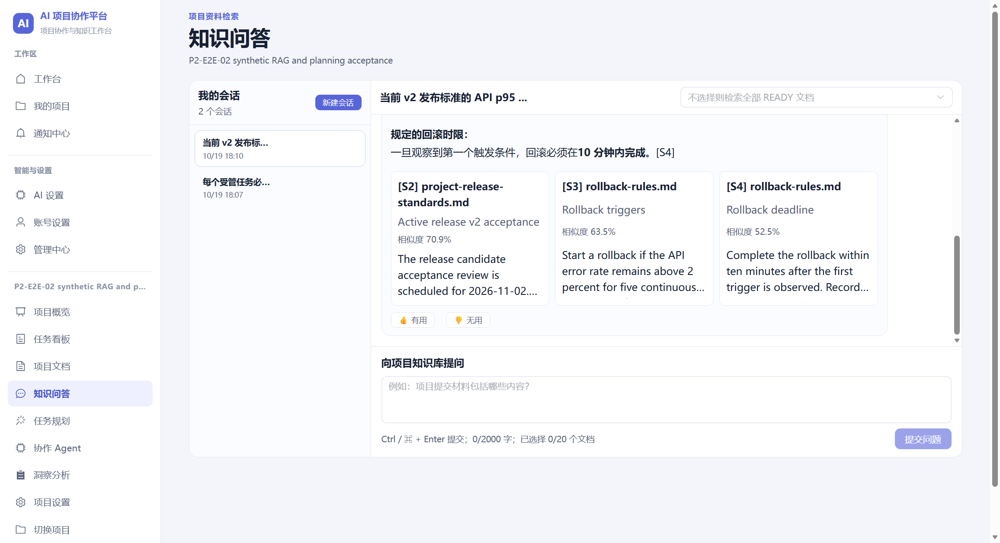
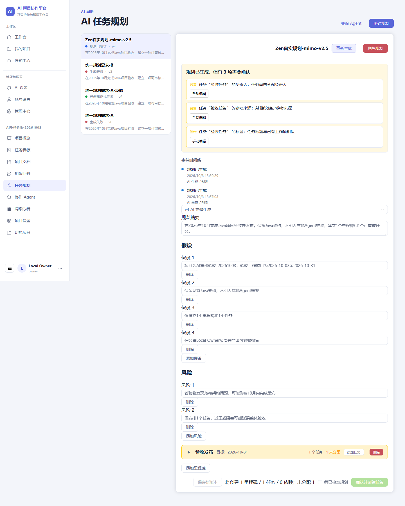
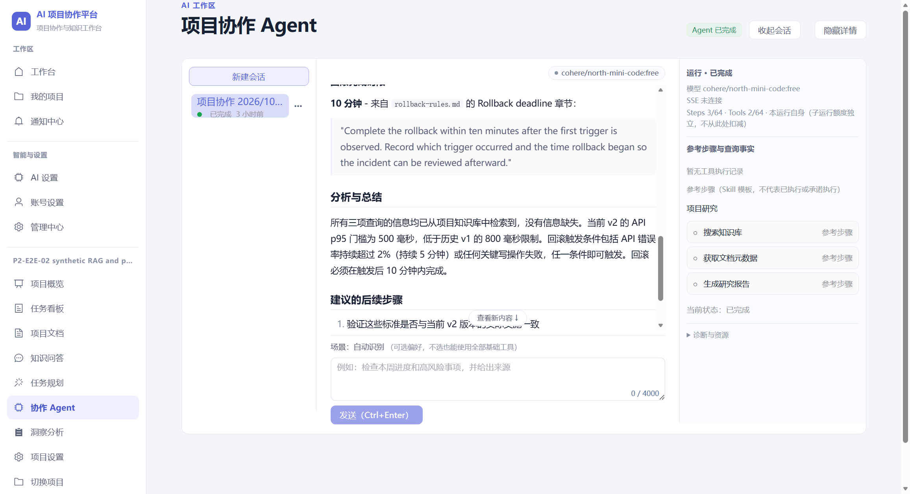
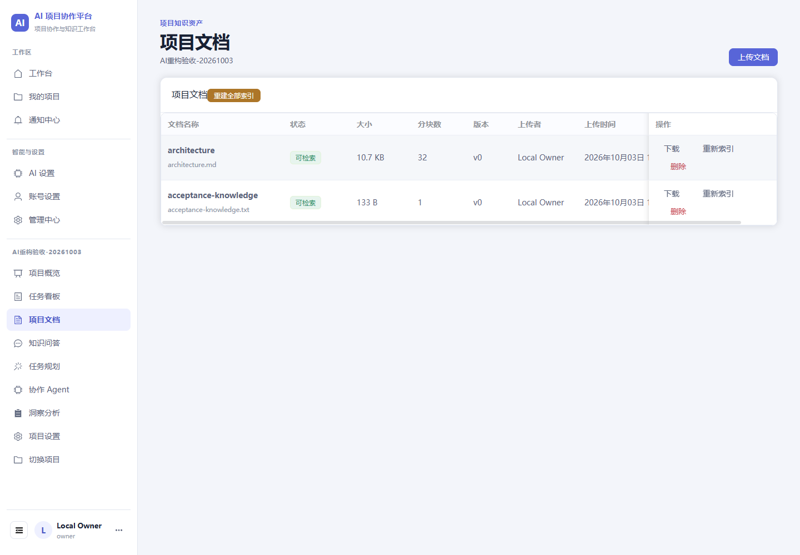
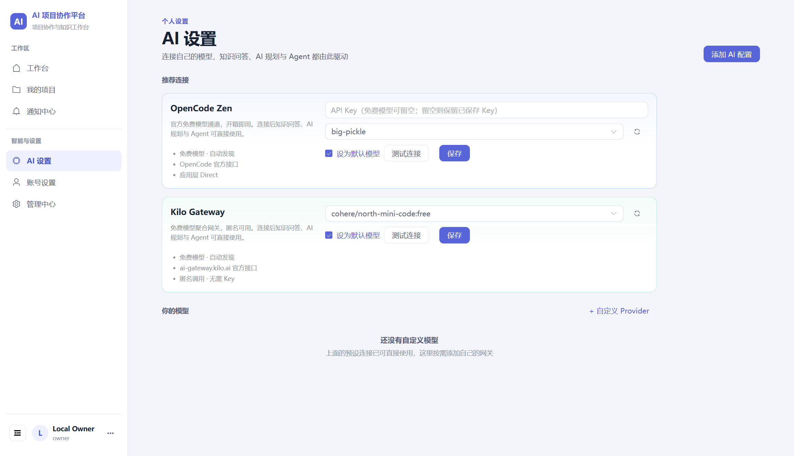
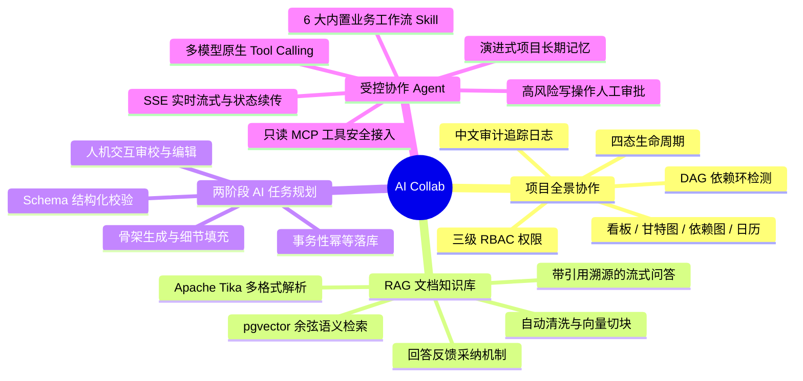
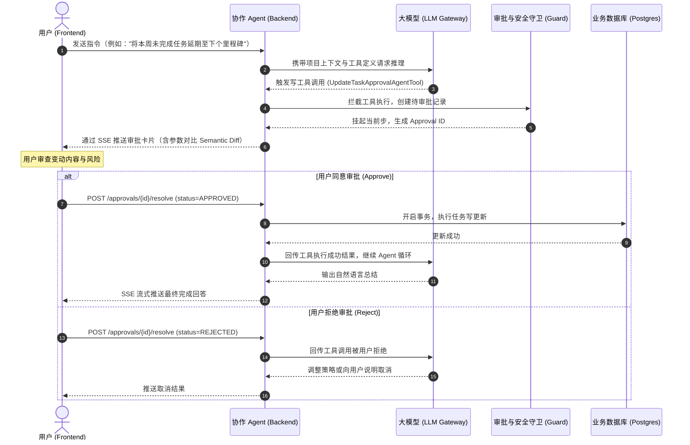

<div align="center">

# AI Collab

### 面向高校竞赛团队与软件工程项目的智能协作平台

<p align="center">
  <a href="https://github.com/BangShou1st/ai-collab/actions">
    
  </a>
  
  
  
  
  
  
  
</p>

<p align="center">
  <b>融合项目管理 · RAG 知识库 · 两阶段 AI 任务规划 · 受控协作 Agent 的一体化研发协作中枢</b>
</p>

---

[功能特性](#-核心功能) • [界面预览](#-界面预览) • [系统架构](#-系统架构) • [技术栈](#-技术栈) • [快速开始](#-快速开始) • [AI 模型接入](#-ai-模型接入) • [分支与开发规范](#-分支与开发规范)

</div>

<br />

## 📖 项目简介

高校软件工程实训与学科竞赛（如挑战杯、中国国际大学生创新大赛、ACM/ICPC、蓝桥杯等）团队在研发协同中常常面临典型痛点：

* **协作工具割裂**：需求、文档、看板分散在不同软件中，难以形成统一的项目全景。
* **团队知识流失**：技术选型、架构决策、论文与规格书散落各处，缺乏结构化沉淀与高效检索手段。
* **任务拆解困难**：新手团队容易漏排核心依赖、估时不准，缺乏科学的任务解构与排期经验。
* **AI 协助无序**：公网大模型仅能提供泛化建议，不了解具体项目上下文；且模型写操作缺乏有效审计与拦截机制。

**AI Collab** 为高校竞赛与软件课程团队量身打造，将**敏捷任务看板**、**基于 pgvector 的企业级 RAG 知识库**、**两阶段自省式 AI 任务规划**以及**带人机审批机制的受控 Agent**无缝融合，提供全流程、可追溯、高可靠的智能协作体验。

---

## 📸 界面预览

<div align="center">

| 任务看板与依赖协同 | RAG 知识库问答与精准溯源 |
| :---: | :---: |
|  |  |
| **两阶段自省式 AI 任务规划** | **协作 Agent 与原生 Tool Calling 运行时** |
|  |  |
| **项目文档切块与知识资产管理** | **多模型提供商与免费聚合网关配置** |
|  |  |

</div>

---

## ✨ 核心功能



### 1. 🎯 全景项目协作 (Project & Work Collaboration)
* **生命周期与权限**：支持 `ACTIVE`、`ARCHIVED`、`COMPLETED`、`DELETED` 四态管理；基于 `OWNER` / `ADMIN` / `MEMBER` 三级 RBAC 在服务端执行强权限约束。
* **多维可视化看板**：具备任务状态拖拽流转、批量操作、成员负载统计。
* **任务依赖与拓扑**：支持前置依赖关系配置，内置有向无环图（DAG）环检测算法，防范依赖死锁。
* **甘特图与日历视图**：直观展示项目里程碑与工作排期，截止日期超期实时高亮预警。
* **完整操作审计**：记录操作流水，生成易读的中文审计摘要与脱敏详情。

### 2. 📚 企业级 RAG 知识库 (Document Knowledge Base)
* **多源格式解析**：集成 Apache Tika 3.3.0，支持 PDF、DOCX、Markdown、TXT 等格式文档提取，单文件上限 20MB。
* **精准清洗与切块**：智能去除冗余格式字符，按语义边界切分，保留原始段落位置元数据。
* **高性能向量检索**：基于 PostgreSQL 17 + pgvector 扩展，利用余弦相似度计算与混合检索定位最匹配切片。
* **溯源式流式问答**：Server-Sent Events (SSE) 实时打字机输出，每个论点精准标注文档引用来源与可跳转证据块。

### 3. 🧠 两阶段自省式 AI 任务规划 (Two-Phase Task Planning)
* **两阶段生成管线**：
  * *阶段一（骨架生成）*：分析需求与知识库背景，提炼核心里程碑与顶层任务。
  * *阶段二（细节填充）*：基于骨架细化任务属性、执行周期、优先级与前置依赖。
* **严格 Schema 校验**：结构化 JSON 输出校验，自动防范模型幻觉导致的字段缺漏或类型错误。
* **人机协同确认**：生成结果在前端以交互式面板展示，支持人工自由二次修改与增删。
* **幂等落库保证**：确认落库操作走全链路事务保护，并发请求通过分布式锁实现幂等。

### 4. 🤖 受控协作 Agent (Controlled Collaborative Agent)
* **统一原生 Tool Calling**：对齐 OpenAI、Anthropic Claude、Google Gemini 等主流大模型 Function Calling 原生协议，并接入 OpenCode Zen & Kilo Gateway 共享库。
* **6 大内置研发工作流 Skill**：
  1. `ProjectHealthSkill`：项目全生命周期健康度诊断与预警。
  2. `ProjectResearchSkill`：项目领域背景、竞品及前沿技术调研。
  3. `WeeklyReportSkill`：基于近期任务与进展自动草拟周报。
  4. `DeliveryReadinessSkill`：发布交付就绪状态核验与缺漏检查。
  5. `IterationPlanningSkill`：迭代排期规划与工作量合理性建议。
  6. `MeetingToTasksSkill`：会议纪要一键结构化提取并转化为待办任务。
* **受控审批写操作 (Human-in-the-Loop)**：**所有写操作（创建/修改任务、里程碑、项目记忆）必须由用户在前端交互弹窗中明确确认审批**，杜绝 Agent 擅自越权篡改业务数据。
* **演进式项目记忆 (Project Memory)**：沉淀团队架构偏好、技术规范与决策约束，在跨会话中持续生效。
* **健壮的流式通信**：SSE 全流程事件广播，具备 `Last-Event-ID` 断线续传与会话状态自愈能力。
* **只读 MCP 扩展**：支持接入 Model Context Protocol 外部服务，服务端白名单与清洗管线过滤防注入。

---

## 🏗️ 系统架构

```
┌─────────────────────────────────────────────────────────────────────────┐
│                      Vue 3 + TypeScript Frontend                        │
│  ┌──────────┬──────────┬──────────┬──────────┬────────────┬───────────┐ │
│  │ Project  │   Work   │ Document │Knowledge │   Agent    │  Settings │ │
│  │ (项目/成员)│ (看板/甘特)│ (解析/存储)│  (RAG问答)│ (受控审批) │ (模型凭证)│ │
│  └──────────┴──────────┴──────────┴──────────┴────────────┴───────────┘ │
└────────────────────────────────────┬────────────────────────────────────┘
                                     │ REST API + Server-Sent Events (SSE)
                                     ▼
┌─────────────────────────────────────────────────────────────────────────┐
│                      Spring Boot 4.1.0 Backend                          │
│                                                                         │
│  [API Layer]            Controller → DTO Validation → Unified Response  │
│                                    ↓                                    │
│  [Application Layer]    Application Service (事务、权限边界、租约管理)   │
│                                    ↓                                    │
│  [Domain Layer]         Domain Model · Business Policies · Repo Interface│
│                                    ↓                                    │
│  [Infrastructure Layer] MyBatis-Plus Mapper · AI Gateway · MinIO Adapter│
└──────────────────┬─────────────────┬───────────────────┬────────────────┘
                   │                 │                   │
                   ▼                 ▼                   ▼
          ┌────────────────┐ ┌───────────────┐ ┌────────────────┐
          │  PostgreSQL 17 │ │    Redis 7    │ │     MinIO      │
          │   + pgvector   │ │ (分布式锁/限流)│ │   (对象存储)    │
          │(业务数据+向量存储)│ └───────────────┘ └────────────────┘
          └───────┬────────┘
                  │
                  ▼
          ┌─────────────────────────────────────────────────────┐
          │                  AI Model Gateway                   │
          │   OpenAI · Anthropic Claude · Gemini · OpenCode Zen │
          │   (原生 Tool Calling · 流式输出 · MCP 只读工具集成)    │
          └─────────────────────────────────────────────────────┘
```

### Agent 受控审批与执行时序



---

## 🛠️ 技术栈

| 层次 | 核心技术 | 版本 | 核心用途与特性 |
|---|---|---|---|
| **后端运行环境** | Java | `21 (LTS)` | 虚拟线程、强封装、新语言特性 |
| **后端框架** | Spring Boot | `4.1.0` | 核心服务容器、Spring Security、OAuth2 Resource Server |
| **持久层** | MyBatis-Plus | `3.5.17` | 高性能 ORM、条件构造器、分页插件 |
| **数据库版本迁移** | Flyway | - | 连续递增版本迁移脚本（**V1–V70**，严禁篡改历史） |
| **文档解析引擎** | Apache Tika | `3.3.0` | 多源文档结构化内容与元数据提取 |
| **前端框架** | Vue | `3.5.18` | Composition API、`<script setup>` 高性能渲染 |
| **类型系统** | TypeScript | `5.8.3` | 全栈严格类型安全，消除隐式 `any` |
| **构建工具** | Vite | `7.1.3` | 秒级热更新、Rollup 生产打包 |
| **状态管理** | Pinia | `3.0.3` | 模块化轻量级 Store，内存态安全令牌机制 |
| **UI 组件库** | Element Plus | `2.10.7` | 现代化后台管理交互组件库 |
| **主数据库** | PostgreSQL | `17` | 关系型业务数据存储 |
| **向量扩展** | pgvector | `0.8+` | 高维向量相似度检索（HNSW / IVFFlat 索引） |
| **缓存/分布式锁** | Redis | `7-alpine` | 双维度接口限流、Agent 租约分布式锁 |
| **对象存储** | MinIO | `RELEASE.2026-09` | 原始文档、附件与资产对象持久化 |
| **测试框架** | Vitest / JUnit 5 | `3.2.4` / `5.x` | 前端 370+ 测试，后端 1600+ 测试 (含 Testcontainers) |
| **AI 共享网关** | OpenCode Zen / Kilo | `v1.4.2` / `v0.2.3` | 公开 JitPack 解析的规范化模型网关层 |

---

## 🚀 快速开始

### 环境依赖

* **JDK**: 21+
* **Node.js**: 22+
* **pnpm**: 11+
* **Docker Desktop**: 必须保持后台运行（WSL2 后端），提供 PostgreSQL、Redis、MinIO 容器。

---

### 1. 克隆代码与配置环境变量

```bash
git clone https://github.com/BangShou1st/ai-collab.git
cd ai-collab
```

初始化本地开发环境变量配置文件（仓库根目录 `.env` 为本地开发的配置源）：

* **Linux / macOS**:
  ```bash
  [ -e .env ] || cp .env.example .env
  ```
* **Windows (PowerShell)**:
  ```powershell
  if (!(Test-Path .env)) { Copy-Item .env.example .env }
  ```

> [!TIP]
> 打开根目录 `.env`，按需修改各服务的 `change-me` 占位符（如数据库密码、JWT 密钥、AI 模型 Key）。

生产环境使用独立的 [`compose.prod.yml`](ai-collab-deploy/compose.prod.yml)、[配置模板](ai-collab-deploy/prod.env.example)与[部署和恢复指南](docs/deployment/production-foundation.md)。生产默认开放普通用户注册，新账号不自动成为系统管理员；真实秘密保存在仓库外，生产环境仍须经过实际验收与授权。

---

### 2. 本地开发推荐入口（Windows 首选）

仓库根目录内置了一键开发维护脚本 [`dev.ps1`](dev.ps1)：

```powershell
# 1. 首次进入前端目录安装依赖
cd ai-collab-frontend
pnpm install --frozen-lockfile
cd ..

# 2. 一键启动基础设施容器 + 本机运行后端源码与前端 Vite
.\dev.ps1 start

# 3. 检查各服务运行与健康探针状态
.\dev.ps1 status

# 4. 开发完成后停止进程（保持数据库容器与数据卷不变）
.\dev.ps1 stop

# （可选）完全停止后台 Postgres/Redis/MinIO 容器
.\dev.ps1 stop-infra

# （可选）检查实际 Java 代理选路与 CONNECT/TLS，不发送模型请求
.\dev.ps1 diagnose-proxy
```

> **`dev.ps1` 的优势**：
> 1. 后台静默运行后端与前端，不抢占焦点、不弹多余黑窗。
> 2. 自动检查端口占用，自动进行 `/actuator/health` 探针轮询检测。
> 3. 严格复用已有数据容器，防止由于频繁 `down` 导致卷冲突。

后端启动入口和 Maven/Surefire 已默认在 JVM 启动前开启 JDK 系统代理发现，无需每次填写本机代理端口。
IDE 直接运行请设置 VM option `-Djava.net.useSystemProxies=true`；已有 JVM 需重启一次。
优先级、环境变量/NO_PROXY 语法、脱敏诊断和限制见[模型网络代理指南](docs/development/model-network-proxy.md)。

---

### 3. 手动启动模式（跨平台）

#### 第一步：启动基础设施

```bash
docker compose --env-file .env -f ai-collab-deploy/docker-compose.yml up -d --no-deps --no-recreate postgres redis minio
```

#### 第二步：启动后端

```bash
cd ai-collab-backend
# Linux / macOS
bash ./mvnw spring-boot:run -Dspring-boot.run.profiles=local

# Windows PowerShell
.\mvnw.cmd spring-boot:run "-Dspring-boot.run.profiles=local"
```

#### 第三步：启动前端

```bash
cd ai-collab-frontend
pnpm install --frozen-lockfile
pnpm dev --port 5173 --strictPort
```

---

### 4. 服务入口与默认账号

| 服务 | 地址 | 默认凭据 / 说明 |
|---|---|---|
| **前端应用界面** | [http://localhost:5173](http://localhost:5173) | 登录或注册新账号 |
| **后端 API 服务** | [http://localhost:8080](http://localhost:8080) | RESTful API 根路径 |
| **健康检查探针** | [http://localhost:8080/actuator/health](http://localhost:8080/actuator/health) | 监控各组件健康状态 |
| **MinIO 控制台** | [http://localhost:9001](http://localhost:9001) | 用户名/密码见 `.env` 中的 `MINIO_ROOT_USER` |
| **系统管理员账号** | - | 用户名：`owner`，密码见 `.env` 中的 `DEMO_OWNER_PASSWORD` |

> [!NOTE]
> * 本地开发环境下默认开放公开注册（`.env` 中 `AUTH_PUBLIC_REGISTRATION_ENABLED=true`）。
> * 登录和注册接口均内置 IP 与用户名的双重滑动窗口速率限制，保障系统安全。

---

## 🤖 AI 模型接入

平台支持**多模型混合配置**，遵循**分级覆盖**原则：

### 1. 凭据配置归属

```
┌────────────────────────────────────────────────────────┐
│                    系统全局默认模型                      │
│     由 .env 声明，提供开箱即用的系统默认推理与 Embedding   │
└───────────────────────────┬────────────────────────────┘
                            │ 可被用户配置覆盖
                            ▼
┌────────────────────────────────────────────────────────┐
│                   个人 AI 设置 (/settings/ai)           │
│   每位用户可绑定专属的 OpenAI / Claude / Gemini API Key  │
│   可分别为「知识库问答」、「任务规划」、「协作 Agent」设置不同模型│
└────────────────────────────────────────────────────────┘
```

* **高安全保护**：用户提交的 API Key 在数据库中由 `MODEL_CONFIG_MASTER_KEY` 进行 AES-GCM 强加密存储，API 接口**只写不读**，日志脱敏过滤。
* **管理中心 AI 设施**：系统级向量模型（Embedding）由系统管理员在管理中心「AI Infrastructure」统一维护。
* **外部 MCP 扩展**：MCP 外部工具白名单由项目管理员在「项目设置 -> 集成」中配置。

### 2. 常见接入配置示例

#### 接入 OpenAI 官方 / 兼容网关
```ini
CHAT_ENABLED=true
CHAT_PROVIDER=openai-compatible
CHAT_BASE_URL=https://api.openai.com
CHAT_API_KEY=sk-proj-xxxxxx
CHAT_MODEL=gpt-4o-mini

EMBEDDING_ENABLED=true
EMBEDDING_PROVIDER=OPENAI_COMPATIBLE
EMBEDDING_BASE_URL=https://api.openai.com
EMBEDDING_API_KEY=sk-proj-xxxxxx
EMBEDDING_MODEL=text-embedding-3-small
EMBEDDING_DIMENSIONS=1536
```

#### 接入本地 Ollama
```ini
CHAT_ENABLED=true
CHAT_PROVIDER=openai-compatible
CHAT_BASE_URL=http://localhost:11434
CHAT_API_KEY=ollama
CHAT_MODEL=qwen2.5:7b

EMBEDDING_ENABLED=true
EMBEDDING_PROVIDER=OPENAI_COMPATIBLE
EMBEDDING_BASE_URL=http://localhost:11434
EMBEDDING_API_KEY=ollama
EMBEDDING_MODEL=bge-m3
EMBEDDING_DIMENSIONS=1024
```

---

## 📂 代码库结构与规模事实

```
ai-collab/
├── ai-collab-backend/               # Spring Boot 4.1.0 后端工程（553 源文件 / 约 4.2 万行）
│   ├── src/main/java/com/shitulelv/aicollab/
│   │   ├── auth/                    # 认证授权、JWT 签发、HttpOnly Cookie 轮换
│   │   ├── user/                    # 用户体系、个人资料、管理员控制中心
│   │   ├── project/                 # 项目管理、成员角色、邀请链接、中文审计日志
│   │   ├── work/                    # 任务看板、里程碑、DAG 依赖环检测、甘特图数据
│   │   ├── document/                # Tika 文档抽取、切块清洗、MinIO 存储
│   │   ├── knowledge/               # RAG 向量检索、余弦相似度匹配、SSE 流式引用问答
│   │   ├── planning/                # 两阶段任务拆解、Schema 严格校验、幂等确认落库
│   │   ├── agent/                   # 协作 Agent 运行时、6 大 Skill、审批拦截器、长期记忆
│   │   ├── notification/            # 站内实时通知与未读计数
│   │   ├── common/                  # 全局统一响应包装、业务异常体系、MyBatis 序列化
│   │   └── infrastructure/          # 多厂商模型网关、向量适配器、安全清洗过滤网关
│   ├── src/main/resources/
│   │   ├── db/migration/            # Flyway 迁移脚本（连续递增 V1–V70，共 70 个版本）
│   │   └── application.yml          # 主配置模板与默认参数
│   └── src/test/                    # 完整单元测试与 Testcontainers 集成测试套件（1600+ 测试）
├── ai-collab-frontend/              # Vue 3.5 + TypeScript 5.8 前端工程（161 源文件 / 约 2.2 万行）
│   ├── src/
│   │   ├── api/                     # 严格类型定义的 Axios 请求客户端与错误规范化层
│   │   ├── auth/                    # 内存态访问凭证、自动静默续期协调器
│   │   ├── shared/                  # 业务公共组件（AppShell 导航、Diff 对比面板等）
│   │   ├── stores/                  # Pinia 共享状态（authStore, projectContextStore 等）
│   │   ├── router.ts                # 前端路由与导航守卫配置
│   │   └── modules/                 # 按业务域划分的高内聚页面模块（Work, Agent, RAG 等）
│   └── vitest.config.ts             # Vitest 单元与组件交互测试套件（370+ 测试）
├── ai-collab-deploy/                # 生产与开发 Docker Compose 编排
├── docs/                            # 系统架构、模块设计、接口规范与历史归档（详见 docs/README.md）
├── tests/fixtures/documents/        # 知识库 RAG 评测与端到端测试的标准文档语料
├── dev.ps1                          # Windows 本地开发一键启停运维入口
├── .env.example                     # 完备的环境变量模板与中文配置说明
└── AGENTS.md                        # AI 编码助手的工程规范约束文档
```

---

## 🌿 分支与开发规范

为保证主干代码的生产可用性与严谨交付，本项目严格遵守规范：

```
                ┌────────────────────────────────┐
                │        origin/main             │
                │        (生产稳定发布主干)        │
                └───────────────▲────────────────┘
                                │ PR (CI 全绿 + 人工合并)
                ┌───────────────┴────────────────┐
                │        origin/dev              │
                │        (日常开发唯一分支)        │
                └───────────────▲────────────────┘
                                │ Git Push
                 开发者本地 dev 分支工作区
```

1. **分支职责明确**：
   * **`dev`**：唯一活跃开发分支。所有功能迭代、缺陷修复均直接提交至 `dev`。
   * **`main`**：生产环境受保护分支。**严禁直接 Push 到 `main`**。
2. **晋升合并路径**：
   * `dev` 升级到 `main` 必须通过 GitHub Pull Request（PR）。
   * 触发合并必须满足：**GitHub Actions CI 双矩阵（Backend Verify + Frontend Test）全绿**，由仓库负责人审核确认合入。
3. **提交规范**：
   * 提交信息遵循 [Conventional Commits](https://www.conventionalcommits.org/) 规范：`feat:` / `fix:` / `docs:` / `test:` / `refactor:` / `chore:`。
4. **提交前自检流水线**：
   ```bash
   # 前端代码检查
   cd ai-collab-frontend && pnpm lint && pnpm typecheck && pnpm test && pnpm build

   # 后端代码检查
   cd ai-collab-backend && ./mvnw -B -ntp test
   ```

---

## 📄 开源许可证

本项目采用 [MIT 许可证](LICENSE)。欢迎高校师生、开发者参与交流与二次构建。

Agent 工具调度使用单 JVM 精确身份配额与有界准入（16 全局 / 4 用户 / 2 Run / 64 等待），详见 [调度设计](docs/design/agent-tool-concurrency.md)。
工具出站前保存执行证据；无法确认的潜在副作用记录为 UNKNOWN 并停止自动推进，受控规划按原 Invocation 查询已受理操作，详见 [远端结果与恢复设计](docs/design/agent-remote-outcome.md)。

Agent 诊断使用低频 PostgreSQL 快照与低基数进程指标，详见 [可观测性设计](docs/design/agent-observability.md) 和 [诊断手册](docs/design/agent-runtime-maintenance.md#21-agent-可靠性诊断p6-c)。
