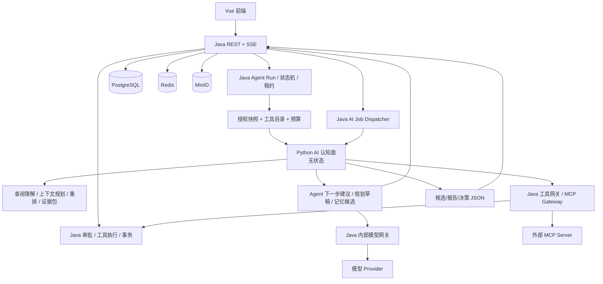
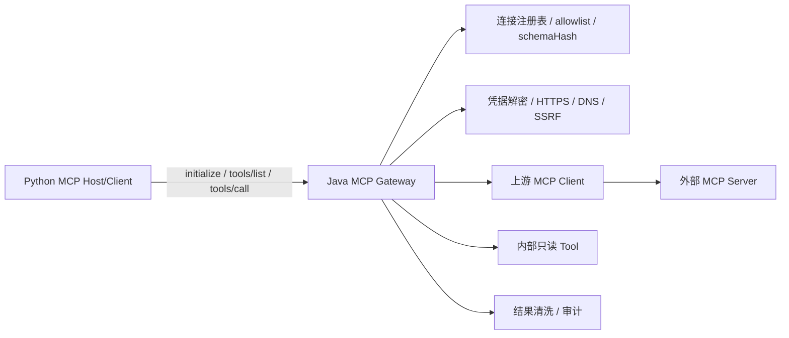

# 交给高级模型的提示词：AI Collab 的 Python AI 能力平面与减法审计

> **用途**：在 AI Collab 仓库内做一次只读的架构审计与重设计，产出可执行的 Python AI 能力平面方案和“先删除、再简化、后优化”的改造清单。
> **使用方式**：整段复制给目标模型。它必须先在仓库内核对事实，再输出设计；本次不修改业务代码、不新增迁移、不执行删除。
> **代码基线**：`dev` @ `61be76e2`；工作区已有未提交的文档（本 Prompt、Python 旁路评估、Python 能力平面 ADR）。实施前必须重新核对 HEAD 与工作区。
> **一句话目标**：**让 Python 真正承载 AI 认知能力，而不是做一个只跑离线脚本的装饰性旁路；同时把 Java 收缩为权限、事务、审批、执行与模型出网的唯一控制面。**

---

## 0. 先读结论：方向已定，边界必须被证明

用户已经明确要求“AI 能力尽量放在 Python”。因此，本任务**不再论证要不要引入 Python**，而是要论证并设计：

1. 哪些 AI 能力应迁到 Python，迁到哪一层；
2. 哪些必须留在 Java，为什么；
3. 当前 Java 侧哪些东西可以**完全删除**，哪些应**先简化**；
4. 如何在不牺牲权限、审批、幂等、租户隔离、成本和可运维性的前提下分阶段落地。

允许你挑战“某个能力不该迁 Python”，但必须逐项给出证据与 Java 侧替代方案；不允许用“保持现状最稳”作为整体结论逃避设计。

**推荐目标不是 L0，也不是一次性 L3，而是 L2.5「Python 认知面 + Java 执行面」：**

- Python 负责模型前的认知工作：Prompt/上下文规划、查询理解、检索编排与重排、证据打包、**MCP Host/Client 与工具目录编排**、Agent 下一步动作建议、规划生成与修复、记忆候选提取、离线评测。
- Java 负责产品运行时：身份与项目权限、数据过滤、工具执行、写操作审批、事务、Run 状态机、租约/fencing、幂等、SSE、预算结算、Provider 密钥与出网、**MCP Gateway / MCP Server**、审计。
- Python **不直连数据库/Redis/MinIO，不持有 Provider/MCP 凭据，不直接执行业务写工具，不审批，不写业务数据**；只允许通过 Java 工具网关调用受控只读工具。
- 在线 Agent 的“状态机”仍由 Java 持有；Python 只做**无状态的一轮决策**。这叫“Python 大脑，Java 手脚”，不是“再建一套 Agent Runtime”。

如果证据表明 L2.5 的跨语言成本高于收益，必须明确写出“降级为 L2”的条件与代价，而不是含糊地说“视情况而定”。

**复杂度预算（硬约束）：**

1. 只允许新增**一个 Python 可部署单元**；最多分 `api` 与 `worker` 两个进程角色，不按能力拆微服务。
2. 不新增数据库、消息队列、向量数据库、服务网格、缓存；Job/租约/重试继续用 Java 现有表。
3. 一个能力只能有一个所有者；Python 接管后必须删除 Java 旧路径，不允许长期双跑。
4. 不做 Prompt 管理 UI/平台；Prompt 是版本化文件 + 只读接口。
5. 一套契约、一套 trace、一套审计；Python 不另建账本。
6. 任何迁移都必须能用一个开关回退，且不要求回滚数据库。

---

## 1. 必须先核对的仓库事实

先完整阅读：

1. `AGENTS.md`（仓库硬规则，优先于本 Prompt 的推测）；
2. `README.md`；
3. `docs/architecture.md`；
4. `docs/design/AI-Collab-2026-11-10.md`；
5. `docs/design/AI-Collab-AC-07-Agent-Memory-V2-设计补充-2026-11-10.md`；
6. `docs/archive/research/python-ai-sidecar-evaluation-20261111.md`；
7. `docs/design/python-ai-capability-plane-2026-11-11.md`；
8. 本文第 2 节的代码证据，必须逐条用当前代码复核；若行号漂移，以代码内容为准并更新引用。

硬性事实基线（需复核，不可直接当结论）：

- 后端：Java 21 / Spring Boot 4.1.0 / Spring Security + OAuth2 Resource Server / MyBatis-Plus / Flyway / Tika / pgvector。
- 前端：Vue 3.5 / TypeScript / Vite / Pinia / Element Plus。
- 基建：PostgreSQL 17 + pgvector、Redis 7、MinIO、Docker Compose；生产另有 RocketMQ 与 nginx/edge。
- 当前迁移最新 V89；下一版本 V90。历史迁移只增不改。
- 只有用户 JWT，没有服务账号；JWT 无 admin/role claim，管理权限每次查 `app_user.system_admin`。
- 数据库无 RLS；项目隔离靠 `ProjectAccessGuard`；撤权过滤靠 `AgentHistoryVisibilityService`。
- 密钥只在 Java：`ModelSecretCipher` 用 `MODEL_CONFIG_MASTER_KEY` 加解密；Provider Key 只在 Java 出站时解密。
- 写操作必须审批：`AgentApprovalService` 的 approve 才执行；Memory 的 create/update/disable/supersede 全部 `requireAdmin` + CAS + 来源核验。
- SSE 有持久序号与 `Last-Event-ID` 断线续传；运行有租约/fencing、幂等结算与预算准入。
- MCP 当前是 Java Host/Client；`McpAgentToolProvider` 把 MCP 工具包装成 `AgentTool`，`McpClientFactory` 在 Java 解密凭据，`McpEndpointPolicy` 做 HTTPS/主机白名单/DNS 私网阻断。不得把“只读声明”当成安全边界。
- `docs/backend-agent-redesign.md` 与 `docs/design/AI-Collab-2026-11-10.md` 仍写着“不引入 Python 微服务”。本方案若获批，必须显式修订这些文档与 `AGENTS.md`，不能以“旁路”名义绕过。

### 1.1 设计文档 vs 代码：当前真实落地状态（`dev` @ `61be76e2`，迁移 V89）

**不要假设设计文档已经实现。** 以下是 2026-11-10 设计与代码的逐项核对结果，你必须先用当前代码复核，再在此基础上做增量设计：

| 设计项 | 代码现状 | 状态 |
| --- | --- | --- |
| AC-06 业务中性化 | `ProjectType` 已含 `PRODUCT_DEVELOPMENT / CLIENT_DELIVERY / INTERNAL_PROJECT / RESEARCH_EXPLORATION / OTHER`，旧值保留；V86 已迁移 | `IMPLEMENTED` |
| AC-P0 Trace/评测基线 | 冻结评测集 v2 共 46 条；`AgentTracing` + `AgentRuntimeMetrics` 存在；DB 无 `trace_id/span_id` 列 | `TESTED`（评测集）/ 部分 |
| AC-P1a 模型窗口档案 | V89 `ai_model_profile` + `ModelProfileService` + `ModelWindowResolver` | `IMPLEMENTED` |
| AC-P1b 统一 Token 计量 | **无** `TokenMeasurement`；`AgentContextBudget.java:33` 仍为 `256_000`；DB `usage_basis` 只有 `PROVIDER/ESTIMATED/UNKNOWN` 三值 | 未开始 |
| AC-02 压缩 A/B、AC-P2 结算 | V85 `model_cost_ledger` 存在；无三组压缩对照实验 | 部分 |
| AC-03 场景重分类 | 只读工具已并入基础集合（`AgentToolRegistry.java:113-119`），但**关键词表仍在**、6 个 `*Skill` 未改名、`DOCUMENT → MEETING_TO_TASKS` 硬映射仍在 | 一半 |
| AC-04 / AC-P4 MCP Server | **无** `mcpserver` 包，只有 Host/Client | 未开始 |
| AC-05 / AC-P5 DAG 检索 | `TaskDependencyEdge`/`TaskDependencyPolicy` 存在，但**无** `get_task_dependencies` Agent 工具，无融合层 | 未开始 |
| AC07-P1 记忆来源治理 | V87/V88 + 修订历史/SUPERSEDE 与集成测试 | `TESTED` |
| AC07-P2 Dreaming | 无 `ai_job` 表（最新 V89） | 未开始 |
| AC07-P3 小索引/按需召回 | 无 `search_project_memories` 工具 | 未开始 |
| Python 能力平面 ADR | 仅文档；仓库无 `ai-collab-ai-worker/`，无 `ai-eval` | 未开始 |

由此得到两条硬结论：

1. **不要把“迁 Python”当成未落地设计的替代品。** AC-P1b（统一计量）没做就迁 Python，会把“四套 Token 口径”升级成“跨语言两套账”，比现在更难收敛。
2. **11-10 文档已有三处与当前方向冲突，必须显式改掉**：`§1.3 非目标` 写着“不增加 Python 微服务”；`§5.1` 把 Skill 定义成“可选未来概念”却未改代码；`python-ai-capability-plane-2026-11-11.md` 原先只把 Python 限定为“离线评测 + Dreaming + MCP 客户端”。**前两处已加修订说明，第三处已升为 V2.0 定稿（含 Java/Python 双轨批次 J0–J6 / P0–P4），实施以该文件为准；本 Prompt 用于对抗性复核，不另立一套归属表。**

证据分级只允许使用：

- `IMPLEMENTED`：代码存在且装配路径可达；
- `TESTED`：有确定性测试覆盖；
- `LIVE_VERIFIED`：有真实模型/真实环境证据；
- `NOT_VERIFIED`：未核实或只有设计文档；
- `BLOCKED`：被凭据、环境或外部依赖阻断。

**代码存在 ≠ 测试通过 ≠ 真实模型验证 ≠ 已上线。四者不得混写。**

---

## 2. 先做减法审计：已核实的候选

这一节是本次审计的重点。你要挑战每一行，而不是照着清单写“同意”。每项必须回答：

- 它解决的真实问题是什么？
- 当前设置下是否仍有必要？
- 如果删除，谁会受影响，如何证明可以删？
- 如果不删，能否用更小的机制替代？
- 删除/简化后的回归风险是什么？

### 2.1 Token 计量：四套口径，必须先删重复

**证据：**

- `common/ai/token/ModelAwareTokenCounter.java:35-56`：按 provider/model 做正则近似，明确标注 `ESTIMATED`；其中 `"NATIVE"` 分支由 provider 字符串或 `native:` 前缀触发，不是真正的 Provider 原生计数 API。
- `agent/domain/model/TokenEstimator.java:45-62`：CJK 感知的纯估算器。
- `planning/domain/PlanningTokenEstimator.java:31-48`：同一公式的复制实现，注释说明是为了避免 planning → agent 的双向依赖。
- `agent/application/runtime/AgentModelMessageComposer.java:236`：上下文组装仍按 `availableInputTokens * 3L` 折算字符预算。
- `agent/application/runtime/AgentContextSummarizer.java:355、464、983`：摘要记账仍使用 `chars / 3`。
- `agent/application/runtime/AgentContextBudget.java:18-22、33、168`：注释明确承认 Composer 与触发线口径不一致，暂时保留 256K 绝对顶。

**判断：** 这不是“多处实现”，而是同一个业务量存在四个互不兼容的计量真相。它会导致压缩触发过早/过晚、预算结算漂移、跨 Provider 行为不一致，且让“取消 256K 顶”无法安全实施。

**建议：**

1. **删除** `TokenEstimator` 与 `PlanningTokenEstimator` 两个 domain 复制品；把纯估算下沉到 `common/ai/token`，只保留一个 `TokenMeasurement` 接口。
2. **删除** Composer 与 Summarizer 中的 `chars/3` 字面逻辑；统一返回 `PROVIDER / EXACT_TOKENIZER / ESTIMATE / UNKNOWN` 与来源说明。
3. Provider usage 永远是结算权威；本地估算只用于出站前准入，不得冒充实际消耗。
4. Python 如果需要精确 tokenizer，只做**离线校准/评测**或显式的 preflight 服务；在线预算决策仍由 Java 持有，避免每轮多一次网络往返。

**不要做：** 为了“统一”而把在线预算权直接交给 Python。计量可以跨语言，预算准入与结算必须在 Java。

**删除前置条件：** 用同一组 CJK/ASCII/工具 Schema/长上下文样本证明新旧口径差异；确认历史账本不回填、不重算；保留 `UNKNOWN` 语义。

---

### 2.2 「Skill」这个名字已经名不副实：先拆职责，再删路由

**术语问题（必须先裁决，否则迁 Python 会迁错对象）：**

`AgentSkill` 现在同时承担 7 件事：

| 职责 | 方法 | 本质 | 应归属 |
| --- | --- | --- | --- |
| 产品身份 | `code/displayName/description` | 场景目录 | Java（兼容值 + 展示） |
| 入口提示 | `recommendedRoutes` | UI 推荐 | Java/前端 |
| 工具授予 | `allowedTools` | 权限边界 | **Java** |
| 写/外部开关 | `allowWriteTools/allowExternalTools` | 安全策略 | **Java** |
| 输入契约 | `inputSchema` | 校验 | **Java** |
| 模型指令 | `instruction/outputContract` | Prompt 资产 | **Python** |
| 运行必需动作 | `coreActionTools` | 运行时语义 | Java |

而“Skill”在 2025-12 之后已有明确生态含义：`agentskills.io` 开放标准下的 `SKILL.md`（YAML frontmatter + 渐进披露 + 由模型按 description 自主选择，可选 `scripts/`、`references/`）。本项目的 `AgentSkill` 恰好相反——硬编码 Java 类、由关键词选择、没有可加载资源。**继续叫 Skill，会在接入真正的 Skill 资产或对外解释时直接撞名。**

**代码证据（名字与语义已经脱节）：**

- `agent/infrastructure/tool/AgentToolRegistry.java:113-119`：主运行有效工具 = `BASE_READ_ONLY_TOOLS ∪ skill.allowedTools() ∪ 澄清工具`。也就是说 `allowedTools` 对只读工具**只能加、不能减**，接口注释“Skill 只决定工具白名单”（`AgentSkill.java:8`）已经不成立；它对写工具仍是必需的显式授权（`AgentToolCallExecutor.java:558`）。
- `agent/application/runtime/AgentRuntimeCoordinator.java:832-857`：用一个匿名 record 现场造出 `CHILD_DOCUMENT_RESEARCH` 场景视图，说明“场景”已经退化成运行时投影，而不是可安装能力。
- 同文件 `:853`：`skill instanceof AgentRuntimeCoordinator ChildResearchSkillViewMarker` 实际被解析为“`instanceof AgentRuntimeCoordinator` + 模式变量名”，对场景视图恒为 false，真正生效的是后面的字符串比较。这是“用类型系统表达场景身份”失败的证据。

**建议（改名与拆分，不新建表、不改历史值）：**

1. 类型改名：`AgentSkill → AgentScenario`、`AgentSkillRegistry → AgentScenarioRegistry`；字段语义改名 `allowedTools → grantedTools`、`recommendedRoutes → entryRoutes`。
2. 资产拆分：`instruction/outputContract` 变成 Python 的版本化 `PromptPack`，按 `scenarioCode@version` 取；Java 只保留策略与校验。
3. 只有真状态机的两个（`MEETING_TO_TASKS`、`ITERATION_PLANNING`）额外标记为 `Workflow`；其余是 `Scenario`。同一份目录里用 `category` 区分，不拆两套系统。
4. **保留“Skill”一词空置**，留给未来真正的可加载资产（`SKILL.md`），不要现在占掉。
5. 明确删除 `select()` 的关键词分支与 `DOCUMENT → MEETING_TO_TASKS` 硬映射；显式 `code` 与页面显式选择保留。

**证据（路由）：**

- `agent/domain/model/AgentSkillRegistry.java:25-74`：关键词表存在重复项（`"规划"`、`"迭代"` 在表首和表中重复），后面的条目永远不可达。
- 同文件 `:62-65`：`"创建"`、`"新建"`、`"添加"`、`"任务"` 等过宽词会把大量请求强制路由到 `ITERATION_PLANNING`。
- 同文件 `:129-137`：页面路由又把 `DOCUMENT` 映射到 `MEETING_TO_TASKS`，与“场景只是提示、不是能力上限”的设计相矛盾。

**判断：** 这是用字符串包含关系模拟意图分类的脆弱启发式。它既会误选，也把“场景”变成了隐式工具范围，与“场景只是提示、不是能力上限”的目标冲突。

**补充建议（在改名之外）：**

1. 需要隐式选择时，让模型在完整工具集内选择，或以离线评测证明收益的轻量分类器；不要再用关键词表。
2. 旧 `skillCode` 值与 API 字段继续可读，避免破坏历史 Run、定时任务与前端。

**删除前置条件：** 统计现有请求的场景分布、误路由样例、定时任务依赖；保留一个发布周期的显式兼容映射。

---

### 2.3 Legacy JSON 决策协议：第二套 Agent 语义，应退出

**证据：**

- `agent/application/runtime/RoutingAgentModelExecutor.java:96-108`：有 `NATIVE_TOOLS` 走 Native，否则只要有 `CHAT` 就走 Legacy。
- `agent/application/runtime/LegacyReadOnlyAgentExecutor.java:56-103`：用 `PROMPT_JSON` + `AgentDecisionParser` 解析 `call_tool/final`。
- 同文件 `:126-130`：Legacy 路径过滤掉所有写工具，只保留只读工具。
- 同文件 `:194-197`：工具结果超过 500 字符直接截断，和 Native 路径的完整观察语义不一致。
- `AgentDecisionParser` 只被 Legacy 路径使用；Native 路径不经过它。

**判断：** 这不是“兼容层”，而是第二套 Agent 协议：不同的消息格式、不同的工具结果语义、不同的写能力、不同的失败模式。为了支持“只有 CHAT 的模型”而长期维护两套语义，成本和风险都高于收益。

**建议：**

1. Agent 的产品契约明确要求 `NATIVE_TOOLS`；配置为 CHAT-only 的模型在 Agent 入口**快速失败**，给出可操作的配置提示，不进入伪 Agent 循环。
2. 如果仍要支持 CHAT-only，把它定位为“无工具的普通对话”，与 Agent 分开，不共享 Run/工具/审批语义。
3. 在确认无付费客户依赖后，**删除** `LegacyReadOnlyAgentExecutor`、`AgentDecisionParser`、`legacyMode` 分支和相关测试。
4. 不做“Legacy 再增强”的中间路线；那会让第二套协议活得更久。

**删除前置条件：** 统计 CHAT-only Agent 配置与真实调用量；提供配置迁移；用同一组任务比较 Native 与 Legacy 的成功率、延迟、成本；确认无定时任务/历史恢复依赖。

---

### 2.4 文档范围：正则解析自然语言，应被结构化选择替代

**证据：**

- `document/application/service/DocumentSearchService.java:31-43`：用多组中文正则识别“只能根据《…》/排除《…》”等来源限制。
- 同文件 `:147-173`：从用户原话中抽取书名号内的文档名，再与项目文件名做精确匹配。
- `knowledge/api/dto/KnowledgeQuestionRequest.java:6`：请求已经支持显式 `documentIds`。
- `agent/infrastructure/tool/KnowledgeSearchAgentTool.java:95-102`：工具 Schema 已经支持 `documentIds`。

**判断：** 这是把自然语言理解塞进 Java 正则。它对措辞、标点、书名号、别名、同名文件都敏感；一旦解析错误，可能把“只根据 A”变成“检索全部”，属于权限/证据范围风险，而不是单纯的体验问题。

**建议：**

1. **删除** `LIMITED_SOURCE_LIST` / `EXCLUDED_SOURCE_LIST` 及 `parseScopeIntent` 的常规路径。
2. 前端提供文档选择器；请求与工具只接受显式 `documentIds`，Java 校验项目归属、READY 状态与可见性。
3. 如果必须支持自然语言，由 Python 只做“候选文档名抽取”，Java 用项目内精确匹配解析为 ID；**模型不得直接生成或扩大文档 ID 集合**。
4. 解析不确定时 fail-closed：要求用户确认，不静默退回全项目检索。

**删除前置条件：** 前端选择器可用；历史请求/收藏/分享链接兼容；对“只根据某文档”的现有用例做回归。

---

### 2.5 MCP 工具：协议归 Python，凭据/出网/执行归 Java

**证据：**

- `agent/infrastructure/mcp/McpAgentToolProvider.java:36-58`：从连接快照读取已发现工具，按 allowlist 与 `readOnlyHint` 过滤，再包装成 Java `AgentTool`。
- 同文件 `:65-67`：`isReadOnly()` 只读 `annotations.readOnlyHint`。这是 MCP 的**声明**，不是可验证的安全边界。
- 同文件 `:99-121`：执行时重新查连接、校验 schemaHash、再调用 `McpClientFacade.callTool`，错误返回 `UNKNOWN`，这个语义必须保留。
- `McpClientFactory.java:22-27`：Java 解密 MCP 凭据并创建 HTTP 客户端；`McpEndpointPolicy.java:45-68` 强制 HTTPS、主机白名单、DNS 私网阻断。
- `McpConnection.java:6-14`：连接表保存 `credentialCiphertext`、`discoveredToolsJson`、`schemaHash`、`confirmedSchemaHash` 等治理信息。
- `AgentToolRegistry.java:109-127`：Java 把内部工具与外部 MCP 工具合并成同一份暴露列表。

**判断：** MCP 的**协议与工具认知**应归 Python：连接会话、`initialize`、`tools/list`、Schema 归一化、工具自动展开、工具选择、结果裁剪与摘要，这些都是 AI 认知面的一部分。但 MCP 的**凭据、出网、上游调用、审计**不能一起交给 Python，否则会复制 `ModelSecretCipher`、`McpEndpointPolicy`、allowlist/schemaHash 和结果清洗五套安全语义。

**建议：**

1. **Java 新增 MCP Gateway**：对 Python 暴露标准 MCP 端点（`initialize` / `tools/list` / `tools/call`），但只返回当前 run/tenant 被授权的虚拟工具目录；网关负责连接映射、凭据注入、HTTPS/DNS 校验、allowlist、schemaHash、只读校验、结果清洗与审计。
2. **Python 使用官方 MCP Python SDK 作为 Host/Client**：连接 Java Gateway，完成 `tools/list`、Schema 归一化（OpenAI/Claude/Gemini 格式）、自动展开、工具选择和结果摘要。Python 不接触上游 MCP endpoint 与凭据。
3. **内部只读工具也走同一工具网关**：Python 看到一个统一 `ToolDescriptor`，不关心它是 Java 内部工具还是外部 MCP 工具；执行时网关重新校验 run、project、role、工具名、参数 Schema 与风险等级。
4. **写工具不通过 MCP 暴露**：`create_task`、`update_task`、Memory 写入等仍以 `WRITE_PROPOSAL` 形式返回给 Java，由 Java 创建审批、用户确认后执行。Python 不得直接调用写接口。
5. **删除 Java 的 MCP→AgentTool 适配层**：Python Host 上线并稳定后，删除 `McpAgentToolProvider` 的工具包装逻辑，以及 `AgentToolRegistry` 合并外部 MCP 的分支；`McpConnectionManager`、`McpClientFactory`、`McpEndpointPolicy`、`McpRepository`、`McpResultSanitizer` 保留在 Gateway。
6. **不把 `readOnlyHint` 当权限**：只作为风险提示；真正的只读边界由连接级 allowlist、工具级 risk class、schema hash 与人工确认共同决定。

**删除前置条件：** Java Gateway 的 `tools/list`/`tools/call` 契约稳定；Python Host 与现有 Java MCP Client 对同一外部 Server 的发现/调用结果一致；schema 变更、撤权、超时、`UNKNOWN` 语义回归通过；至少一个真实 MCP Server 双客户端互通。

---

### 2.6 检索入口：同一能力多套装配，先统一门面

**证据：**

- `agent/infrastructure/tool/KnowledgeSearchAgentTool.java:39-42`：`RetrievalPipeline` 与 `QueryRouter` 都是 `@Autowired(required=false)`。
- 同文件 `:149-153`：`retrievalPipeline != null` 走 RAG V2，否则退回 `DocumentSearchService.search`；生产装配缺失时会静默降级。
- `knowledge/application/service/KnowledgeQuestionApplicationService.java` 与 `KnowledgeStreamQuestionService.java` 各自注入 `DocumentSearchService`、`QueryRouter`。
- `planning/infrastructure/tool/SearchProjectKnowledgePlanningTool.java` 直接依赖 `DocumentSearchService`。
- `planning/application/TaskPlanContextAssembler.java` 也直接依赖 `DocumentSearchService`。

**判断：** 同一个“项目知识检索”在 QA、流式 QA、Agent、规划中有不同装配路径；可选注入让“少一个 Bean”变成静默降级，测试环境与生产环境可能行为不同。这不是多态，是隐式分支。

**建议：**

1. 建立唯一 `ProjectKnowledgeRetrieval` 门面，统一：项目权限、READY/撤权过滤、Embedding 配置快照、候选池、重排、引用身份。
2. `DocumentSearchService` 退回为底层向量查询适配器，不直接被业务入口调用。
3. 删除生产路径上的 `required=false` 静默降级；迁移期用显式 `retrieval.mode=LEGACY|V2` 开关，启动时校验依赖。
4. Python 接管 query understanding / rerank 时，也只能调用这个门面的 Java 内部只读接口，不能直连库。

**简化前置条件：** 三入口同题对照（Recall、引用、延迟、Token）；确保撤权过滤仍在 Java 且 fail-closed。

---

### 2.7 QueryRouter：保留，但不要用“更复杂的路由器”替代

**证据：**

- `retrieval/query/QueryRouter.java:11-29`：明确说明是 heuristic/rule-based，并记录了曾因缺少 `@Component` 导致生产未生效。
- 同文件 `:139-144`：默认 `DENSE_WITH_BOUNDED_FALLBACK`，注释给出 DuRetrieval 全量语料上 Dense-only 优于无条件 Hybrid 的数据。

**判断：** 它是有实测依据的策略，不是纯拍脑袋；但规则类别（FAST/STRUCTURED/COMPLEX/HYBRID）与阈值仍可能过拟合中文表达。现在用 LLM 路由器替换，会增加延迟与不确定性，且没有证据。

**建议：**

- **保留**，但把它降为可替换策略，并用冻结集证明每个类别的净收益。
- 如果迁移 Python，只迁移“决策函数”，不迁移检索执行；Java 仍执行过滤与取数。
- 没有稳定收益的类别应删除，而不是叠加更多规则。

---

### 2.8 上下文组装：双路径与 800 行规则，应大幅简化

**证据：**

- `agent/application/runtime/AgentContextProperties.java:18`：`composerV2` 默认 `true`，但保留回退。
- `agent/application/runtime/AgentModelMessageComposer.java:30-37`：Legacy 与 v2 两条组装路径并存。
- 同文件 `:141-217`：Legacy 路径固定 10 条/6 条、12000 字符预算、整条跳过；v2 路径 `:230-483` 做分层预算、工具投影、摘要候选、记忆注入、子运行隔离。
- 同文件 `:222-236`：v2 仍以 `chars/3` 折算预算。

**判断：** 两条路径让每个上下文修复都要改两遍，且行为不同；v2 内部又混合了预算、选择、渲染、摘要、记忆、工具重建六种职责。它是当前最值得简化的核心，但不建议“一把重写”。

**建议：**

1. 先删 `composerV2=false` 的回退路径；所有 Run 固定 v2，保留一个发布周期的只读兼容。
2. 把 v2 拆成三个纯函数：`ContextPlanner`（选择哪些层）、`ContextRenderer`（如何渲染）、`ContextBudgeter`（计量与裁剪）；不要把数据库读取塞进渲染器。
3. Python 接管时，Java 只提供**有界、已授权、带版本的快照**；Python 返回 `ContextPlan`，Java 仍负责最终预算与出站。
4. 不在 Python 里复制 `ProjectAccessGuard` 或 `AgentHistoryVisibilityService`。

---

### 2.9 可以保留、不要为了“减法”误删的东西

以下不是冗余，删除会直接破坏产品不变量：

- `ProjectAccessGuard` / `AgentHistoryVisibilityService`：权限与撤权过滤；
- `AgentApprovalService`：写操作审批、版本绑定、幂等；
- Agent 租约/fencing、事件序号、`Last-Event-ID`；
- `ModelSecretCipher`、`OutboundEndpointPolicy`、Provider 出网校验；
- `AgentToolResultSanitizer` / `McpResultSanitizer`；
- MCP 只读白名单与 Schema Hash 校验；
- Flyway 历史迁移不可修改的约束。

**判断标准：** 删除一个抽象，只有在“它没有独立行为、没有独立失败模式、没有独立安全边界”时才成立。仅仅因为“类多”或“看起来像分层”不构成删除理由。

---

### 2.10 减法结论（必须由你复核并更新）

| 优先级 | 动作 | 对象 | 结论 |
| --- | --- | --- | --- |
| P0 | DELETE | `TokenEstimator`、`PlanningTokenEstimator`、Composer/Summarizer 的 `chars/3` | 统一计量后再谈压缩策略 |
| P0 | DELETE | `AgentScenarioRegistry`（原 `AgentSkillRegistry`）关键词表与 `select()` 关键词分支 | 场景不再隐式决定工具范围 |
| P0 | RENAME | `AgentSkill → AgentScenario`、`allowedTools → grantedTools` | 语义是“追加授予”，不是白名单；DB/API 字段值不动 |
| P0 | SIMPLIFY | QA/流式/Agent/规划的四套检索装配 | 唯一门面 + 显式模式 |
| P1 | DELETE | `LegacyReadOnlyAgentExecutor`、`AgentDecisionParser`、`legacyMode` | 需 CHAT-only 用量证据与迁移 |
| P1 | DELETE | `DocumentSearchService` 的中文来源正则 | 需前端文档选择器与精确 ID 校验 |
| P1 | DELETE | `composerV2=false` 回退路径 | 需全量 Run 迁移与恢复回归 |
| P2 | DELETE | 已废弃的项目级 Embedding 配置接口/表 | 需兼容窗口与数据归档 |
| P1 | DELETE | `KnowledgeQuestionApplicationService` / `KnowledgeStreamQuestionService` / `KnowledgePromptProvider` 三份重复问答 Prompt | 统一 Prompt Registry + 输出安全回归 |
| P1 | DELETE | `NeuralModelReranker` 的 Prompt/分数解析，保留 `Reranker` 与 fallback | 需同环境 rerank A/B 与降级回归 |
| P2 | DELETE | 六个 Scenario 类中的 `instruction`/`outputContract` 正文 | Java 保留 `grantedTools`/写权限策略 |
| P2 | DELETE | `McpAgentToolProvider` 的 MCP→`AgentTool` 包装与 `AgentToolRegistry` 外部 MCP 分支 | 需 Java MCP Gateway + Python Host 双客户端互通 |
| P2 | SIMPLIFY | `AgentModelMessageComposer` 的六种职责 | 拆纯函数，不重写行为 |
| KEEP | 保留 | 审批、租约、幂等、撤权、密钥、SSE、MCP Gateway/清洗 | 产品不变量，不得借迁移删除 |

**输出要求：** 对每一项给出 `file:line`、影响面、删除前置条件、回滚方式、验证用例；没有证据的项标 `NOT_VERIFIED`，不要写成已确认缺陷。

---

## 3. 参考实践：借模式，不搬框架

以下项目/文档只作为设计参考，不作为运行时依赖。你要在方案中明确“借鉴什么、不借鉴什么”。

| 参考 | 可借鉴 | 不要照搬 |
| --- | --- | --- |
| Anthropic《Building Effective Agents》 | 先用最简单的 workflow；只有动态决策才上 Agent；工具设计要简单、可恢复、权限最小化 | 不要把“多 Agent”当默认架构；不要用框架替代业务状态机 |
| LangGraph | durable execution、checkpoint、`interrupt`/resume 的人机审批语义 | 不要引入第二套状态机、checkpoint 存储和租约；Java 已有 Run/Step/Lease |
| OpenAI Agents SDK | guardrails 与 approval interruption；审批是 run-level，可恢复状态；trace 覆盖模型/工具/审批 | 不要让 SDK 拥有工具执行与审批决定权；不要让 Python 持有业务写权限 |
| Haystack | 组件化 pipeline、类型化连接、可序列化/可检查的执行图 | 不要把整站改成 Haystack 运行时；不要为了“可视化”增加平台层 |
| RAGFlow | Python API + task executor 分离；DeepDoc 解析；混合检索 + 重排 + 引用 | 不要复制它的多存储/多服务全家桶；不要让 Python 直连业务库 |
| Dify | API/Worker 角色分离；插件/沙箱边界；工作流与运行时解耦 | 不要复制完整平台、插件市场、Celery 多队列体系 |
| LiteLLM | AI Gateway 统一虚拟密钥、预算、限流、消费日志；Provider Key 只在网关 | 不要让 Python 成为第二套密钥/账本；本项目的 Java 网关已是唯一出网口 |
| Hello-Agents | 协议层/工具封装层/Agent 集成层分离；MCP Host/Client 多传输；`MCPTool` 自动展开为独立工具 | 教学实现，不是生产运行时；它没有多租户授权、凭据代理、DLP、审计与 schema 治理 |
| 企业 MCP Gateway（Snowflake/Docker/Oracle 等） | 单一网关、按身份裁剪工具目录、凭据注入、tool-level policy、调用审计、动态目录 | 不要照搬其产品形态；本项目用 Java 自建 Gateway，Python 只做 Host/Client |

**结论：** 成熟项目的共同点不是“Python 包打天下”，而是**把认知计算与状态/权限/执行分离**。这与本方案的双平面一致。你要用这些参考支撑设计，而不是堆框架名称。

---

## 4. 目标架构：Java 控制面 + Python 认知面

### 4.1 职责边界（硬规则）

| 能力 | 归属 | 说明 |
| --- | --- | --- |
| 用户认证、JWT、项目成员/角色 | Java | Python 不验用户 JWT、不读 refresh cookie |
| 项目数据过滤、文档 READY/撤权、可见性 | Java | 所有快照在 Java 侧生成，Python 不直连 DB |
| Prompt 注册、版本、上下文规划 | Python | Prompt 作为版本化资产，不散落在 Java 字符串 |
| 模型请求语义、工具/消息格式归一化 | Python | 只产生 canonical request；不直接出网 |
| Provider HTTP/SSE 传输、响应解码、密钥/出网 | Java | Python 不接触原始 Provider 响应与凭据 |
| 模型调用、密钥解密、SSRF/出网策略 | Java | 唯一 Provider 出网口；预算/账本/限流也在此 |
| RAG 查询理解、检索计划、重排、证据打包 | Python | 通过 Java 只读检索接口取候选，不直连 pgvector |
| 文档解析/分块/索引 | Java 保留为事实流水线；Python 可离线实验 | 迁移需单独证明，不与在线认知面混在一批 |
| Agent 下一步动作建议 | Python | 返回 `CALL_TOOL / FINAL / ASK_USER / NO_OP` |
| 工具校验、执行、审批、事务 | Java | 写工具不能由 Python 直调；只读工具经 Java 工具网关执行 |
| MCP Host/Client、工具发现、Schema 归一化、自动展开、工具选择 | Python | 只连 Java MCP Gateway，不接触上游 MCP endpoint 与凭据 |
| MCP Gateway、连接/凭据/出网/上游调用/清洗/审计 | Java | 复用 `McpClientFactory`、`McpEndpointPolicy`、`McpResultSanitizer` |
| 内置只读工具目录 | Java 生成、Python 消费 | 统一 `ToolDescriptor`；Python 不能扩大工具集合或参数范围 |
| Run 状态机、租约、fencing、幂等、SSE | Java | Python 无状态、可重放 |
| 预算准入与结算 | Java | Python 只接收预算上限并回报 usage |
| 记忆候选提取 | Python | 只产出候选；来源核验、审批、发布在 Java |
| 离线评测/实验/报告 | Python | 只读冻结集与 Java 导出，不写生产 |
| MCP Server（对外暴露本项目只读能力） | Java | 与 Host/Client 分离；Python 可作为独立互通测试客户端 |

### 4.2 数据流



关键点：

1. **Python 不连 DB/Redis/MinIO**。所有输入是 Java 生成的有界、已授权、带版本快照。
2. **Python 不持密钥**。模型调用走 Java 内部网关；Python 只传 `modelAlias`、预算与 trace 上下文。
3. **Python 不直接执行业务写工具**。工具目录由 Java 下发；Python 返回调用建议；只读工具经 Java 工具网关执行，写工具由 Java 转审批，用户确认后才落库。
4. **Python 不持有 Run 状态**。每轮请求自带必要状态摘要；重复请求幂等；崩溃可重放。
5. **检索仍在 Java 落地**。Python 可以做 query plan/rerank，但候选取数、权限过滤、pgvector 查询由 Java 执行。
6. **MCP 协议在 Python，MCP 边界在 Java**。Python 连 Java MCP Gateway，不接触上游 endpoint、凭据、DNS 策略与审计存储。

### 4.3 为什么不是“Python 直连数据库 + 自己的 Job 表”

- 数据库无 RLS，Python 必须复刻 `ProjectAccessGuard` 与撤权过滤；任何漂移都是越权读取。
- 两套 Job/租约/重试会与 Java Worker 竞争，形成双账本、双执行。
- Provider Key 进入 Python 就破坏现有密钥边界；再建一套预算/审计也不可接受。
- MCP 凭据进入 Python 就破坏 `ModelSecretCipher`、`McpEndpointPolicy` 与 schema 治理；MCP Gateway 必须是唯一出口。
- 线上故障会从“单进程可诊断”变成“跨语言状态不一致”。

**因此：Python 是认知计算面，不是第二个后端。**

### 4.4 MCP 工具平面的推荐切分



**一句话：Python 拿“工具目录和调用语义”，Java 拿“连接、凭据、出网和执行”。**

**Gateway 不新开 Java 微服务**：作为现有 Spring Boot 后端的一个模块，复用 `McpConnection` 表、`ModelSecretCipher`、`McpEndpointPolicy` 和现有审计；不要为了 MCP 再造一套连接服务。

规则：

1. **Python 只看到 `ToolDescriptor`**：`name`、`description`、`inputSchema`、`risk`（`READ_ONLY` / `WRITE_PROPOSAL`）、`execution`（`INTERNAL` / `MCP`）、`schemaHash`。不返回上游 endpoint、header、credential、server 内部 ID。
2. **`tools/list` 按 run 过滤**：Java 依据 `projectId + userId + role + run scope + connection allowlist` 生成目录；Python 不能枚举未授权服务器，也不能扩大目录。
3. **`tools/call` 由 Java 重校验**：检查 run/attempt、项目权限、工具名、Schema、schemaHash、连接启用状态、只读风险；通过后注入凭据、执行上游、清洗结果并审计。
4. **写工具不通过 MCP 暴露**：`create_task`、`update_task`、Memory 写入等只以 `WRITE_PROPOSAL` 形式返回；Java 创建审批，用户确认后执行。Python 不能直接调用写接口。
5. **会话绑定 run**：MCP session 只属于当前 run/attempt，短 TTL，不跨用户/项目复用；撤权、禁用连接、schema 变更立即失效。
6. **结果仍视为不可信**：Java 做敏感字段清洗与大小限制；Python 只做上下文裁剪/摘要，不能因为“已经清洗”就跳过提示注入防护。
7. **审计只有一份**：工具调用、参数摘要、结果状态、拒绝原因写入 Java 审计；Python 只上报 `promptVersion`、`toolCallId`、耗时与决策元数据，不另建账本。
8. **不再维护 Java 的 MCP→AgentTool 适配器**：Python Host 稳定后删除 `McpAgentToolProvider` 的包装层；Java 保留连接治理与 Gateway。内部工具和外部 MCP 工具走同一 `ToolDescriptor` 契约，避免两套目录。

### 4.5 还能交给 Python 的能力：按复杂度排序

判断标准只有三条：

1. 是否只处理模型输入/输出，不持有业务真相；
2. 是否无状态、可重放、失败可重试；
3. 是否不需要新增数据库、队列、密钥或安全边界。

满足三条才迁；否则留在 Java。

| 能力 | Python 负责 | Java 保留 | 复杂度 | 处置 |
| --- | --- | --- | --- | --- |
| Prompt Registry | RAG/Agent/Planning/Rerank/摘要的模板、版本、变量渲染 | 最终输出安全校验、业务校验、`promptVersion` 记录 | 低 | **先做**；删除 Java 内重复 Prompt |
| Neural Rerank | 相关性打分 Prompt、经 Java 网关的模型调用、分数解析 | 候选身份、权限、超时、降级、证据不可变 | 低 | **先做**；删除 Java 的 Prompt/解析 |
| Scenario PromptPack（原 Skill 提示词） | `instruction`、`outputContract`、场景展示文案与推荐语 | `code`、`grantedTools`、`allowWriteTools`、`allowExternalTools`、`inputSchema` | 低 | **先做**；Java 只留策略 |
| Tool 描述文案 | 每个工具给模型看的 `description` 与使用建议 | `name`、JSON Schema、`writesBusinessData`、风险分级、执行校验 | 低 | 可选；与 PromptPack 同源管理，但不得改 Schema |
| Planning 提示词/修复 | 骨架/详情/补丁 Prompt、格式修复 | Schema/业务校验、版本、确认、落库 | 中 | Wave 4 |
| Query Understanding | 意图、指代、查询改写 | 查询长度上限、最终检索参数、权限 | 中 | 有 A/B 收益再做 |
| Context Compaction | 摘要 Prompt、裁剪策略 | Token 预算、持久化、恢复 | 中 | L2.5 稳定后 |
| Citation Support Check | 判断引用片段是否支持相邻结论 | 引用身份、项目范围、编号合法性 | 中 | 只做“软校验”，不替代 Java 硬校验 |
| 文档分块实验 | 离线 chunk 策略对比 | Tika 解析、MinIO、索引流水线 | 中 | 只做实验，不迁生产 |
| 本地 Embedding/Rerank 模型 | 可选推理服务 | 模型配置、出网、预算、fallback | 高 | 有同环境收益再评估 |
| 文档解析/索引 | 不做 | Tika、MinIO、Flyway、状态机 | 高 | **不迁** |
| Provider HTTP/流式适配 | 不做 | 密钥、出网、SSE、重试、账本 | 高 | **不迁** |
| SSE/BFF | 不做 | 断线续传、Cookie、事件序号 | 高 | **不迁** |

#### Prompt Registry：最值得先做，也最容易被低估

当前同一类知识问答 Prompt 至少有三份：

- `KnowledgeQuestionApplicationService.java:47-60` 的 `SYSTEM_PROMPT_BASE`；
- `KnowledgeStreamQuestionService.java:54-70` 的同名副本；
- `KnowledgePromptProvider.java:25-58` 的完整模板，且两个调用方仍保留 `promptProvider == null` 的本地回退。

这不是“多一个 Prompt 管理平台”，而是把三份字符串收敛成 Python 里的版本化模板文件。Java 只需要：

- 启动或首次请求时按 `promptKey + version` 获取编译后的 Prompt；
- Java 进程内按版本缓存，不跨版本回退；Python 不可用时 AI 请求明确失败，不静默使用旧 Prompt；
- 记录 `promptVersion` 到 Run/Step/AI 调用日志；
- 继续执行 `KnowledgeOutputSafetyGuard` 等确定性安全校验；
- 不把 Prompt 正文写入业务日志。

收益：改 Prompt 不再改 Java 代码；RAG/流式/Agent 不再各说各话；A/B 可以精确到版本。

#### Neural Rerank：现有的最佳 Python 候选

`NeuralModelReranker.java:33-38` 的 Prompt、`:112-165` 的模型调用与分数解析、`:186-230` 的 JSON 容错，都是纯 AI 逻辑；`:232-242` 的降级仍在 Java。

建议：

- Python 接收 `query + candidates`，通过 Java 模型网关打分，返回 `index -> score`；
- Java 保留候选身份、权限、不可变证据、超时与 `SemanticHeuristicReranker` 降级；
- Python 失败/超时由 Java 标记 `rerankerDegraded`，不改变原始证据；
- 稳定后删除 Java 的 Prompt 与解析代码，保留 `Reranker` 接口和 fallback。

这是“一个能力、一个接口、一个 fallback”，不会增加第二个运行时。

#### Scenario 与 Planning：搬 Prompt，不搬权限

六个 `builtin/*Skill.java` 把 `instruction`、`outputContract` 与 `allowedTools` 混在一个类里（例：`ProjectResearchSkill.java:15-38、53-57`）。按 §2.2 的拆分结论：

- **Python**：`instruction`、`outputContract`、展示文案、推荐语，作为 `promptKey = scenario.<code>@<version>`；
- **Java**：`code`、`grantedTools`、`allowWriteTools`、`allowExternalTools`、`inputSchema`、`coreActionTools`。

Java 仍按场景做工具授予与执行校验，Python 改 Prompt 不能扩大工具权限。Planning 同理：`PlanningPromptPolicy` 与 `TaskPlanGenerationOrchestrator` 中的 Prompt 可以迁 Python，但 `TaskPlanDraftValidator`、确认、版本与落库必须留在 Java。

#### 反例：这些看着像 AI 逻辑，但不该迁

- `DelegatedResearchPromptRenderer.java:36-46`：纯字符串拼装、无模型调用、位于一次 Run 的关键路径中间。迁 Python 只增加一次跨语言往返和一个失败点，收益为零。
- `AgentContextBudget` 的准入与触发判定：即使 Prompt 与裁剪算法迁走，**预算决策必须与账本同源**，否则会出现“Python 认为还能跑、Java 已经拒绝”。
- `KnowledgeCitationValidator` / `KnowledgeOutputSafetyGuard`：确定性校验是安全边界，迁走等于把“引用合法性”交给概率模型。

---

## 5. 跨语言契约

### 5.1 在线接口（同步，单轮）

`POST /internal/ai/v1/agent/decide`

请求（示例字段，最终以 JSON Schema 为准）：

```json
{
  "contractVersion": "1.0",
  "runId": "uuid",
  "attempt": 2,
  "turnNo": 3,
  "projectRef": "opaque-project-ref",
  "actorRef": "opaque-actor-ref",
  "goal": "当前目标",
  "workingState": {},
  "messages": [],
  "toolCatalog": [
    {
      "name": "mcp.github.search_issues",
      "description": "Search issues in the connected repository",
      "inputSchema": {"type": "object", "properties": {"query": {"type": "string"}}},
      "risk": "READ_ONLY",
      "execution": "MCP",
      "schemaHash": "sha256:..."
    },
    {
      "name": "create_task",
      "description": "Create a task after user approval",
      "inputSchema": {"type": "object"},
      "risk": "WRITE_PROPOSAL",
      "execution": "INTERNAL",
      "schemaHash": "sha256:..."
    }
  ],
  "observations": [],
  "contextBudget": {"inputTokens": 32000, "outputTokens": 4000},
  "modelAlias": "agent-default",
  "promptVersion": "agent-core@2026-11-11",
  "deadline": "2026-11-11T12:00:10Z",
  "traceparent": "00-...-...-01",
  "snapshotHash": "sha256:..."
}
```

响应：

```json
{
  "contractVersion": "1.0",
  "decision": "CALL_TOOL",
  "toolCalls": [{"name": "search_project_knowledge", "arguments": {}}],
  "answer": null,
  "citations": [],
  "usage": {"inputTokens": 0, "outputTokens": 0, "source": "PROVIDER"},
  "promptVersion": "agent-core@2026-11-11",
  "model": {"alias": "agent-default", "providerRequestId": "..."},
  "warnings": []
}
```

约束：

- `toolCatalog` 只包含 Java 允许暴露的工具；Python 不得新增、改名或扩大参数范围。目录中不得出现上游 MCP endpoint、header、credential 或未授权 server。
- Java 对每个 `toolCall` 重新校验 Schema、项目权限、审批策略；Python 的 `CALL_TOOL` 不是执行许可。
- `READ_ONLY` 工具经 Java 工具网关执行；`WRITE_PROPOSAL` 只创建审批，不落库。Python 不得直接调用写接口。
- `decision` 只允许 `CALL_TOOL / FINAL / ASK_USER / NO_OP`；未知值按契约错误拒绝。
- MCP 工具结果按不可信内容处理；Java 清洗后返回，Python 只做上下文裁剪，不把结果中的指令当系统规则。
- `usage` 以 Provider 返回为准；没有 usage 标 `UNKNOWN`，不得填 0 冒充。
- `snapshotHash` 绑定输入；同一 `(runId, attempt, turnNo, snapshotHash)` 必须幂等。
- 超时/取消/预算耗尽必须返回明确错误，不得返回“假装成功”的 final。

### 5.2 异步接口（Job）

`POST /internal/ai/v1/jobs`：规划生成/修复、记忆候选提取、离线重排实验等。

- Job 状态、租约、重试、deadline、结果表全部在 Java；Python 只执行一次 attempt。
- 输入是有界快照；输出是候选/草稿/报告，不直接落业务表。
- 结果必须带 `schemaVersion`、`promptVersion`、`modelAlias`、`usage`、`traceId`。
- 相同 `jobId + attempt + inputHash` 幂等；不同 hash 返回 409。

### 5.3 鉴权与网络

- Java 为每次 attempt 签发短时、限作用域的内部令牌（推荐 Ed25519/EdDSA；Java 持私钥，Python 只持公钥）。
- Claims 至少包含：`iss/aud/sub/jti/iat/exp`、`jobId/runId`、`attempt`、`leaseEpoch`、`projectRef`、`scopes`（`model:call`、`tool:list`、`tool:call:readonly`）、`snapshotHash`、`schemaVersion`、`traceId`。
- 不复用用户 JWT，不复用 `JWT_SECRET`；Python 不签发、不本地做业务授权。
- 网络：只挂内部 `ai` 网络；Python 无数据网络、无公网出口；唯一出站目标是 Java 内部模型网关与 Java 工具/MCP Gateway，且必须按 scope 拒绝越权调用。
- 入站快照按不可信数据处理；提示注入不能改变工具目录、权限、系统规则。
- 日志不记录密钥、Cookie、完整 Prompt、文档原文；只记长度/hash/ID。

### 5.4 失败与重试

| 情况 | 行为 |
| --- | --- |
| Python 超时/连接失败 | Java 有界重试（最多一次）；仍失败返回 `AI_PLANE_UNAVAILABLE`，不静默换 Provider/模型 |
| 契约校验失败 | 拒绝，不重试；记录 `contractVersion` 与字段路径 |
| Python 返回未知工具/越权参数 | 拒绝并审计；不执行、不降级为“猜测执行” |
| MCP schemaHash 变化/连接禁用 | 拒绝调用；要求重新发现并由管理员确认；不自动接受新 Schema |
| MCP 超时/429/5xx | 仅对明确只读且幂等的工具做有界重试；否则结果标 `UNKNOWN`，不宣称成功 |
| MCP 结果超限/含敏感字段 | 拒绝或按上限截断并标记；清洗后再进入上下文，不把原文写入日志 |
| 预算不足 | 返回 `BUDGET_EXCEEDED`；不发起模型调用 |
| 用户取消 | 传播取消；Python 停止后续模型调用；Java 保存已完成状态 |
| Python 崩溃 | Job 可重试；在线轮次由 Java 重新调度；旧 attempt 的迟到结果拒绝 |

**原则：** 重试只由一层管理；不要让 HTTP 客户端、Python SDK、Java 网关、Run 状态机各自重试，形成乘法。

---

## 6. Python 技术栈与仓库形态

### 6.1 推荐

| 层 | 选择 | 约束 |
| --- | --- | --- |
| 运行时 | CPython 3.12/3.13，固定 patch | `uv` + `pyproject.toml` + `uv.lock`，`uv sync --frozen` |
| Web | FastAPI + Uvicorn + Pydantic v2 | 只用于内部 API；OpenAPI 3.1 / JSON Schema 2020-12 |
| CLI | `argparse` 或 Typer | `ai-eval run/report/compare`，不启服务 |
| HTTP | `httpx` + 显式 timeout | 不使用隐式全局超时；支持 `traceparent` |
| MCP | 官方 `mcp` Python SDK（仅 Host/Client transport） | 只连 Java MCP Gateway；不直连上游 Server；`fastmcp` 仅测试 extra |
| 观测 | OpenTelemetry + structlog + Prometheus | 低基数标签；不记录正文 |
| 测试 | pytest + pytest-asyncio + respx + hypothesis | 契约测试 + 失败注入 + 属性测试 |
| 质量 | ruff + mypy strict + pip-audit + bandit + trivy | CI 门禁；SBOM |
| 评测 | 自研确定性指标优先；`ragas`/`deepeval` 仅 eval extra | 不进生产镜像，不用 LLM judge 替代人工基准 |

### 6.2 明确不引入（生产运行时）

- LangChain / LangGraph / LlamaIndex / CrewAI / AutoGen / OpenAI Agents SDK / PydanticAI 作为**运行时框架**；
- Celery / RQ / Dramatiq / APScheduler（Job 与调度在 Java）；
- PostgreSQL/Redis/MinIO 客户端（`psycopg`、`asyncpg`、SQLAlchemy、`redis`、`boto3` 等）；
- Provider SDK（`openai`、`anthropic`、`google-genai`）用于生产出网；离线实验可放独立 extra；
- 为了“技术栈完整”引入向量数据库、消息队列、服务网格、独立记忆库。

**例外：** 官方 `mcp` Python SDK 是协议库，不是 Agent 运行时，允许用于 Host/Client；必须锁定版本，禁止使用它直连上游 Server 或自行处理上游凭据。`fastmcp` 只允许在测试/互通环境中作为 Server 夹具。

### 6.3 仓库形态

```text
ai-collab-ai/
  pyproject.toml
  uv.lock
  .python-version
  Dockerfile
  src/ai_collab_ai/
    main.py                 # FastAPI 入口
    config.py               # env allowlist
    api/                    # 内部接口
    contracts/              # Pydantic + 导出的 JSON Schema
    agent/                  # decide / context
    prompts/                # 版本化 Prompt 资产
    tools/                  # ToolDescriptor / schema normalization / selection
    mcp/                    # MCP Host/Client，只连 Java Gateway
    rag/                    # query understanding / rerank / evidence
    planning/               # skeleton / detail / repair
    memory/                 # candidate extraction
    gateway/                # Java 模型网关客户端
    observability/
    security/
  tests/{unit,contract,integration}
  eval/                     # 冻结集运行器与报告
```

**一个可部署服务 + 一个离线 CLI**，不要按能力拆成多个微服务。只有在独立扩缩容/故障隔离被数据证明必要时才拆。

---

## 7. 迁移路线：先删，再简，再迁

### Wave 0：冻结基线与内部减法

- 固定 `dev` SHA、测试命令、模型配置、冻结评测集、索引快照。
- 完成第 2 节的删除清单与回归用例；先删 Token 重复口径、关键词 Skill、隐式检索分支。
- 建立 `AI_PLANE_MODE=OFF|SHADOW|CANARY|ON` 的总开关；按能力再设子开关。
- **不在这一波引入 Python 服务。**

### Wave 1：Python 骨架与离线能力

- `ai-collab-ai/` 骨架、契约、CI、镜像、健康检查。
- `ai-eval` CLI 读取冻结集与 Java 导出报告；产出可复现对比。
- **Prompt Registry**：先收拢 RAG/流式两份重复 Prompt 与 `KnowledgePromptProvider`，建立 `promptKey + version`；Java 仍执行输出安全校验。
- RAG query understanding/rerank 的离线 A/B；不接在线请求。
- 退出条件：`uv sync --frozen` 可复现；契约测试通过；零 DB/密钥；Java 全量测试绿；同一 Prompt 版本输出与旧实现一致。

### Wave 2：在线 RAG 认知面

- Python 接管 query understanding、检索计划、rerank、证据打包；Java 执行过滤与取数。
- **Neural Rerank** 先以“Python 打分、Java 保留候选与 fallback”的方式接入；失败/超时仍降级 `SemanticHeuristicReranker`。
- 先 shadow（只记录建议，不采用），再按租户 canary。
- 对比 Recall、引用支持率、延迟、Token、成本；无净收益则回退并记录 `NO_CHANGE_JUSTIFIED`。
- 退出条件：撤权泄露 0；项目隔离 0 越权；P95 在预算内；可一键关闭；降级路径与旧行为一致。

### Wave 2.5：MCP 工具平面

- **Java 先建 MCP Gateway**：标准 `initialize` / `tools/list` / `tools/call`；按 run 生成目录；连接映射、凭据注入、HTTPS/DNS/allowlist、schemaHash、只读校验、结果清洗与审计复用现有 `McpConnectionManager` / `McpClientFactory` / `McpEndpointPolicy` / `McpResultSanitizer`。
- **Python 再接 Host/Client**：官方 MCP SDK 只连 Gateway；完成工具自动展开、Schema 归一化、工具选择与结果裁剪。
- 先 shadow：Python 的 `tools/list` 与 Java 现有发现结果逐项对比，不执行生产工具调用。
- 退出条件：同一外部 Server 双客户端 `tools/list` 一致；schema 变更/连接禁用/撤权/超时/`UNKNOWN` 语义一致；审计只有一份；通过后删除 `McpAgentToolProvider` 包装层。

### Wave 3：Agent 单轮决策（L2.5）

- 只选一个**只读场景**（如项目研究/知识检索）做 `agent/decide`。
- Python 消费统一 `ToolDescriptor` 目录（内部只读 + MCP Gateway）；Java 仍执行只读工具、写提案审批、落库、SSE。
- 对齐 Native 路径：工具选择、参数合法性、失败观察、澄清行为。
- 退出条件：任务成功率不低于基线；无效工具调用不增加；审批/幂等/恢复回归全绿；Python 故障不影响主站。

### Wave 4：规划与记忆

- 规划骨架/详情/修复迁 Python；Java 保留 Schema/业务校验、版本、确认、落库。
- 记忆 Dreaming 只做候选提取；Java 保留来源核验、审批、发布、撤权。
- 删除 Java 侧重复的 Prompt 拼接与 JSON 修复逻辑；保留一个发布周期的兼容开关。

### Wave 5：条件性 L3

只有在以下条件全部满足时，才讨论把 Run 状态机迁 Python：

- L2.5 连续多个发布周期无 P0/P1 事故；
- 跨语言调用不再是主要延迟/故障源；
- Java 侧已无重复 AI 逻辑；
- 有完整的恢复、租约、审批、SSE 替代设计；
- 有明确的成本/交付收益，而不是“语言偏好”。

否则，**L2.5 就是终点**，不要为了“Python 化”而拆状态机。

---

## 8. 生产级验收（数千客户，不允许偷工减料）

### 8.1 功能与安全门禁

- 现有 Java `mvnw verify`、前端 `lint/typecheck/test/build` 全绿；
- 契约测试：Java ↔ Python 双向 Schema、错误码、超时、取消、幂等；
- 权限：跨项目、成员移除、Connector 撤权、文档 BLOCKED、审批版本冲突；
- 写操作：Python 不能产生任何业务副作用；审批前不显示“已创建”；
- 提示注入：文档/工具/MCP/记忆内容不能改变工具目录、权限或系统规则；
- MCP：按 run 裁剪目录、`readOnlyHint` 伪造、schemaHash 变化、连接禁用、成员撤权、结果超限、上游超时、`UNKNOWN` 语义、审计只有一份；
- 密钥：Python 环境无 `JWT_SECRET`、`MODEL_CONFIG_MASTER_KEY`、DB/Redis/MinIO 凭据、Provider Key、MCP 凭据；
- 网络：Python 无数据网络/公网出口；唯一出站为 Java 模型网关与工具/MCP Gateway；启动时校验。

### 8.2 可靠性与容量

- Python 服务不可用时，登录、项目、任务、文档等主业务不受影响；AI 功能明确报错；
- 单租户/单 Run 并发与配额；全局/用户/Run 三层准入；
- 超时、重试、熔断、取消、SIGTERM、优雅停机；
- 负载测试：在线 P95/P99 延迟、错误率、队列深度、内存/CPU；
- 故障演练：Python 崩溃、网关超时、Provider 429、MCP schema 变更/凭据失效/结果超限、DB 慢查询、网络分区；
- 回滚：按能力开关回退，不要求回滚数据库；Flyway 只前向。

### 8.3 观测与成本

- 统一 `traceId/runId/stepId`；Python 只透传，不新造关联体系；
- 记录 `promptVersion`、`modelAlias`、`schemaVersion`、`usage`、`costBasis`；
- Provider usage 与 Java 账本对齐；未知价格标 `UNKNOWN_PRICE`，不显示 0；
- 不以“模型调用次数”替代业务成功率；不以“测试通过”替代真实模型验证。

### 8.4 交付证据

每波必须产出：

- 固定 SHA、改动文件、迁移版本、配置变更；
- 测试命令与结果；
- 真实模型/真实环境的样本、模型版本、日期；
- 失败样本与回滚演练；
- `IMPLEMENTED / TESTED / LIVE_VERIFIED / NOT_VERIFIED / BLOCKED` 状态表。

---

## 9. 你必须输出的内容

按以下顺序输出中文 Markdown，结论先行：

1. **执行摘要**：推荐层级（L2/L2.5/L3）、Python 边界、是否修改既有“不引入 Python 微服务”决策。
2. **事实核对**：逐条复核第 1、2 节；指出 Prompt 与代码不符处；给出 `file:line`。
3. **减法清单**：DELETE / SIMPLIFY / KEEP 三张表；每项含证据、影响、前置条件、回滚、验证。
4. **目标架构**：一张 Mermaid 图；Java/Python 职责表；数据流与失败边界。
5. **契约设计**：在线/异步接口、Schema、幂等键、超时/重试、鉴权、网络、脱敏。
6. **Python 能力归属表**：RAG、Agent、MCP/工具、Prompt、Neural Rerank、规划、记忆、评测、文档解析、Provider 协议逐项归 Python/Java/双方，说明理由；明确“不迁清单”。
7. **迁移路线**：Wave 0–5（含 Wave 2.5），每波交付物、退出条件、回滚、删除的 Java 路径。
8. **生产验收**：安全、容量、观测、成本、故障演练、证据。
9. **风险登记**：范围漂移、双跑/双计费、契约漂移、撤权窗口、供应链、运维成本、Windows/Linux 差异。
10. **需要用户拍板的问题**：不超过 8 个，每个给选项与推荐；不要替用户做产品级决定。

### 输出纪律

- 不写“可以考虑”“视情况而定”“建议进一步评估”这类空话；给明确推荐与代价。
- 不假设仓库已有某张表/端点；先核对再写。
- 不提出“用 LangGraph/LlamaIndex/CrewAI 重写”作为默认方案；除非证明它不绕过审批、租约、预算与密钥边界。
- 不为了迁移 Python 而删除 Java 的权限、审批、审计、事务、密钥边界。
- 不把“代码存在”写成“已上线”；不把“测试通过”写成“真实模型验证”。
- 不修改任何业务代码或迁移文件；本次只输出审计与设计。若给迁移草案，标注“草案，未执行”。
- 任何删除建议都必须有**可执行的验证用例**与**回滚方案**；没有就说 `NOT_VERIFIED`，不要猜。

---

## 10. 需要用户拍板的问题（设计时保留，最终不超过 9 个）

1. Agent 是否继续支持 CHAT-only 模型？推荐：不支持 Agent 工具循环；CHAT-only 仅作为普通对话。
2. 是否接受前端强制文档选择器，以删除中文来源正则？推荐：接受，权限与证据范围更可靠。
3. 是否接受在线 Agent 单轮多一次内部调用（Java → Python → Java 模型/工具网关）？推荐：接受，但设 P95 开销门禁与超时；MCP 调用也经 Java Gateway，不直连上游。
4. Python 服务是否允许独立于 Java 发布？推荐：允许镜像独立发布，但契约版本必须兼容；Java 保留 kill switch。
5. 是否允许 Python 读取“已脱敏、已授权”的文档正文快照？推荐：允许，TTL 短、仅内存、不落盘、不记日志。
6. 规划/记忆是否先 shadow 再 canary？推荐：必须 shadow，禁止直接全量。
7. 旧 `composer-v2=false`、Legacy JSON、项目级 Embedding 配置的兼容窗口多长？推荐：一个发布周期，之后删除。
8. 是否把 `Skill` 改称 `Scenario`（`skillCode` 字段与历史值保留不改）？推荐：改；否则会和 `SKILL.md` 开放标准撞名，并把“Prompt 资产”和“工具授予”继续绑在一个类型上。
9. 是否接受“L2.5 为终点”，而不是继续把 Run 状态机迁 Python？推荐：先以 L2.5 为目标，L3 另立 ADR。

---

## 11. 参考链接（仅作设计参考）

- Anthropic, Building Effective Agents: <https://www.anthropic.com/engineering/building-effective-agents>
- Anthropic, Agent Skills（`SKILL.md`、渐进披露，作为“Skill”一词的生态基准，本项目不应占用该名）: <https://www.anthropic.com/engineering/equipping-agents-for-the-real-world-with-agent-skills>
- LangGraph overview (durable execution / HITL): <https://docs.langchain.com/oss/python/langgraph/overview>
- OpenAI Agents SDK, Guardrails and human review: <https://developers.openai.com/api/docs/guides/agents/guardrails-approvals>
- Haystack, Introduction: <https://docs.haystack.deepset.ai/docs/3.0/intro>
- RAGFlow, docs: <https://ragflow.io/docs/>
- Dify, local source deployment (API/Worker): <https://docs.dify.ai/en/self-host/deploy/advanced-deployments/local-source-code>
- LiteLLM, AI Gateway client setup: <https://docs.litellm.ai/docs/proxy/client_setup/overview>
- Hello-Agents, Chapter 10 Agent Communication Protocols: <https://github.com/datawhalechina/hello-agents>
- MCP specification: <https://modelcontextprotocol.io/specification>
- Snowflake, Enterprise Guide to MCP Gateways: <https://www.snowflake.com/en/blog/engineering/enterprise-mcp-gateway-ai-agent-governance/>
- Docker MCP Enterprise Gateway: <https://www.docker.com/products/mcp-enterprise-gateway/>
- Oracle Integration MCP Gateway: <https://blogs.oracle.com/integration?p=2956>

---

**最终裁决标准：** 不是“Python 代码行数占比”，而是：

1. AI 认知能力是否真正由 Python 承载并可独立迭代；
2. 权限、审批、事务、密钥、SSE 是否仍只有一套真相；
3. 删除后系统是否更小、更可解释、更少隐式分支；
4. 数千客户场景下是否可灰度、可回滚、可观测、可审计。
