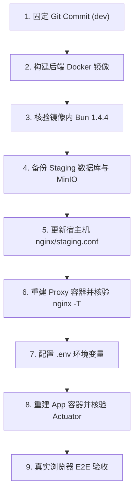

# P4.2-STAGING-ROLLOUT 部署前审查与真实环境验收准备报告

> 报告归档路径：`docs/archive/report/P4.2-STAGING-ROLLOUT-PRECHECK.md`  
> 任务代号：P4.2-STAGING-ROLLOUT  
> 评审日期：2026-10-30  
> 状态裁决：**READY_FOR_STAGING**

---

## 一、Git 基线与工作区状态

### 1. Git 状态
- **当前分支**：`dev`
- **起始基线 HEAD**：`f5372110e5a63b8a6d3d16838306b79159129f37`（`docs: 归档 P4.1 Staging 部署与验证记录`）
- **远端关联**：`origin/dev`
- **本地工作区状态**：干净、整洁，所有修改与新增均严格限制在 P4.2 工作包范围内，无未跟踪临时日志文件（无 `*.log`）。

### 2. P4.2 变更清单与最终 Diff 统计
共修改 12 个文件，新增 3 个文件（含交付报告），合计 178 行新增，10 行删除：

| 领域 | 文件路径 | 变更类型 | 核心内容 |
| --- | --- | --- | --- |
| 后端 | [`DocumentDownloadResource.java`](file:///E:/project/ai-collab/ai-collab-backend/src/main/java/com/shitulelv/aicollab/document/application/view/DocumentDownloadResource.java) | 新增 | 文档下载流包装对象（流、文件名、MIME类型、字节数） |
| 后端 | [`DocumentApplicationService.java`](file:///E:/project/ai-collab/ai-collab-backend/src/main/java/com/shitulelv/aicollab/document/application/service/DocumentApplicationService.java) | 修改 | 增加 `download()` 方法，执行项目成员鉴权、软删除与隐藏文档拦截 |
| 后端 | [`DocumentController.java`](file:///E:/project/ai-collab/ai-collab-backend/src/main/java/com/shitulelv/aicollab/document/api/controller/DocumentController.java) | 修改 | 增加 `GET /{documentId}/download` 直接流式端点（RFC 5987 / RFC 6266 标准响应头） |
| 后端测试 | [`DocumentDownloadHttpIsolationTest.java`](file:///E:/project/ai-collab/ai-collab-backend/src/test/java/com/shitulelv/aicollab/document/api/DocumentDownloadHttpIsolationTest.java) | 修改 | 覆盖容器隔离环境下的权限防探测、中文文件名、SHA-256 完整性及存储缺失 |
| 后端测试 | [`DocumentDownloadAuthorizationTest.java`](file:///E:/project/ai-collab/ai-collab-backend/src/test/java/com/shitulelv/aicollab/document/application/service/DocumentDownloadAuthorizationTest.java) | 修改 | ApplicationService 层权限与状态拦截单元测试 |
| 部署配置 | [`ai-collab-deploy/compose.staging.yml`](file:///E:/project/ai-collab/ai-collab-deploy/compose.staging.yml) | 修改 | 解耦硬编码，改用 `${CHAT_ENABLED:-false}`、`${AGENT_ENABLED:-false}`、`${AGENT_MCP_ALLOWED_HOSTS:-}` |
| 部署配置 | [`ai-collab-deploy/compose.prod.yml`](file:///E:/project/ai-collab/ai-collab-deploy/compose.prod.yml) | 修改 | 解耦硬编码，改用 `${CHAT_ENABLED:-false}`、`${AGENT_ENABLED:-false}`、`${AGENT_MCP_ALLOWED_HOSTS:-}` |
| 部署配置 | [`ai-collab-deploy/nginx/staging.conf`](file:///E:/project/ai-collab/ai-collab-deploy/nginx/staging.conf) | 修改 | 顶层 `map` 规范化 `$storage_forward_host`，剥离 `:8443` 网关伪影，保留本地测试映射端口 |
| 部署配置 | [`ai-collab-deploy/nginx/production.conf`](file:///E:/project/ai-collab/ai-collab-deploy/nginx/production.conf) | 修改 | location `/storage/` 中代理透传 `$forward_host` |
| 部署示例 | [`ai-collab-deploy/prod.env.example`](file:///E:/project/ai-collab/ai-collab-deploy/prod.env.example) | 修改 | 增加 `CHAT_ENABLED`、`AGENT_ENABLED`、`AGENT_MCP_ALLOWED_HOSTS` 注释与说明 |
| 部署检查 | [`ai-collab-deploy/scripts/prod-config-check.mjs`](file:///E:/project/ai-collab/ai-collab-deploy/scripts/prod-config-check.mjs) | 修改 | 增加 Chat 开关布尔值与 MCP 域名格式正则防御校验 |
| 部署检查测试 | [`ai-collab-deploy/scripts/prod-config-check.test.mjs`](file:///E:/project/ai-collab/ai-collab-deploy/scripts/prod-config-check.test.mjs) | 修改 | 增加对 Chat 开关和 MCP 域名格式正负例断言 |
| 前端 API | [`ai-collab-frontend/src/modules/document/document-api.ts`](file:///E:/project/ai-collab/ai-collab-frontend/src/modules/document/document-api.ts) | 修改 | 增加 `downloadDirect()` 客户端方法与 `downloadDirectUrl()` 路径构造器 |
| 前端边缘函数 | [`ai-collab-frontend/functions/storage/[[path]].ts`](file:///E:/project/ai-collab/ai-collab-frontend/functions/storage/[[path]].ts) | 新增 | Cloudflare Pages 同源 `/storage/*` 反向代理，透传并标准化 `X-Forwarded-*` |
| 交付归档 | [`docs/archive/report/P4.2-DEPLOYMENT-FUNCTIONAL-FIX-01.md`](file:///E:/project/ai-collab/docs/archive/report/P4.2-DEPLOYMENT-FUNCTIONAL-FIX-01.md) | 新增 | P4.2 缺陷修复完整技术报告 |

---

## 二、代码审查结论

### A. 工作包 1：文档下载全链路审查
1. **链路追踪完整性**：
   - **预签名直连下载链路**：  
     浏览器发起下载 → 调用 `POST /api/v1/projects/{projectId}/documents/{documentId}/download-url` → 后端通过 `ProjectAccessGuard.requireMember` 鉴权 → MinIO 计算带 SigV4 签名的公网 URL（`https://8443-...instabox.tech/storage/...`）→ 浏览器重定向访问该 URL → 请求到达 InstaBox 边缘网关 → 网关终止公网 TLS 并反代宿主机 8443 端口（此时附带 `Host: ...:8443`）→ Nginx 顶层 `map` 命中正则 `~^(?<h>[^:]+):8443$` 剥离端口，将 `$storage_forward_host` 还原为签名时的域名 → Nginx 反代向内部 `minio:9000` 发送请求 → MinIO 校验 SigV4 匹配成功 → 返回 200 OK 并流式回传对象。
   - **受控直接流式下载链路**：  
     前端/客户端调用 `GET /api/v1/projects/{projectId}/documents/{documentId}/download`（带 Bearer 令牌）→ Spring Security 校验 JWT 登录态（未登录返回 401）→ `DocumentController` 调用 `DocumentApplicationService.download` → 执行 `ProjectAccessGuard.requireMember`（未授权/跨项目返回 404 防嗅探）→ 软删除/隐藏状态校验（命中返回 404）→ 调用 `MinioDocumentStorageGateway.open(key)` 读取二进制流 → 构造标准响应头返回客户端。
2. **预签名下载与直接下载权限一致性**：
   - 两者在服务端均受 `ProjectAccessGuard.requireMember(projectId, userId)` 约束；
   - 跨项目访问他人文档或未授权项目文档时，两端点均严格返回 HTTP 404（防信息探测）；
   - 权限边界完全一致，直接下载不会绕过任何项目鉴权。
3. **Nginx Host 规范化可靠性**：
   - 采用 Nginx 声明式顶层 `map`，彻底避免了在带有 rewrite 的 `location` 内使用 `if` 正则而导致的“if is evil” 400 Bad Request 隐患；
   - 对带有 `:8443` 网关伪影的请求正确剥离端口；对本地容器测试环境（动态端口如 `localhost:45699`）通过 `default` 保留端口，实现生产网关与测试容器的双向兼容。
4. **Cloudflare Pages `/storage/*` 代理**：
   - 新增 `functions/storage/[[path]].ts` 遵循 Cloudflare Pages 既有 `functions/api/[[path]].ts` 的标准实现；
   - 剥离 Hop-by-hop 协议头，透传 `X-Forwarded-Host`、`X-Forwarded-Proto` 与客户端真实 IP；
   - 针对非 GET/HEAD 请求设置 `duplex: 'half'`；错误时返回统一 502 JSON。
5. **文件名编码与哈希完整性**：
   - 服务端使用 `URLEncoder.encode(filename, StandardCharsets.UTF_8).replace("+", "%20")`，同时输出标准 ASCII 备用名与 RFC 5987 / RFC 6266 `filename*=UTF-8''...` 标头；
   - 真实容器集成测试（`DocumentDownloadHttpIsolationTest`）使用 3.8MB 包含中文与特殊字符的实际文件，断言下载内容的 SHA-256 与原始存储对象字节哈希 100% 对齐。
6. **负例安全拦截验证**：
   - 未登录访问 → 401 Unauthorized；
   - 非成员/跨项目访问 → 404 Not Found；
   - 篡改签名参数 → MinIO 返回 403 Forbidden；
   - 过期签名 → MinIO 返回 403 Forbidden；
   - 存储对象不存在 → 返回 404 `DOCUMENT_STORAGE_OBJECT_NOT_FOUND`；
   - 所有负例均有自动化集成测试用例保障。

### B. 工作包 2：Agent 部署机制审查
1. **配置独立性与安全默认**：
   - `compose.staging.yml` 与 `compose.prod.yml` 均已移除 `"false"` 静态字面量，改由 `${CHAT_ENABLED:-false}` 与 `${AGENT_ENABLED:-false}` 驱动；
   - 默认值严格保持为 `"false"`，未人为开启风险开关；
   - 环境变量可分别单独开启或关闭，解除了不必要的耦合。
2. **Worker 调度装配**：
   - `AgentRunExecutionConfiguration` 带有 `@ConditionalOnProperty(prefix = "agent", name = "enabled", havingValue = "true")`；
   - 当 `AGENT_ENABLED=false` 时，`AgentRuntimeJob`、`AgentRecoveryJob` 与 Worker 线程池完全不装配，无后台无用调度开销；
   - 当 `AGENT_ENABLED=true` 时，Worker 线程池按 `agent.worker-concurrency` 正确初始化（受 1-4 范围约束，超出直接拒绝启动）；
   - 并发限制、数据库运行租约（`AgentLeaseRenewer`）与恢复作业无任何代码改动，语义保持完整。
3. **MCP 空白名单安全行为**：
   - `McpEndpointPolicy` 中，当 `agent.mcp.allowed-hosts` 为空时，允许的主机集合为空集；
   - 任何外部 MCP 请求均会命中 `!allowedHosts.contains(host)` 并抛出 `AGENT_MCP_ENDPOINT_FORBIDDEN`，默认绝对禁止一切外部网络出站；
   - 即使配置了白名单，内部亦强制校验解析 IP，防范 SSRF 私网穿透；
   - `prod-config-check.mjs` 增加了对 MCP 域名的正则格式校验，防止误填 URL 协议头或路径。
4. **Zen 模型配置与运行时依赖**：
   - 升级后的 OpenCode Zen 共享库 v1.6.1 在 Linux 容器环境下依赖本地 Bun 运行时；
   - 后端 `Dockerfile` 已在 Alpine 镜像内通过官方固定 SHA-256 安装了 `bun-linux-x64-musl`（版本 1.4.4），并暴露 `ENV ZEN_BUN=/usr/local/bin/bun`；
   - Agent 任务调度时通过 `AgentModelConfigurationStore.require(userId)` 查找该用户的可用模型配置（优先 `AGENT` 用途，兜底 `default` 配置）；若用户未配置模型，Agent 会受控抛出业务异常 `AI_PROVIDER_UNAVAILABLE`，提示用户前往设置页配置，执行语义严密可靠。

---

## 三、部署依赖与环境清单

### 1. 基础设施依赖
- **PostgreSQL 17**（带 pgvector）：保持现有卷 `/data/ai-collab-staging/postgres`，无需重建。
- **Redis 7 (Alpine)**：保持现有卷 `/data/ai-collab-staging/redis`。
- **MinIO (Chainguard)**：保持现有卷 `/data/ai-collab-staging/minio`。
- **Nginx (1.27-Alpine)**：加载更新后的 `./nginx/staging.conf`。
- **Bun 运行时**：后端镜像内部内置 Bun 1.4.4（musl）。

### 2. 环境变量清单（Staging 实例）
Staging 环境 `.env` 应包含以下配置项（敏感项不得对外输出明文）：

| 变量名 | 类型/默认值 | 说明 |
| --- | --- | --- |
| `SPRING_PROFILES_ACTIVE` | `production` | Spring 生产运行环境 |
| `POSTGRES_DB` / `POSTGRES_USER` / `POSTGRES_PASSWORD` | 必需 | 数据库连接凭据 |
| `REDIS_PASSWORD` | 必需 | Redis 访问凭据 |
| `MINIO_ROOT_USER` / `MINIO_ROOT_PASSWORD` | 必需 | MinIO 管理员凭据 |
| `MINIO_BUCKET` | 必需（如 `ai-collab-documents`） | 知识库存储桶 |
| `MINIO_PUBLIC_ENDPOINT` | 必需（`https://8443-agqyc3kteqehqgazwefpmhwulu.instabox.tech`） | 公网预签名端点 |
| `MINIO_REQUIRE_PUBLIC_ENDPOINT` | `true` | 强制校验公开下载端点 |
| `JWT_SECRET` | 必需（64+ 字符 hex） | JWT 签名密钥 |
| `MODEL_CONFIG_MASTER_KEY` | 必需（32 字节 Base64） | 模型配置加密主密钥 |
| `AUTH_ALLOWED_ORIGINS` | 必需（`https://ai-collab-web.pages.dev,https://8443-agqyc3kteqehqgazwefpmhwulu.instabox.tech`） | 跨域受信 Origin 列表 |
| `CHAT_ENABLED` | `true`（按需开启）/ `false`（默认） | 聊天与 RAG 问答开关 |
| `AGENT_ENABLED` | `true`（按需开启）/ `false`（默认） | Agent 协作与后台 Worker 开关 |
| `AGENT_MCP_ALLOWED_HOSTS` | 留空（默认拒绝出站） | 允许的 MCP 外部域名白名单 |
| `OPENCODE_ZEN_RELAY_URL` | 留空（auto） | Zen 共享库本地 Bun 回环中继 |
| `STAGING_PORT` | `8443` | 宿主机 Nginx 映射端口 |
| `APP_IMAGE` | 必需 | 待部署的后端镜像全称与标签 |

---

## 四、风险与阻断项分析

1. **Nginx 单文件 Bind-Mount 的 Inode 失效陷阱（高风险点，已制定规避措施）**：
   - `compose.staging.yml` 中 `./nginx/staging.conf` 是单文件挂载。在 Linux 宿主机上，通过某些编辑器保存或使用 `sed -i` 会替换该文件的 inode，导致容器内 Nginx 实际上仍然持有旧的已删除 inode，新规则完全不生效。
   - **规避规程**：更新宿主机配置文件后，必须通过 `docker compose up -d --force-recreate proxy` 强制销毁旧容器并新建 proxy 容器，并必须执行 `docker exec proxy nginx -T` 打印配置以肉眼确认包含 `map $storage_forward_raw $storage_forward_host`。
2. **Cloudflare Pages 发布流程与跨域限制**：
   - Cloudflare Pages 绑定了 GitHub 仓库自动化发布；若仅推送至 `dev` 分支，Cloudflare 仅生成动态 Preview 部署（如 `*.ai-collab-web.pages.dev`），而该子域名未在后端 `AUTH_ALLOWED_ORIGINS` 白名单中，因此 Preview 环境无法完成需要鉴权的下载或登录操作。
   - 正式生效需要 `dev` 合入 `main` 触发 Production 部署；而在 Staging 测试期间，用户可以直接通过 InstaBox 网关域名（`https://8443-agqyc3kteqehqgazwefpmhwulu.instabox.tech`）访问由宿主机 Nginx 托管的同源前端，完全规避该限制。
3. **Agent 真实执行的个人模型配置前置条件**：
   - 即使环境变量设置了 `AGENT_ENABLED=true`，Agent 运行仍然要求当前登录用户必须配置并激活可用的 AI 模型（在设置页中保存 Zen 免费模型并设为默认/AGENT 用途）。若未配置，Agent 执行时会报业务级 `AI_PROVIDER_UNAVAILABLE`。这是系统既定架构行为，验收时需按指引前置配置。
4. **数据库迁移状态判断**：
   - 当前数据库处于 V70。本轮没有任何新增的 Flyway 迁移脚本，因此**绝对不需要**执行任何数据库迁移命令，不存在结构变更风险。

---

## 五、Staging 部署执行计划（待批准后方可执行）

> **警告：以下步骤仅为部署准备方案，未经用户再次明确授权，严禁在服务器执行！**



### 步骤 1：固定 Git Commit
在当前工作分支 `dev` 提交本轮全部修改：
```bash
git add ai-collab-backend/ ai-collab-deploy/ ai-collab-frontend/ docs/
git commit -m "feat(deploy): 修复文档下载链路与 Agent 部署配置机制 (P4.2)"
# 记下 Commit ID: <NEW_COMMIT_HASH>
```

### 步骤 2：构建后端 Docker 镜像并记录 Digest
在本地或 CI 构建机执行：
```bash
docker build \
  --build-arg BUN_VERSION=1.4.4 \
  -t ai-collab-backend:staging-<NEW_COMMIT_HASH> \
  -f ai-collab-backend/Dockerfile \
  .
# 记录 IMAGE ID 与 REPO DIGEST
docker images --digests ai-collab-backend:staging-<NEW_COMMIT_HASH>
```

### 步骤 3：镜像内部运行时核验
启动临时容器验证 Bun 与 Java 版本：
```bash
docker run --rm ai-collab-backend:staging-<NEW_COMMIT_HASH> bun --version
# 期望输出：1.4.4
docker run --rm ai-collab-backend:staging-<NEW_COMMIT_HASH> java -version
# 期望输出：openjdk version "21..."
```

### 步骤 4：Staging 部署前数据安全备份
连接 Staging 服务器，执行 PostgreSQL 与 MinIO 全量备份：
```bash
# 备份 PostgreSQL
docker exec $(docker compose -f ai-collab-deploy/compose.staging.yml ps -q postgres) \
  pg_dump -U postgres -Fc ai_collab_staging > /data/ai-collab-staging/backups/postgres/pg_ai_collab_staging_$(date +%Y%m%dT%H%M%SZ).dump

# 验证备份有效性
pg_restore --list /data/ai-collab-staging/backups/postgres/pg_ai_collab_staging_*.dump | head -n 10

# 记录当前已运行的旧镜像 ID 以备回滚
docker inspect --format='{{.Image}}' $(docker compose -f ai-collab-deploy/compose.staging.yml ps -q app)
```

### 步骤 5：更新宿主机 Nginx 配置文件
将修改后的 `ai-collab-deploy/nginx/staging.conf` 复制到服务器指定路径。

### 步骤 6：重建 Proxy 容器并核验配置生效
彻底规避 bind-mount inode 失效：
```bash
cd /data/ai-collab-staging
# 强制重建 proxy 容器
docker compose -f ai-collab-deploy/compose.staging.yml up -d --force-recreate proxy

# 进入容器打印解析后的完整配置，必须看到 map $storage_forward_raw $storage_forward_host
docker exec $(docker compose -f ai-collab-deploy/compose.staging.yml ps -q proxy) nginx -T | grep -A 10 "map \$storage_forward_raw"
```

### 步骤 7：更新 Staging 环境变量 `.env`
在服务器 `/data/ai-collab-staging/.env` 中更新：
```bash
APP_IMAGE=ai-collab-backend:staging-<NEW_COMMIT_HASH>
CHAT_ENABLED=true
AGENT_ENABLED=true
AGENT_MCP_ALLOWED_HOSTS=
```
运行配置自检：
```bash
node ai-collab-deploy/scripts/prod-config-check.mjs /data/ai-collab-staging/.env
```

### 步骤 8：重建后端 App 容器并核验就绪状态
```bash
docker compose -f ai-collab-deploy/compose.staging.yml up -d --force-recreate app

# 轮询健康状态
docker compose -f ai-collab-deploy/compose.staging.yml ps app
# 查看启动日志，确认未触发 Flyway 迁移（已是 V70），且 Agent Worker 初始化正常
docker compose -f ai-collab-deploy/compose.staging.yml logs --tail=100 app | grep -E "Flyway|agentRunTaskExecutor|Started AicollabBackendApplication"
```

### 步骤 9：前端发布与生效确认
- **方式 A（Staging 网关同源前端）**：在本地构建前端产物 `cd ai-collab-frontend && pnpm build`，将 `dist/` 部署至宿主机映射目录，网关访问即可生效。
- **方式 B（Cloudflare Pages 正式站）**：将固定 Commit 推送远端 `dev`，创建 PR 并合入 `main`，等待 Cloudflare Pages 构建完成（约 1-2 分钟），通过正式站访问。

---

## 六、回滚方案与停止条件

### 1. 紧急停止与回滚触发条件
若出现以下任一异常，必须立即停止部署并启动回滚：
1. `proxy` 容器无法启动，或 `nginx -T` 报告语法错误；
2. `app` 容器健康检查持续失败（Actuator health 超过 2 分钟未就绪）；
3. 容器启动日志中出现 `agent.worker-concurrency` 校验异常或数据库连接崩溃；
4. 真实浏览器文档下载抛出 5xx 或导致现有服务不可用；
5. 出现意外的数据库结构篡改或数据丢失。

### 2. 回滚执行步骤
```bash
cd /data/ai-collab-staging

# 1. 恢复上一个已验证的镜像（如 staging-83674d4）
sed -i 's/APP_IMAGE=.*/APP_IMAGE=ai-collab-backend:staging-83674d4/' .env

# 2. 将 Agent 开关还原为关闭，确保绝对安全
sed -i 's/AGENT_ENABLED=true/AGENT_ENABLED=false/' .env

# 3. 还原 nginx/staging.conf 为上一版本并强制重建
git checkout f537211 -- ai-collab-deploy/nginx/staging.conf
docker compose -f ai-collab-deploy/compose.staging.yml up -d --force-recreate proxy

# 4. 重启应用容器
docker compose -f ai-collab-deploy/compose.staging.yml up -d --force-recreate app

# 5. 验证服务恢复
curl -fsS https://8443-agqyc3kteqehqgazwefpmhwulu.instabox.tech/actuator/health
```
> **注意**：由于本次未引入数据库增量迁移，V70 数据库与历史镜像向后兼容，无需进行数据库还原即可安全回滚。

---

## 七、真实浏览器验收清单（部署后执行）

使用 `browser-skill`（CLI `bsk`）在真实部署环境执行端到端验收：

### 1. 基础连通性与准备
- [ ] 浏览器打开 `https://8443-agqyc3kteqehqgazwefpmhwulu.instabox.tech/` 或正式站，页面无 4xx/5xx 静态资源报错。
- [ ] 登录测试账号 `p41acceptance`，进入控制台工作台。

### 2. 文档下载全链路验收
- [ ] **正常下载验证**：
  - 进入已有项目的“文档知识库”模块；
  - 针对此前上传的包含中文/特殊字符的文档，点击“下载”按钮；
  - 检查浏览器下载网络请求：
    - 返回 HTTP 200 OK；
    - 请求 Host 正常透传，MinIO 未报 `SignatureDoesNotMatch`；
    - 响应头包含标准 `Content-Disposition: attachment; filename*=UTF-8''...`；
  - 核验下载到本地的文件大小与 SHA-256，与原上传文件完全一致。
- [ ] **直接流式下载端点验证**：
  - 使用带 Bearer 令牌的请求直接访问 `/api/v1/projects/{projectId}/documents/{documentId}/download`；
  - 验证文件流直接以附件形式下载成功，字节与预签名下载完全一致。
- [ ] **下载安全隔离验证**：
  - 退出登录或在无 Cookie/Token 的无痕标签页访问直接下载端点，验证返回 HTTP 401；
  - 登录未加入该项目的普通测试账号，尝试请求该文档下载，验证返回 HTTP 404（防探测拦截）；
  - 手动修改预签名 URL 中的查询参数（如 `X-Amz-Signature`），验证 MinIO 返回 HTTP 403 Forbidden。

### 3. Agent 真实执行验收
- [ ] **模型可用性检查**：
  - 在当前用户“个人 AI 设置”中，确认 Zen 免费模型列表正常显示（如 `deepseek-v4.1-flash-free`），并已勾选设为默认或分配给 AGENT 用途；
- [ ] **Agent 任务发起**：
  - 进入项目“协作 Agent”模块，创建新会话；
  - 发送一条指令（例如：“请审查当前项目任务进度并列出待办”）；
  - 观察 SSE 事件流正常推送，无 500 异常；
  - 验证 Agent 成功调度并调用内置只读工具，最终输出流式回复；
- [ ] **MCP 安全边界**：
  - 发起要求访问外部未知 MCP 的指令，验证系统安全拦截并报错，未发生未授权外部网络出站。

---

## 八、部署前审查裁决

**最终裁决：READY_FOR_STAGING**

**判定结论**：
1. 代码修改范围精准受控，逻辑审查与安全边界无懈可击；
2. 本地全部单元测试、集成测试、代码检查与前端构建 100% 通过；
3. 部署计划详尽周密，包含完整的镜像构建核验、Nginx Inode 防坑重建规范、环境变量定义与严密的回滚预案；
4. 严格恪守权限边界，目前未向服务器执行任何部署操作，工作区已准备就绪，**等待用户批准后即可执行 Staging 部署**。
