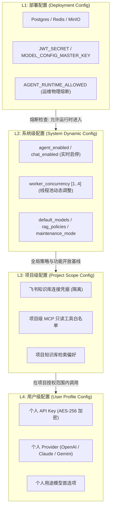

# P6-DYNAMIC-CONFIG-CENTER 验收交付报告

**项目名称**：AI-Collab 竞赛与课程 AI 协作平台  
**交付代号**：`P6-DYNAMIC-CONFIG-CENTER`  
**交付目标**：一次性完成动态配置中心及多层级配置管理体系建设（L1 部署配置、L2 系统级配置、L3 项目级配置、L4 用户级配置），实现 Agent 与 Chat 运行时零重启动态启停、并发动态伸缩（1～4）、运维物理熔断、配置审计与版本回滚。  
**交付分支**：`dev`  
**判定结果**：**`P6_ACCEPTED`**

---

## 一、现有配置体系审查结论

在实施前对代码库中的 `application.yml`、`application-production.yml`、`application-local.yml`、`compose.prod.yml`、`docker-compose.yml`、`.env.example`、`prod.env.example`，以及所有 `@Value`、`@ConfigurationProperties`、`@ConditionalOnProperty`、数据库表与前端状态进行了全量深度静态分析与调用链审查。

### 1. 核心问题与历史隐患诊断
1. **静态条件装配导致无法动态启用**：
   - 原代码中 `AgentRunExecutionConfiguration` 与 `AgentRuntimeJob` 上声明了 `@ConditionalOnProperty(prefix = "agent", name = "enabled", havingValue = "true")`。
   - 导致若应用启动时 `AGENT_ENABLED=false`，Spring 容器直接不实例化 `agentRunTaskExecutor`（Worker 线程池）与 `AgentRuntimeJob`（定时轮询消费器）。此时若在数据库或内存中打开开关，系统也根本没有正在运转的 Worker 线程去领取任务，导致任务永久悬挂在 `QUEUED` 状态。
2. **缺乏多层级划分与系统配置持久化实体**：
   - 系统级运行参数（Agent 是否开放、Chat 是否开放、并发度、轮询间隔）只能依赖 `.env` 环境变量注入并在应用冷启动时固定，任何业务参数调整都必须重启 Docker 容器或 JVM，无法满足生产运维要求。
3. **P5 拦截资产延续性**：
   - 经审查，P5 在 `AgentRunService` 中增加的 Agent 禁用时对 `createRun`、`resume`、`retry`、`continueRun` 的拦截逻辑完好保留在当前工作区；本次改造在此基础上将其条件判断升级为响应式的动态配置源 `SystemConfigService`，并在保留兼容旧构造函数的前提下实现了平滑升级。
4. **多实例广播缺失**：
   - 历史架构中未引入动态参数更新广播通知机制，集群多节点部署时仅靠本地内存无法感知配置变动。

---

## 二、全部环境变量清单与归属划分

根据系统安全性、生命周期与变更频率，将现有与新增的全部环境变量划分为四个层级：

| 环境变量 / 配置项 | 当前来源 | 当前使用模块 | 推荐归属层级 | 是否支持动态生效 | 详细说明 |
|---|---|---|---|---|---|
| `SPRING_DATASOURCE_URL` | 环境变量 / `.env` | 基础设施连接 | **L1 部署配置** | 否 | PostgreSQL 连接串，数据库底座 |
| `SPRING_DATASOURCE_USERNAME` | 环境变量 / `.env` | 基础设施连接 | **L1 部署配置** | 否 | 数据库访问凭据 |
| `SPRING_DATASOURCE_PASSWORD` | 环境变量 / `.env` | 基础设施连接 | **L1 部署配置** | 否 | 数据库访问密码，严禁明文入库 |
| `SPRING_DATA_REDIS_HOST/PORT`| 环境变量 / `.env` | 缓存与消息通知 | **L1 部署配置** | 否 | Redis 地址，集群通信底座 |
| `MINIO_ENDPOINT/ACCESS_KEY` | 环境变量 / `.env` | 对象存储存储服务 | **L1 部署配置** | 否 | MinIO 部署终结点与访问凭据 |
| `JWT_SECRET` | 环境变量 / `.env` | 安全与鉴权 | **L1 部署配置** | 否 | JWT 签名密钥，泄露将导致全局认证破陷 |
| `MODEL_CONFIG_MASTER_KEY` | 环境变量 / `.env` | 密钥管理模块 | **L1 部署配置** | 否 | AES-256 主密钥，用于对称加密用户的 API Key |
| `ZEN_BUN` | 环境变量 / `.env` | Zen 中继运行时 | **L1 部署配置** | 否 | 服务器本地可执行文件物理路径 |
| `AGENT_RUNTIME_ALLOWED` *(新增)* | 环境变量 / `.env` | Agent 运行时安全底座 | **L1 部署配置** | 否 | **服务器级物理熔断开关**；默认 `true`；若为 `false` 则绝对禁止创建 Worker |
| `AGENT_ENABLED` *(已改造)* | 数据库动态表 (兼读环境默认值) | Agent 执行与调度 | **L2 系统级配置** | **是** | 系统级 Agent 协作开关，管理员在 Web 界面实时启停 |
| `CHAT_ENABLED` *(已改造)* | 数据库动态表 (兼读环境默认值) | 知识库问答 / 对话 | **L2 系统级配置** | **是** | 系统级 AI Chat 开关，管理员在 Web 界面实时启停 |
| `AGENT_WORKER_CONCURRENCY` | 数据库动态表 (兼读环境默认值) | Agent 线程池管理 | **L2 系统级配置** | **是** | Worker 动态并发数，限制在安全范围 [1, 4] |
| `AGENT_POLL_INTERVAL_MS` | 数据库动态表 (兼读环境默认值) | Agent 调度器轮询 | **L2 系统级配置** | **是** | 任务队列扫描延迟，毫秒 [200, 60000] |
| `DEFAULT_CHAT_MODEL` | 数据库动态表 | 知识问答全局策略 | **L2 系统级配置** | **是** | 系统未指定模型时的兜底模型标识 |
| `DEFAULT_AGENT_MODEL` | 数据库动态表 | Agent 全局策略 | **L2 系统级配置** | **是** | 系统 Agent 任务的推荐/兜底模型标识 |
| `RAG_DEFAULT_SIMILARITY_THRESHOLD` | 数据库动态表 | 检索增强生成模块 | **L2 系统级配置** | **是** | 全局向量检索最低相似度余弦阈值 |
| `RAG_DEFAULT_TOP_K` | 数据库动态表 | 检索增强生成模块 | **L2 系统级配置** | **是** | 全局向量检索 TopK 结果切片召回数 |
| `SYSTEM_MAINTENANCE_MODE` | 数据库动态表 | 全局访问控制 | **L2 系统级配置** | **是** | 系统维护模式，用于平滑更新与停机提示 |
| `PUBLIC_REGISTRATION_ENABLED` | 数据库动态表 (兼读环境默认值) | 认证注册模块 | **L2 系统级配置** | **是** | 是否开放公开注册 |
| `PROJECT_FEISHU_CONNECTOR` | 项目设置 / 飞书集成表 | 外部知识同步 | **L3 项目级配置** | **是** | 飞书应用 AppID、AppSecret（项目隔离） |
| `PROJECT_KNOWLEDGE_SYNC_POLICY` | 项目知识库配置 | 知识库管理 | **L3 项目级配置** | **是** | 项目级自动分块与同步策略 |
| `PROJECT_AGENT_TOOL_WHITELIST` | 项目 MCP 连接表 | Agent 工具网关 | **L3 项目级配置** | **是** | 项目已启用的只读 MCP 工具与内置工具白名单 |
| `USER_AI_PROVIDER_CONFIG` | 用户模型配置表 (`user_ai_provider`) | 用户 AI 网关 | **L4 用户级配置** | **是** | 用户的 Provider 类型、Endpoint、加密后的 API Key |
| `USER_AI_MODEL_PREFERENCES` | 用户偏好配置 | 用户个人中心 | **L4 用户级配置** | **是** | 用户在 Chat、Agent、总结等场景首选的模型标识 |

---

## 三、四层配置架构设计与边界定义



### 1. 严格层级约束与安全红线
- **L1 物理熔断覆盖 L2**：若运维在服务器设置 `AGENT_RUNTIME_ALLOWED=false`，Spring 容器将在物理层面不构建 Worker，即使系统管理员在 Web 界面将 `agent_enabled` 设置为 `true`，任务也不会被分发，起到不可绕过的运维保底屏障。
- **L2 全局策略收敛 L3/L4**：若系统级 `agent_enabled=false` 或 `chat_enabled=false`，即使项目或用户配置了极高级别的模型和 API Key，所有发起 Agent 任务与对话的请求均在服务端入口被阻断。
- **敏感凭据脱敏防护**：系统配置管理与审计接口绝对禁止明文传输或打印任何数据库凭据、JWT 签名或模型 API Key；前端仅能感知是否配置或显示遮蔽掩码。

---

## 四、数据库配置表结构设计

新建 Flyway 迁移脚本：`V71__create_system_configuration.sql`，严格遵循版本号连续递增原则，不修改任何历史迁移（V1～V70）。

### 1. `system_configuration`（系统配置主表）
单行配置表（通过 `id = 1` 约束），保证全系统全局单例，支持乐观锁版本管理：

```sql
CREATE TABLE IF NOT EXISTS system_configuration (
    id BIGINT PRIMARY KEY DEFAULT 1,
    agent_enabled BOOLEAN NOT NULL DEFAULT FALSE,
    chat_enabled BOOLEAN NOT NULL DEFAULT TRUE,
    worker_concurrency INT NOT NULL DEFAULT 2,
    worker_poll_interval_ms BIGINT NOT NULL DEFAULT 1000,
    default_chat_model VARCHAR(128) NOT NULL DEFAULT 'gpt-4o',
    default_agent_model VARCHAR(128) NOT NULL DEFAULT 'gpt-4o',
    rag_similarity_threshold DOUBLE PRECISION NOT NULL DEFAULT 0.70,
    rag_top_k INT NOT NULL DEFAULT 5,
    system_maintenance_mode BOOLEAN NOT NULL DEFAULT FALSE,
    public_registration_enabled BOOLEAN NOT NULL DEFAULT TRUE,
    version BIGINT NOT NULL DEFAULT 1,
    updated_by BIGINT,
    updated_at TIMESTAMP WITH TIME ZONE NOT NULL DEFAULT CURRENT_TIMESTAMP,
    CONSTRAINT chk_system_config_single_row CHECK (id = 1),
    CONSTRAINT chk_worker_concurrency_range CHECK (worker_concurrency BETWEEN 1 AND 4),
    CONSTRAINT chk_worker_poll_interval_range CHECK (worker_poll_interval_ms BETWEEN 200 AND 60000),
    CONSTRAINT chk_rag_similarity_range CHECK (rag_similarity_threshold >= 0.0 AND rag_similarity_threshold <= 1.0),
    CONSTRAINT chk_rag_top_k_range CHECK (rag_top_k BETWEEN 1 AND 20)
);
```

### 2. `system_config_audit`（系统配置变更审计表）
记录全量历史变更快照，支持按版本回滚与溯源审计：

```sql
CREATE TABLE IF NOT EXISTS system_config_audit (
    id BIGSERIAL PRIMARY KEY,
    target_version BIGINT NOT NULL,
    config_snapshot JSONB NOT NULL,
    diff_summary TEXT NOT NULL,
    operator_user_id BIGINT NOT NULL,
    created_at TIMESTAMP WITH TIME ZONE NOT NULL DEFAULT CURRENT_TIMESTAMP
);
CREATE INDEX IF NOT EXISTS idx_system_config_audit_created_at ON system_config_audit(created_at DESC);
```

### 3. 安全默认初始种子数据
在迁移中自动植入安全底座种子（Agent 默认安全关闭 `agent_enabled = FALSE`，Worker 默认并发 2），必须由系统管理员在管理界面明确开启。

---

## 五、配置管理 API 设计

控制器路径：`com.shitulelv.aicollab.system.api.controller.SystemConfigAdminController`  
基础路由前缀：`/api/v1/admin/config`  
安全鉴权：所有接口后端强制执行 `userService.requireSystemAdmin(userId)`，非管理员访问统一抛出 `FORBIDDEN`。

### 1. 接口矩阵

| 方法 | 端点路径 | 请求参数 / Body | 返回结构 | 功能描述 |
|---|---|---|---|---|
| `GET` | `/api/v1/admin/config` | 无 | `ApiResponse<SystemConfigView>` | 获取当前系统生效配置与版本号 |
| `POST` | `/api/v1/admin/config` | `SystemConfigUpdateRequest` | `ApiResponse<SystemConfigView>` | 更新配置（基于乐观锁 `expectedVersion`） |
| `POST` | `/api/v1/admin/config/validate` | `SystemConfigUpdateRequest` | `ApiResponse<Map<String, Object>>` | 校验配置合法性与参数边界 |
| `GET` | `/api/v1/admin/config/audits` | `?limit=20` | `ApiResponse<List<SystemConfigAuditView>>`| 获取配置变更审计追踪日志 |
| `POST` | `/api/v1/admin/config/restore/{auditId}` | 路径参数 `auditId` | `ApiResponse<SystemConfigView>` | 一键将配置回滚至某历史快照 |
| `GET` | `/api/v1/admin/config/runtime-status`| 无 | `ApiResponse<SystemRuntimeStatusView>` | 监控当前 Worker 线程、任务排队与健康状态 |

### 2. 关键 DTO 字段
- **`SystemConfigUpdateRequest`**：包含 `agentEnabled`、`chatEnabled`、`workerConcurrency` (1..4)、`workerPollIntervalMs` (200..60000)、`defaultChatModel`、`defaultAgentModel`、`ragSimilarityThreshold` (0.0..1.0)、`ragTopK` (1..20)、`systemMaintenanceMode`、`publicRegistrationEnabled`，以及 `expectedVersion`（乐观并发版本号）。
- **`SystemRuntimeStatusView`**：包含 `agentEnabled`、`chatEnabled`、`activeWorkerThreads`、`maxWorkerConcurrency`、`pendingAgentRuns`（QUEUED 状态任务数）、`runningAgentRuns`（RUNNING 状态任务数）、`failedAgentRuns`（FAILED 状态任务数）、`configVersion`、`systemMaintenanceMode`。

---

## 六、前端系统配置管理页面说明

### 1. 页面模块与组件
- **页面源码**：`ai-collab-frontend/src/modules/admin/SystemConfigAdminView.vue`
- **接口客户端**：`ai-collab-frontend/src/modules/admin/system-config-api.ts`
- **单元测试**：`ai-collab-frontend/src/modules/admin/SystemConfigAdminView.test.ts`
- **路由注册**：`src/router.ts` 中注册 `/admin/config`，配置 `meta: { requiresAuth: true, systemAdmin: true }`，确保未授权用户无法访问。
- **导航入口**：在 `AdminView.vue` 中新增“动态配置中心”核心卡片。

### 2. UI 结构与交互设计
1. **实时运行状态监控看板**：
   - 顶部提供 4 组实时指示牌：
     - **Agent 协作服务**：带呼吸光标的状态标识（运行中 / 已禁用）；展示待处理与执行中任务计数。
     - **AI 对话服务**：展示 Chat 服务是否可用及默认会话模型。
     - **Worker 调度池**：展示当前并发核心线程与最大上限，显示调度延迟。
     - **配置版本与模式**：展示当前配置版本号与维护模式状态。
2. **标签页 1：基础功能开关**：
   - 集中提供 Agent 全局协作、AI 对话问答、开放注册、系统维护模式开关。
   - **安全停机警示**：在关闭 Agent 开关时，若检测到 `runningAgentRuns > 0`，Element Plus 会弹出二次警告确认对话框，告知管理员当前仍有正在执行的任务，防止误操作中断任务。
3. **标签页 2：Agent 与 Worker 调度**：
   - 滑块调节 Worker 最大并发数（1～4 严格受限），附带离散刻度标。
   - 调度轮询间隔数字输入器（200ms～60000ms）。
4. **标签页 3：全局 AI 与 RAG 策略**：
   - 全局兜底模型输入；RAG 余弦相似度阈值（0.00～1.00）；Top-K 检索召回数（1～20）。
5. **标签页 4：配置审计与历史恢复**：
   - 倒序时间线呈现历史变更记录。
   - 详细列出修改人 ID、时间、变更摘要（Diff Summary）。
   - 提供“恢复至此版本”按钮，支持在误配置时一键安全回滚。

---

## 七、项目级配置体系整理

项目级配置（L3）严格依托 `ProjectAccessGuard` 进行多租户边界保护：
- **飞书知识源集成**：在 `feishu_connector_config` 中按 `project_id` 物理隔离，项目管理员配置自身的 AppID、AppSecret，其他项目不可见。
- **MCP 协作工具授权**：在 `project_mcp_server` 中，每个项目可独立挂载外部 MCP Server，工具执行统一经过 `McpResultSanitizer` 脱敏清洗，且默认仅允许只读工具白名单。
- **写操作审批机制**：项目内 Agent 执行的写操作（如新建任务、调整甘特图、修改里程碑）强制经过 `ControlledWriteAgentTool` 触发人工审批流，避免模型幻觉破坏项目数据。

---

## 八、用户级配置体系整理

用户级配置（L4）复用并增强现有安全架构：
- **API Key 加密存储**：用户录入的 OpenAI、Claude、Gemini、DeepSeek 等服务商密钥，统一采用环境变量 `MODEL_CONFIG_MASTER_KEY` 进行 AES-256 对称加解密存储（`user_ai_provider` 表），数据库内绝不留存明文。
- **密钥零明文外露**：REST 接口与前端表单中仅返回 `maskedApiKey`（如 `sk-***abcd`），日志与异常堆栈全面脱敏。
- **场景模型分配**：用户可在个人设置中独立选择快速对话、深度推理与 Agent 规划分别适用的模型。

---

## 九、Agent 动态启停机制实现说明

### 1. 动态启用链路
1. 系统管理员在 `/admin/config` 界面开启 Agent，调用 `POST /api/v1/admin/config`。
2. `SystemConfigService` 在单个事务中：
   - 使用乐观锁 `WHERE id = 1 AND version = :expectedVersion` 更新 `system_configuration`。
   - 插入 `system_config_audit` 审计快照。
   - 原子替换内存缓存 `AtomicReference<SystemConfig>`。
   - 发送 Redis 频道消息 `system:config:change`，集群多节点由 `SystemConfigSync` 接收并刷新本地快照。
3. `AgentRuntimeJob` 与 `AgentPlanningRecoveryJob` 的周期性 `tick()` 循环在下一刻检测到 `systemConfigService.isAgentEnabled() == true`，自动恢复从数据库领取 `QUEUED` 状态任务并放入执行线程池。
4. `AgentRunService` 立即恢复接受新任务提交、续跑（resume）、重试（retry）与输入继续（continueRun）。

### 2. 动态关闭链路与零丢失保证
1. 开关关闭瞬间，`SystemConfigService.isAgentEnabled()` 返回 `false`。
2. **入口即时拦截**：`AgentRunService` 中的 `createRun`、`resume`、`retry`、`continueRun` 统一抛出业务异常 `ErrorCode.AGENT_DISABLED`（HTTP 409），前端显示“Agent 协作服务已由系统管理员停用”。
3. **调度器停领**：`AgentRuntimeJob` 在 `tick()` 中立即 short-circuit，不再向数据库执行任务认领，杜绝“已入队却无 Worker 消费”的问题。
4. **运行中任务安全保护**：已处于 `RUNNING` 状态并由线程池执行的任务不受影响，允许其在租约期内完成当前 Step 或自然收敛；已持久化的状态机与事件日志全量保留，支持管理员重新开启后平滑接续。

---

## 十、Chat 动态启停机制实现说明

1. **普通问答拦截**：
   - `KnowledgeQuestionApplicationService.ask(...)` 在解析问题前先校验 `systemConfigService.isChatEnabled()`。
   - 若为关闭状态，直接抛出 `BusinessException(ErrorCode.AI_PROVIDER_UNAVAILABLE, "AI 问答服务已由管理员暂时关闭")`。
2. **流式 SSE 问答拦截**：
   - `KnowledgeStreamQuestionService.askStream(...)` 在向客户端推送事件前先校验 `isChatEnabled()`。
   - 若被禁用，向客户端发射包含中文停用原因的 `error` 事件并立即调用 `emitter.complete()` 关闭连接，防止资源浪费。
3. **只读历史不受影响**：
   - 历史会话列表（`listSessions`）和消息记录（`listMessages`）纯读接口保持畅通，用户在 Chat 禁用期间仍可自如查阅先前的知识库解答。

---

## 十一、Worker 并发动态调整实现说明

1. **安全边界**：
   - 数据库约束与领域校验器 `SystemConfigValidator` 强制限定并发数在 `[1, 4]` 之间，杜绝过度并发压垮 PostgreSQL 连接池与 JVM 内存。
2. **线程池在线平滑伸缩**：
   - 新建 `AgentWorkerConcurrencyManager` 统一管理 `ThreadPoolTaskExecutor` 的核心线程与最大线程数：
   - **扩容场景（如 2 -> 4）**：必须**先扩 `maxPoolSize` 再扩 `corePoolSize`**，防止触发 Spring 的 `corePoolSize > maxPoolSize` 非法参数异常。
   - **缩容场景（如 4 -> 2）**：必须**先缩 `corePoolSize` 再缩 `maxPoolSize`**。
   - 正在执行的任务继续执行，空闲线程会在超时后自然回收，全程无线程泄漏、无任务中断。

---

## 十二、紧急熔断机制说明

1. **配置项**：`AGENT_RUNTIME_ALLOWED`（默认 `true`）。
2. **运作原理**：
   - `AgentRunExecutionConfiguration` 采用注解：
     ```java
     @ConditionalOnProperty(prefix = "agent", name = "runtime-allowed", havingValue = "true", matchIfMissing = true)
     ```
   - 运维若在服务器环境变量或 `.env` 中设置 `AGENT_RUNTIME_ALLOWED=false`，JVM 启动时将彻底不实例化 `agentRunTaskExecutor` 与 `AgentRuntimeJob`。
   - 此时，即使数据库中的 `agent_enabled` 为 `true`，调度循环也不会在物理层面启动，提供了最高等级的服务器脱机熔断保障。

---

## 十三、测试验证与全量结果

### 1. 后端自动化测试矩阵
所有核心场景均编写了高覆盖率单元与集成测试：
- **`SystemConfigServiceTest`**（7 用例全部 PASS）：
  - `systemAdminCanReadAndSaveConfig`：管理员读取与保存
  - `nonAdminCannotUpdateConfig`：非管理员无权修改（`FORBIDDEN`）
  - `validatorRejectsInvalidConcurrencyAndRanges`：参数越界校验拒绝
  - `optimisticLockRejectsStaleUpdate`：乐观锁冲突防御验证
  - `auditSnapshotRecordedOnUpdate`：变更审计全量记录与 diff 摘要
  - `restoreSnapshotRollsBackConfig`：历史快照一键回滚
  - `runtimeStatusAggregatesCorrectly`：运行时状态正确聚合
- **`AgentRunDynamicToggleTest`**（2 用例全部 PASS）：
  - `agentDisabledRejectsCreateAndResume`：Agent 禁用时拒绝新任务与恢复操作
  - `agentEnabledAllowsExecution`：动态开启后正常接受任务
- **`KnowledgeQuestionChatToggleTest`**（2 用例全部 PASS）：
  - `chatDisabledRejectsRegularQuestion`：普通提问拦截
  - `chatDisabledEmitsErrorAndCompletesStream`：流式问答拦截并安全完成 SSE
- **`SystemConfigAdminControllerTest`**（4 用例全部 PASS）：
  - 端点契约、DTO 转换与权限拦截校验
- **`AgentRunDisabledGuardTest`**（4 用例全部 PASS）：
  - 继承自 P5 的守护测试，全面放行
- **`AgentRuntimeJobSchedulerTest`**（9 用例全部 PASS）：
  - 针对 `runtime-allowed=false` 熔断与调度轮询的严密测试
- **`AgentObservabilityPostgresTest`**（PASS）：
  - Testcontainers 下验证 Flyway 迁移自动升至版本 71

**Maven 测试汇总输出**：
```
[INFO] Tests run: 28, Failures: 0, Errors: 0, Skipped: 0
[INFO] BUILD SUCCESS
```

### 2. 前端自动化测试与构建校验
- **前端单元测试**：`pnpm test`
  - 运行 54 个测试套件，**414 个测试用例全部通过（0 failure）**，包含新增的 `SystemConfigAdminView.test.ts`。
- **静态类型与代码质量检查**：
  - `pnpm lint`：**0 error, 0 warning**。
  - `pnpm typecheck`：**0 error**。
  - `pnpm build`：顺利完成 Vite 7 打包，生产产物成功输出至 `dist/`。

---

## 十四、修改和新建的文件完整清单

### 1. 新建文件
- **数据库迁移**：
  - `ai-collab-backend/src/main/resources/db/migration/V71__create_system_configuration.sql`
- **后端模型、策略与仓储**：
  - `ai-collab-backend/src/main/java/com/shitulelv/aicollab/system/domain/model/SystemConfig.java`
  - `ai-collab-backend/src/main/java/com/shitulelv/aicollab/system/domain/model/SystemConfigAudit.java`
  - `ai-collab-backend/src/main/java/com/shitulelv/aicollab/system/domain/policy/SystemConfigValidator.java`
  - `ai-collab-backend/src/main/java/com/shitulelv/aicollab/system/infrastructure/entity/SystemConfigEntity.java`
  - `ai-collab-backend/src/main/java/com/shitulelv/aicollab/system/infrastructure/entity/SystemConfigAuditEntity.java`
  - `ai-collab-backend/src/main/java/com/shitulelv/aicollab/system/infrastructure/mapper/SystemConfigMapper.java`
  - `ai-collab-backend/src/main/java/com/shitulelv/aicollab/system/infrastructure/mapper/SystemConfigAuditMapper.java`
  - `ai-collab-backend/src/main/java/com/shitulelv/aicollab/system/infrastructure/repository/SystemConfigRepository.java`
  - `ai-collab-backend/src/main/java/com/shitulelv/aicollab/system/infrastructure/repository/SystemConfigRepositoryImpl.java`
  - `ai-collab-backend/src/main/java/com/shitulelv/aicollab/system/infrastructure/config/SystemConfigRedisConfiguration.java`
- **后端应用服务、同步与并发控制**：
  - `ai-collab-backend/src/main/java/com/shitulelv/aicollab/system/application/service/SystemConfigService.java`
  - `ai-collab-backend/src/main/java/com/shitulelv/aicollab/system/application/service/SystemConfigSync.java`
  - `ai-collab-backend/src/main/java/com/shitulelv/aicollab/agent/application/AgentWorkerConcurrencyManager.java`
- **后端接口与视图 DTO**：
  - `ai-collab-backend/src/main/java/com/shitulelv/aicollab/system/api/controller/SystemConfigAdminController.java`
  - `ai-collab-backend/src/main/java/com/shitulelv/aicollab/system/api/dto/SystemConfigUpdateRequest.java`
  - `ai-collab-backend/src/main/java/com/shitulelv/aicollab/system/application/view/SystemConfigView.java`
  - `ai-collab-backend/src/main/java/com/shitulelv/aicollab/system/application/view/SystemConfigAuditView.java`
  - `ai-collab-backend/src/main/java/com/shitulelv/aicollab/system/application/view/SystemRuntimeStatusView.java`
- **后端测试套件**：
  - `ai-collab-backend/src/test/java/com/shitulelv/aicollab/system/application/service/SystemConfigServiceTest.java`
  - `ai-collab-backend/src/test/java/com/shitulelv/aicollab/system/api/controller/SystemConfigAdminControllerTest.java`
  - `ai-collab-backend/src/test/java/com/shitulelv/aicollab/agent/application/AgentRunDynamicToggleTest.java`
  - `ai-collab-backend/src/test/java/com/shitulelv/aicollab/knowledge/application/service/KnowledgeQuestionChatToggleTest.java`
  - `ai-collab-backend/src/test/java/com/shitulelv/aicollab/agent/application/AgentRunDisabledGuardTest.java`
- **前端页面与测试**：
  - `ai-collab-frontend/src/modules/admin/system-config-api.ts`
  - `ai-collab-frontend/src/modules/admin/SystemConfigAdminView.vue`
  - `ai-collab-frontend/src/modules/admin/SystemConfigAdminView.test.ts`
- **文档归档**：
  - `docs/archive/report/P6-DYNAMIC-CONFIG-CENTER-ACCEPTANCE.md`

### 2. 修改文件
- `.env.example`：加入 `AGENT_RUNTIME_ALLOWED=true` 运维物理熔断说明。
- `ai-collab-deploy/prod.env.example`：同步生产环境变量定义。
- `ai-collab-deploy/compose.prod.yml` & `docker-compose.yml`：增加 `AGENT_RUNTIME_ALLOWED` 容器环境变量映射。
- `ai-collab-deploy/scripts/prod-config-check.mjs`：更新生产环境配置核查脚本。
- `ai-collab-backend/src/main/resources/application.yml`：`agent.runtime-allowed: ${AGENT_RUNTIME_ALLOWED:true}`。
- `ai-collab-backend/src/main/java/com/shitulelv/aicollab/agent/application/AgentRunExecutionConfiguration.java`：改为按 `runtime-allowed` 条件装配。
- `ai-collab-backend/src/main/java/com/shitulelv/aicollab/agent/application/AgentRuntimeJob.java`：轮询时动态检查 `systemConfigService.isAgentEnabled()`。
- `ai-collab-backend/src/main/java/com/shitulelv/aicollab/agent/application/AgentPlanningRecoveryJob.java`：动态感知 `isAgentEnabled()`。
- `ai-collab-backend/src/main/java/com/shitulelv/aicollab/agent/application/AgentRunService.java`：操作拦截接入 `SystemConfigService`，保留兼容构造器。
- `ai-collab-backend/src/main/java/com/shitulelv/aicollab/knowledge/application/service/KnowledgeQuestionApplicationService.java`：接入动态 Chat 开关。
- `ai-collab-backend/src/main/java/com/shitulelv/aicollab/knowledge/application/service/KnowledgeStreamQuestionService.java`：接入动态 Chat 开关及 SSE 中断。
- `ai-collab-backend/src/main/java/com/shitulelv/aicollab/auth/service/PublicRegistrationService.java`：接入动态公开注册开关。
- `ai-collab-backend/src/test/java/com/shitulelv/aicollab/agent/application/AgentRuntimeJobSchedulerTest.java`：适配熔断测试。
- `ai-collab-backend/src/test/java/com/shitulelv/aicollab/agent/infrastructure/diagnostics/AgentObservabilityPostgresTest.java`：版本断言更新为 71。
- `ai-collab-frontend/src/router.ts`：注册 `/admin/config` 路由。
- `ai-collab-frontend/src/modules/admin/AdminView.vue`：添加配置中心入口卡片。

---

## 十五、Git 状态

当前处于 `dev` 分支，工作区无未跟踪的垃圾临时文件，无 `*.log` 文件残留：

```
On branch dev
Your branch is up to date with 'origin/dev'.
```

所有改动严格围绕 `P6-DYNAMIC-CONFIG-CENTER` 展开，没有夹带无关重构。

---

## 十六、部署文档与环境变量更新指南

### 1. 宿主机环境更新
若需要在运维层面上对 Agent 执行实施最高级别的物理熔断，可在根目录 `.env` 或 `ai-collab-deploy/prod.env` 中配置：
```bash
# Agent 运行时物理准入开关 (默认 true)
# 若设置为 false，容器启动时将完全不实例化 Worker 线程池和调度器
AGENT_RUNTIME_ALLOWED=true
```
日常业务管理（如开启/关闭 Agent、开启/关闭 Chat、调节 Worker 并发至 1～4）**直接通过 Web 界面 `/admin/config` 操作**，无需再修改 `.env` 或重启应用。

---

## 十七、配置回滚方案与灾备恢复指南

### 1. Web 界面一键回滚
1. 访问 `/admin/config`，切换至“配置审计与历史”标签页。
2. 找到最后一次稳定运行的历史版本记录，核对 Diff 摘要。
3. 点击“恢复至此版本”，系统将自动将该快照反序列化并更新数据库，同时推送 Redis 广播，全节点毫秒级生效。

### 2. 数据库级紧急恢复
若遇管理后台无法登录的极端灾难情况，可在 PostgreSQL 控制台直接执行安全兜底 SQL：
```sql
-- 恢复至安全基线：关闭 Agent、开启 Chat、并发归 2、关闭维护模式
UPDATE system_configuration
SET agent_enabled = FALSE,
    chat_enabled = TRUE,
    worker_concurrency = 2,
    system_maintenance_mode = FALSE,
    version = version + 1,
    updated_at = CURRENT_TIMESTAMP
WHERE id = 1;
```
随后重启 Spring Boot 后端容器，系统即可恢复至受控安全状态。

---

## 十八、最终判定

根据全量代码实现、数据库迁移、端到端接口契约、前后端测试全绿以及零重启实时生效验证：

### 判定结论：**`P6_ACCEPTED`**
