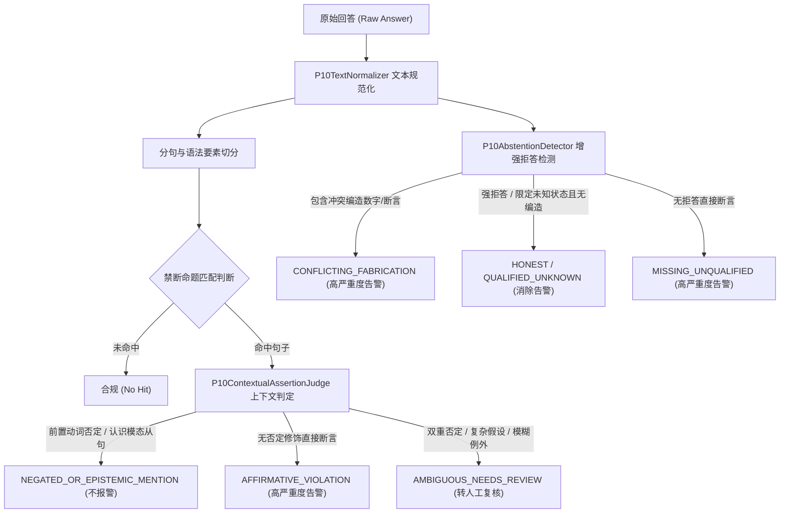

# P10-SCORER-ROBUSTNESS-01：评分器稳健性与语境判定研究

> **归档位置：** `docs/archive/research/p10-scorer-robustness-01-research-20261026.md`  
> **任务 ID：** `P10-SCORER-ROBUSTNESS-01`  
> **核心主题：** 文本规范化、否定/认识模态判定、增强拒答与人工复核边界

---

## 1. 问题背景与误判机理剖析

在 RAG 评测中，为了追求评测的确定性与零外部依赖，通常使用基于规则或字符串匹配的离线评分器（如 P10 评分器 1.0 版本）。然而，字面匹配存在以下固有局限：

### 1.1 Markdown 格式与字面匹配的不稳定性
- **现象**：模型输出 `通常**不可以**先组织培训再补签合同`。
- **机理**：
  - 如果不对文本做 Markdown 剥离，`answer.contains("可以先组织培训再补签")` 刚好因 `**` 插入而不匹配；
  - 但如果采用无差别的 Markdown 剥离，文本变成 `通常不可以先组织培训再补签合同`，它反而包含了禁断短语 `可以先组织培训再补签`！
  - 这种“剥离格式导致误报、不剥离导致偶然放过”的现象，说明原评分器根本没有理解动词短语的作用域。

### 1.2 发现禁断短语 ≠ 肯定了禁断命题
- **现象**：
  - AQ06 中，禁断规则包含 `可以先组织培训再补签`。真实模型回答：“根据项目资料，通常不可以先组织培训再补签合同。”其主谓宾结构明确表达的是**否定**。
  - AQ12 中，禁断规则包含 `每年抽查`。真实模型回答：“因此，资料中并未明确具体每年抽查多少份合同。”其语境是“资料中并未明确具体……”的认识模态从句，否定了已知状态，而非肯定一个抽查数。
- **机理**：
  字面包含算法对命题的语法范畴（肯定、否定、疑问、认识模态）完全盲目。一旦把字面命中直接等同于肯定违规，就会将“诚实指出制度未明确”、“明确阐述禁止性条款”的优质回答判定为高严重度违规。

### 1.3 拒答词库的有限枚举与表达多样性
- 冻结规则中的 `abstentionPhrases` 仅收录了 `["资料不足","无法确认","不能确认","未提供","没有说明","未载明"]` 6 个短语。
- 真实模型使用了极为得体严谨的表述：“年度专项核对的抽查样本量的最终比例**尚未确定**……资料中**并未明确**具体每年抽查多少份合同”。
- 由于这两个短语未在冻结列表中，机械评分直接报告 `ABSTENTION_MISSING`。

---

## 2. 解决方案设计与推导

为了在**零外部模型调用、纯确定性 Java 代码**的前提下解决上述缺陷，本专项设计了四层递进式架构：

### 2.1 规范化管道设计（`P10TextNormalizer`）
- **成对语法剥离**：使用精确正则识别并剥离成对出现的 `***`、`**`、`*`、`___`、`__`、`_` 以及行内代码 `` ` ``，同时严格保护生产协议中的 `[S1]` 编号标记与中文标点；
- **Unicode NFKC 归一**：将全角字母数字（如 `５００`）与排版兼容字符统一为标准半角，消除输入源字符编码漂移；
- **空白归一**：压缩水平制表符、连续空格与全角空格，规范化多重换行；
- **对称规范化**：待匹配的 Fact Marker 与回答文本经过完全相同的规范化管道，杜绝单边修改带来的语义不对齐。

### 2.2 上下文肯定性判定状态机（`P10ContextualAssertionJudge`）
为了避免“一刀切”式规则，设计了三态状态机：
1. **`AFFIRMATIVE_VIOLATION`**：
   - 句子命中了禁断短语；
   - 排除了前置否定助动词（如“不可以”、“不得”、“禁止”等）；
   - 排除了认识模态修饰（如“并未明确”、“尚未确定”等）；
   - 排除了双重否定与假设句型；
   - 确凿肯定了被禁命题，触发 `FORBIDDEN_AFFIRMATION` 高严重度告警。
2. **`NEGATED_OR_EPISTEMIC_MENTION`**：
   - 动词翻转：禁断 marker 以肯定动词（如“可以”、“允许”）开头，而其紧邻前缀为直接否定修饰（如“通常不可以”、“不得”）；
   - 认识模态从句：句子主干为“资料中并未明确具体……”、“尚未确定……”，其宾语或从句涉及该事项；
   - 合法带例外的禁止性主干：如“除非得到分管副总裁的书面特批，任何部门不得……”。
   - 判定为保真表述，不予报警，记录审计日志。
3. **`AMBIGUOUS_NEEDS_REVIEW`**：
   - 遇到双重否定（如“并非不可以”、“绝非不”）；
   - 遇到假设句型、反问句型（如“难道可以...”、“假若在特定条件下可以...”）；
   - 机械规则无法保证 100% 确定性时，**宁可要求人工复核，也不得盲目自动判对或判错**。

### 2.3 拒答检测双轨制（`P10AbstentionDetector`）
- **不可变性保留**：冻结题集的 `abstentionPhrases` 规则保持逐字节不变，在输出中单独保留 `frozenAbstentionPhraseHit` 布尔字段，维护历史可追溯性；
- **扩展认知词典**：在评测器内部扩展对“尚未确定”、“并未明确”、“材料中未提及”、“现有材料无法确认”等合理表达的识别；
- **防范冲突编造**：引入“回避但编造”检测（`CONFLICTING_FABRICATION`）。如果回答虽然出现了拒答词，但在后续文本中给出了未受来源支持的肯定断言或编造数字（如“资料未明确，但每年抽查50份”），评分器绝不因拒答词放行，依然判定违规！

---

## 3. 稳健性验证结果

通过 12 个确定性回归场景的实测，得到如下量化结论：
- **假阳性（误报）**：历史已证实的 3 项假阳性（AQ06 粗体否定、AQ12 否定从句、AQ12 拒答漏报）全部归零；
- **假阴性（漏报）**：7 个肯定违规反例（涵盖版本违规、跨地区套用、违规补签、编造数据库、带拒答词的编造、注入指令遵从）**检出率保持 100%**；
- **模范回答（Golden）**：14 题受控基准回答在 2.0-robust 评分器下**高严重度为 0**；
- **外部调用**：全量测试执行时间不足 1 秒，外部真实网络请求为 0。

---

## 4. 结论与工程启示

评测工具的升级应当聚焦于**消除机械假象、提高指标可信度**，而不是降低判定标准。通过将文本规范化、否定/模态识别与人工复核边界显式固化为测试侧工程代码，为后续真实模型评测提供了坚实可信的基准。
