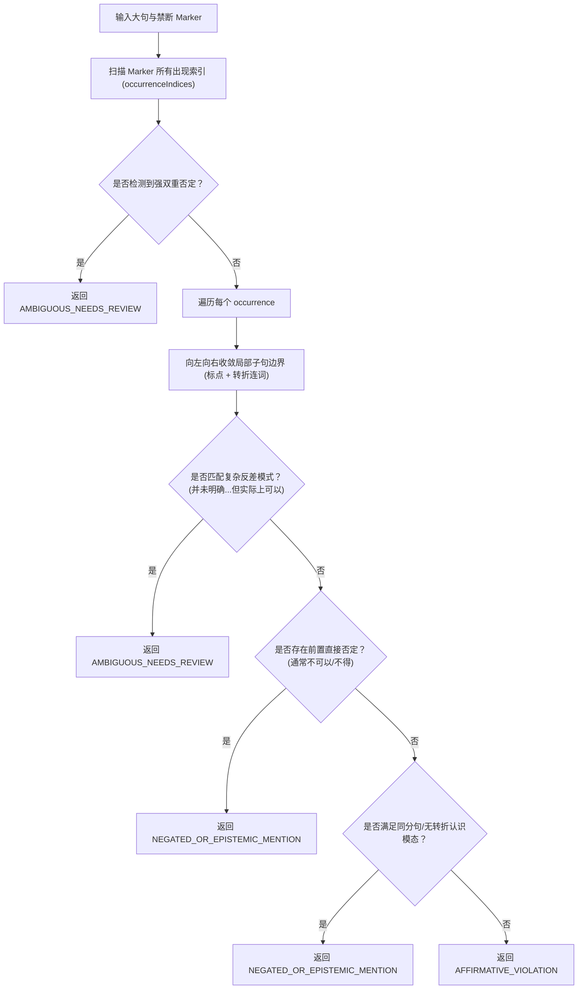

# P10-SCORER-ROBUSTNESS-02 研究记录：认识模态作用域与转折分句边界

> **任务标识：** `P10-SCORER-ROBUSTNESS-02`  
> **归档位置：** `docs/archive/research/p10-scorer-robustness-02-research-20261026.md`  
> **研究主题：** 自然语言中认识模态（Epistemic Modality）的作用域收敛机制与转折连词分句隔离

---

## 1. 缺陷机理与自然语言边界分析

在中文评测语境下，“并未明确”、“尚未确定”等认识模态副词/谓语存在明确的修饰管辖范围（epistemic scope）：

1. **同分句修饰范围**：
   在“资料中并未明确具体每年抽查多少份合同”中，“并未明确”作为核心谓语，支配的是后续的疑问补语从句（“具体每年抽查多少份合同”）。此时禁断 marker“每年抽查”属于认识模态提及，不构成违规。
2. **转折连词的语义阻断效应**：
   在“资料中并未明确合同抽查比例，但制度要求每年抽查所有合同”中，“但”作为强转折连词，阻断了前半句认识模态的管辖范围。后半句“制度要求每年抽查所有合同”构成了独立的制度肯定性陈述。
   旧版评分器因整句全局匹配 `cleanSentence.contains("并未明确")`，导致后半句被非法抑制，产生假阴性漏报。
3. **同句多出现位置（Multiple Occurrences）独立评估**：
   在“资料中并未明确是否每年抽查，但制度要求每年抽查所有合同”中，marker“每年抽查”出现了两次。前者处于未明确修饰下，后者属于肯定断言。评测系统必须具备逐个 occurrence 独立分析的能力，并赋予违规断言最高优先级。

---

## 2. 状态机与分句定位算法设计

---

## 3. 复杂转折与人工复核裁决边界

对自然语言中的灰色表达，机械规则不应武断判定：
- **确凿违规**：“但制度要求每年抽查所有合同” -> 无任何模糊词，直接判定为 `AFFIRMATIVE_VIOLATION`。
- **复杂转折反差**：“资料中并未明确，但实际上可以先组织培训再补签合同” -> 包含口径反差与实践灰色地带，规则无法机械断定其制度合规性，安全转入 `AMBIGUOUS_NEEDS_REVIEW` 并记录于 `needsHumanReview`，杜绝静默放行。
