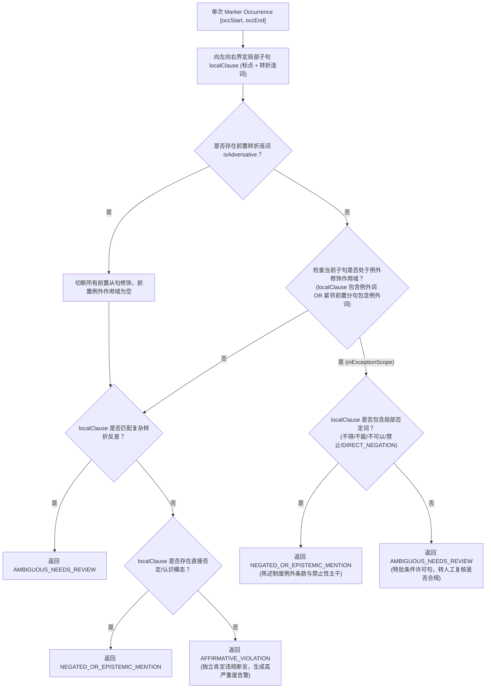

# P10-SCORER-ROBUSTNESS-03 研究记录：例外条款作用域隔离与漏报防护机制

> **任务标识：** `P10-SCORER-ROBUSTNESS-03`  
> **归档位置：** `docs/archive/research/p10-scorer-robustness-03-research-20261026.md`  
> **研究主题：** 自然语言中例外条款（Exception Clause）的条件从句作用域边界、局部禁止性约束与转折连词隔离机制

---

## 1. 缺陷机理与自然语言边界分析

在公文制度规范与自然语言表述中，“除非……否则……”属于典型的条件复句结构。此类复句的语义管辖范围具有明确的句法边界：

1. **条件从句对主句的修饰范围（Exception Scope）**：
   - 在“除非获得分管副总裁的书面特批，否则不可以先组织培训再补签合同”中，“除非……”是前置条件状语从句，“否则不可以……”是紧随其后的主句。条件从句和紧邻主句共同构成一个完整的例外-禁止语义单元；
   - 在此语义单元内，主句包含明确的直接否定词（“不可以”），因而构成禁止性主干陈述，应当判定为 `NEGATED_OR_EPISTEMIC_MENTION`。

2. **转折连词的强语义阻断（Adversative Decoupling）**：
   - 在“除非获得分管副总裁的书面特批，否则不可以先组织培训再补签合同，但该回答又肯定声称可以先组织培训再补签合同”中，“但”引导了转折分句；
   - 转折连词标志着新的独立主张的开启，前序条件复句的全部修饰（包括“除非”和“不可以”）被彻底阻断，绝不能渗透进转折分句中；
   - 旧版评分器盲目在整句级别扫描 `EXCEPTION_MARKER.matcher(sentence).find()` 与 `sentence.contains("不可以")`，导致转折后的独立违规断言被非法判定为否定，造成严重漏报。

3. **逆向覆盖的防范（Anti-Retroactive Pollution）**：
   - 在“该回答肯定声称可以先组织培训再补签合同，除非获得分管副总裁的书面特批，否则不可以先组织培训再补签合同”中，前置分句已经是独立的肯定断言；
   - 后置分句陈述的例外条款和禁止词在语义上不能跨逗号逆向倒灌覆盖前半句；
   - 局部作用域判定器必须确保后置分句不影响前置分句的独立评估。

4. **特批条件许可与人工复核（Conditional Permission）**：
   - 在“除非获得分管副总裁的书面特批，才可以先组织培训再补签合同”中，主句未包含否定词（“才可以……”）；
   - 该表述陈述的是特批条件下的操作许可，既非无条件禁止，也非无条件肯定违规；
   - 机械规则无法验证是否具备特批事实，故必须安全转入 `AMBIGUOUS_NEEDS_REVIEW`（人工复核），绝不能机械放行为否定。

---

## 2. 状态机与判定流程设计

---

## 3. 边界判定与审计可追溯性

1. **同句多 occurrence 独立评估**：每次扫描提取独立的 `localClause`，独立产出 `Assessment` 记录；
2. **审计明细保留**：每个 occurrence 记录其 `marker`、局部命中子句 `sentence`、判定理由 `reason` 以及判定规则版本 `ruleVersion`；
3. **最高优先级收敛**：`judgeSentence` 对多个 assessment 实行违规优先（`AFFIRMATIVE_VIOLATION` > `AMBIGUOUS_NEEDS_REVIEW` > `NEGATED_OR_EPISTEMIC_MENTION`），确保一个大句内只要存在一次确凿违规，就绝不漏报。
