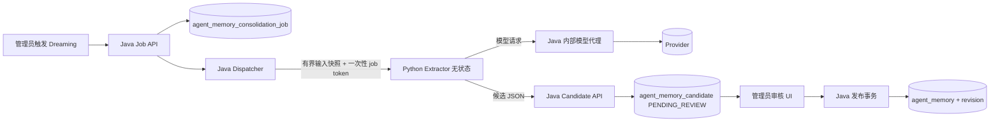

# AI Collab｜Python AI 旁路评估

> **状态**：评估结论，不是实施计划
> **日期**：2026-11-11
> **代码基线**：`dev` @ `61be76e2`（工作区干净）
> **结论**：**条件性 GO**——只允许"离线评测消费者"与"由 Java 编排的无状态 Dreaming 候选提取器"；**不允许** Python 直连数据库/Redis/MinIO、持有或解密模型密钥、执行在线 Agent Loop、参与审批或执行任何业务写操作。

---

## 1. 问题与既有约束

要评估的是：把 Agent Loop、Context Engineering、Tool Selection、Memory/Dreaming、RAG Pipeline、Evaluation 交给一个 Python 自研引擎，是否可行、是否值得。

仓库当前的明确立场：

- `docs/backend-agent-redesign.md:9`：保持 Java 单语言后端，不引入 Python、Spring AI、LangChain4j 或新的 Agent 框架。
- `docs/design/AI-Collab-2026-11-10.md:12,58`：不迁移 Python 编排引擎、不增加 Python 微服务。
- `docs/design/AI-Collab-AC-07-Agent-Memory-V2-设计补充-2026-11-10.md:56,116`：Dreaming 不用新 Python 服务，不引入独立 Python Memory Service。

所以这不是普通重构，而是对既有架构决策的修改；一旦批准，必须同步修改上述文档与 `AGENTS.md`，不能以"旁路"为名绕过红线。

## 2. 硬边界（由代码与规范决定，不是偏好）

| 边界 | 事实与证据 |
| --- | --- |
| 只有用户 JWT，没有服务账号 | `JwtConfiguration.java:48-62` 只有一个 HS256 编解码器；`AccessTokenService.java:31-43` 的 claims 只有 jti/sub/username/iat/exp；全仓无 client_credentials/scope/服务主体。 |
| 管理权限不在 token 里 | `UserService.java:67-74` 每次查 `app_user.system_admin`；JWT 里没有 admin claim。 |
| 密钥只在 Java | `ModelSecretCipher.java:27-96` 用 `MODEL_CONFIG_MASTER_KEY` 加解密 Provider/Connector/MCP 凭据；`RoutingChatModelGateway.java:90-155` 只在 Java 出站时解密。 |
| 数据库没有 RLS | 迁移目录无 `CREATE POLICY/ROW LEVEL SECURITY`；项目隔离完全靠 `ProjectAccessGuard`（`DatabaseProjectAccessGuard.java:19-37`）。 |
| 撤权过滤在 Java | `AgentHistoryVisibilityService.java:17-44` 用四个 `NOT EXISTS` 过滤 connector 撤权、授权过期、BLOCKED 文档；所有读路径与 SSE 都调用它（`AgentRunService.java:295-311`、`AgentEventStreamService.java:285-298`）。 |
| 写操作必须审批 | `AGENTS.md:113-118`；`AgentApprovalService.java:314-368` 的 approve 才执行写；Memory 的 create/update/disable/supersede 全部 `requireAdmin` + CAS + 来源核验（`AgentMemoryService.java:78-174`）。 |
| 事件有稳定序号，消息没有 | `agent_run_event` 有 `(run_id, sequence_no)` 唯一与 `agent_run.last_event_sequence`（V28）；`agent_message` 只有 `(created_at, id)`，而 `created_at` 是事务开始时间（V22:123），不能当提交序水位。 |

结论：Python 若直连 PostgreSQL，就必然要复制上面所有权限、撤权、脱敏与审计语义；库内没有 RLS 兜底，任何简化都会变成越权读取。**旁路不能直连数据层。**

## 3. 职责分级与结论

| 职责 | 结论 | 理由 |
| --- | --- | --- |
| 评测消费与报告聚合（读 JSON / 读 Java 产物） | **GO（先做）** | 无数据库、无密钥、无生产调用链；现有冻结集与报告都是 UTF-8 JSON，Python 可直接读。 |
| 离线 RAG/检索实验 | **GO（受控）** | 只产出报告与建议，不写回生产；实验语料放 `tests/fixtures/`。 |
| Dreaming 候选提取 | **条件性 GO** | 只能做无状态提取器；Job/候选表、幂等、预算、发布都必须留在 Java。 |
| 在线 Agent Loop / Tool Selection / Context Engineering | **NO-GO（当前）** | 会把审批、租约、SSE 续传、预算准入全部拆成跨语言契约，成本高且无量化收益。 |
| 模型网关 / Provider Key 代理 | **NO-GO** | 密钥与出站 SSRF 策略（`OutboundEndpointPolicy.java:44-108`）必须继续由 Java 独占。 |
| 前端 BFF / SSE 代理 | **NO-GO** | 需要处理 refresh cookie（`RefreshTokenCookieService.java:30-38`）、`Last-Event-ID` 与心跳；现有 Java 已实现。 |

## 4. 推荐架构：Java 编排、Python 无状态提取

关键点：

1. **Python 不连数据库**。输入是 Java 生成的有界、已脱敏快照；输出是 JSON 候选。
2. **模型密钥不出 Java**。Python 的模型调用走 Java 内部代理，由 Java 选择配置、执行预算与记账；`MODEL_CONFIG_MASTER_KEY` 与 Provider Key 不进入 Python 环境。
3. **一次性 job token**。Java 为每个 Job 签发短时、限作用域（job id + project id + extractor version + exp）的内部令牌；Python 用它调用模型代理与结果回传接口。令牌过期即失效，不落库明文，不用于任何用户接口。
4. **Java 拥有 Job 与候选表**。状态机、租约/fencing、重试、幂等键、费用上限都在 Java；Python 崩溃只影响一次 Job，可重试。
5. **发布仍在 Java**。候选经管理员批准后，由 `AgentMemoryService` 在事务内完成来源复核、CAS 与修订记录。

### 4.1 为什么不采用"Python 后台直连 DB + 自建 Job 表"

- 库内无 RLS，Python 必须复刻 `ProjectAccessGuard` 与 `AgentHistoryVisibilityService` 的全部语义；
- 两套 Job/租约/重试实现会与 Java Worker 的 `claimNext` 语义竞争；
- 费用与用量无法复用 `agent_run_event.cost_amount` / `agent_usage_settlement`，会形成第二套账本；
- 任何一处漂移都可能泄露已撤权会话内容。

## 5. 最小数据契约

### 5.1 Dreaming 输入快照（Java → Python）

- 标识：`projectId`、`sessionId`、`sourceRunIds[]`、`coveredMessageIds[]`（v1 不做时间游标）。
- 内容：按消息 ID 取的有界正文、run 事件（`sequence_no`、类型、必要 payload）、工具调用结果（仅 `SUCCEEDED` 可作为确认事实）、已批准的审批记录。
- 过滤：只取 `AgentHistoryVisibilityService` 判定可见的会话/文档；脱敏沿用 `AgentToolResultSanitizer` 的敏感字段清单。
- 上限：消息条数、字符数、事件数、单条长度都要有硬上限；超限分段或拒绝，不静默截断。

### 5.2 候选输出（Python → Java）

- 字段：`candidateType`、`operation`（CREATE/REVISE/SUPERSEDE/DISABLE/NO_ACTION）、`targetMemoryId/version`、`title/content`、`sourceRefs[]`、`whyUseful`、`fingerprint`、`needsReview`。
- Java 二次校验：类型枚举、长度、来源 ID 与项目归属、目标记忆是否存在且 ACTIVE/未替代、是否包含敏感字段。
- 幂等键：`(project_id, source_session_id, covered_through_message_id, extractor_version, fingerprint)`。
- 发布幂等：候选 `version` CAS + `published_memory_id UNIQUE`。

### 5.3 已知数据缺口

- `agent_message` 没有稳定 sequence；v1 用"已结束会话的闭合快照 + 覆盖消息 ID 集合"，不做增量水位。若后续要增量，需要 V90+ 新增消息序号或专用 ingestion 账本。
- `agent_tool_invocation` 没有公共读取接口；需要 Java 新增按 project/session 的只读聚合端点。
- 现有 `agent_memory` 只有单一 `source_type/source_id`；多来源 Dreaming 需要 `agent_memory_source_ref`（设计 §6.2）。

## 6. 安全红线（必须写进部署与代码审查）

- Python 环境**不得**出现：`JWT_SECRET`、`MODEL_CONFIG_MASTER_KEY`、`POSTGRES_PASSWORD`、`REDIS_PASSWORD`、MinIO 凭据、邮件凭据、Provider API Key。
- Python **不得**直连 PostgreSQL/Redis/MinIO/RocketMQ；不得运行 Flyway；不得生成预签名 URL。
- Python **不得**调用任何写接口：审批、Memory、Connector、任务/项目/文档、用户/管理员、Provider/Model Profile、系统配置、审计。
- Python **不得**自行签发/验签 JWT，或把 JWT claims 当作授权依据。
- Python **不得**访问 `/api/v1/auth/**` 或读取 refresh cookie。
- 入站内容按不可信数据处理：提示注入、越权指令、要求删除/外传密钥的内容不得改变系统行为。
- 日志不得记录密钥、Cookie、完整 Prompt、文档原文；跨语言日志沿用 `traceId/requestId`。

## 7. 工程成本

| 组件 | 新增内容 | 复杂度 |
| --- | --- | --- |
| Java 契约层 | job/candidate 表（V90+）、只读快照端点、内部模型代理、job token、候选回传与审核 API | 高（主要工作量） |
| Python 服务 | 无状态 FastAPI/CLI、输入输出 schema、模型代理客户端、OTel/metrics/health、依赖锁定 | 中 |
| 部署 | 独立 Dockerfile、`docker-compose.yml` / `compose.local.yml` / `compose.staging.yml` / `compose.prod.yml` 四套拓扑、digest 固定、data 网络、资源限制 | 中高 |
| CI/CD | 新 job（lint/pytest/image/smoke）、GHCR 推送、release 依赖、compose 契约脚本更新 | 中 |
| 观测 | OTel SDK、W3C traceparent 注入、Prometheus scrape、告警 | 中 |
| 运维 | 新进程的升级、回滚、日志轮转、故障演练 | 持续 |

注意：仓库当前四套 compose 均无资源限制，生产也没有 Tempo/Collector；Python 的观测与资源上限需要从零补。新增服务还会同时触碰 `prod-compose-contract.mjs`、`prod-config-check.mjs`、`install.sh`/`install.ps1` 与 CI 合成 env。

## 8. 与"Java 直接实现"的对比

| 维度 | Java 直接实现 AC07-P2 | Python 旁路 |
| --- | --- | --- |
| 权限/撤权/审计 | 复用现有 guard 与 visibility | 需跨语言契约；Python 不得碰库 |
| 事务与幂等 | 现有 CAS/租约/账本 | Job/候选仍要 Java 建，Python 只是执行器 |
| 模型调用与费用 | 现成网关与账本 | 需要内部模型代理与 job token |
| 部署/运维 | 无新增进程 | 新镜像、四套拓扑、CI、监控 |
| Python 生态收益 | 无 | 可用于 Dreaming/评测/RAG 实验 |
| 失败面 | 单进程 | 跨进程超时、重试、版本漂移 |

结论：**如果目标只是让 Dreaming 跑起来，Java 实现更便宜**；Python 旁路的正当理由必须是"确实需要 Python 生态/团队技能/独立实验迭代"，并且要接受新增的运维面。

## 9. 分阶段计划与门禁

| 阶段 | 内容 | 门禁 |
| --- | --- | --- |
| P0 契约与红线 | 本文档评审；确定 job token、输入/输出 schema、V90 迁移草案；更新架构文档与 AGENTS 的例外条款 | 安全评审通过；无 DB/密钥进入 Python |
| P1 评测消费者（建议先做） | Python 只读 `golden-cases.json`、`frozen-eval-set-v2.json`、`target/*.json`，产出汇总报告；不进生产调用链 | 报告可复现；与 Java 报告数字一致；零生产权限 |
| P2 Dreaming 影子模式 | Java 编排 + Python 无状态提取；候选只入库不展示；单项目、单会话闭合快照 | 未授权内容 = 0；重复候选率达标；单会话成本有上限；可一键关闭 |
| P3 审核与扩大 | 管理员审核 UI、候选发布、指标对照（批准率、精确率、成本、P95） | 连续两个批次指标达标；回滚演练通过 |

回滚：P1 直接停脚本；P2/P3 关闭 feature flag 并移除 Python 服务，Java 侧保留 job/candidate 表但不再调度，不影响在线 Agent。

## 10. 风险登记

| 风险 | 影响 | 缓解 |
| --- | --- | --- |
| Python 直连库或拿密钥 | 数据泄露/越权 | 硬性网络与 env allowlist；代码审查红线；CI 扫描 |
| 两套 Job/账本 | 重复执行、费用失真 | Job 与账本只在 Java；Python 无状态 |
| 提示注入 | 候选内容被操纵 | 输入标注不可信；输出 schema 校验；Java 二次校验 |
| 跨语言观测缺失 | 故障难定位 | job token 带 traceId；OTel 双端接入；报告带 commitSha/datasetSha |
| 依赖与镜像漂移 | 供应链风险 | 锁定依赖、digest 固定、镜像扫描 |
| 团队维护成本 | 交付变慢 | 先做 P1 评测消费者，用数据决定是否继续 |

## 11. 待决策

1. 是否接受"Python 只读、Java 写"的硬边界；若不接受，应先改架构与安全评审，而不是在旁路绕过。
2. P1 评测消费者是否先做；它几乎无风险，可作为最小验证。
3. Dreaming 的模型调用由 Java 代理（推荐）还是允许 Python 持有专用后台 Key（需要新的密钥治理与预算方案）。
4. 是否新增 `agent_memory_source_ref`，以及 Dreaming 增量水位是否需要 V90 的消息序号。
5. 生产是否已有外部 OTel/Tempo/日志平台；没有的话，Python 观测先落 Prometheus + 日志，不承诺完整链路。
