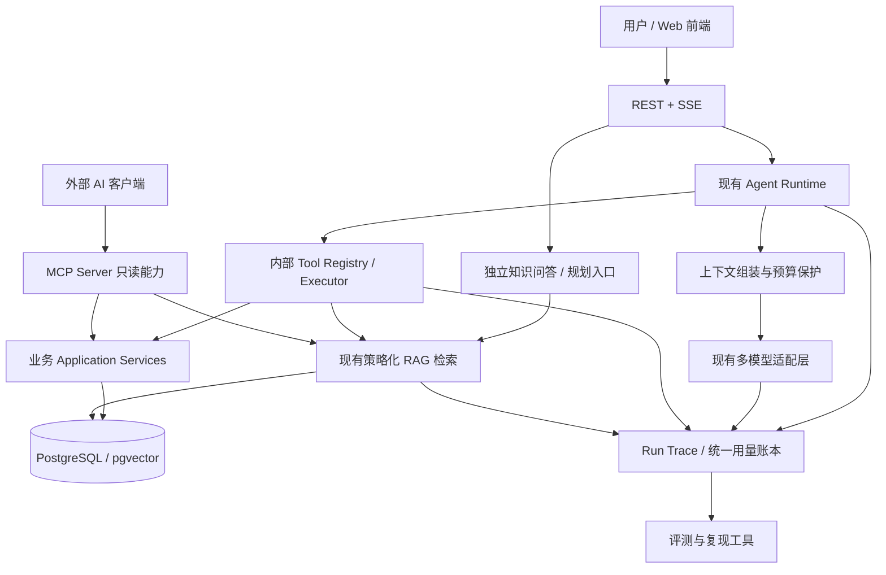

# AI Collab｜Agent 工程与产品架构改造设计文档

> 版本：V1.0（实施设计草案）  
> 编制日期：2026-11-10  
> 项目仓库：[`BangShou1st/ai-collab`](https://github.com/BangShou1st/ai-collab)  
> 代码基线：以 `dev` 分支为实施起点；实施时固定并记录实际 commit SHA，不以本文日期代替代码版本  
> 文档性质：**改造方案，不是已完成/已部署/已验收声明**  
> 关联方案：[AI-CostOps Java 后端与核心链路改造设计](./AI-CostOps-2026-11-10-Java后端与可靠性改造设计.md)

## 0. 决策摘要

项目名称暂保留 **AI Collab**，中文产品定位统一为 **「AI 驱动的项目协作与知识管理平台」**。保留 Java 21 / Spring Boot 模块化单体、PostgreSQL/pgvector、Redis、MinIO、现有 Agent Runtime 和业务审批模型；不迁移 LangGraph、LangChain4j、Spring AI 或 Python 编排引擎。

本次按六个工作包推进：

1. **AC-01 可观测与评测基线**：以 Run/Step/模型调用/工具调用为主线，建立可复现的 Agent 与 RAG 测试集、诊断 Trace 和成本记录。
2. **AC-02 上下文与成本治理**：取消对 Codex 256K 固定策略的参考，按实际模型窗口管理上下文；统一 Token 估算、压缩准入、累计预算和实际费用。
3. **AC-03 Agent / Tool / Workflow 边界**：把六套所谓“内置 Skill”界定为任务场景与工作流，通用 Agent 不再被粗糙关键词路由意外锁死工具范围。
4. **AC-04 自有 MCP Server**：在现有 MCP Host/Client 之外，新增**向外提供只读项目业务能力**的标准 MCP Server；重用现有业务服务和鉴权。
5. **AC-05 关系增强检索**：基于 `task_dependency` 和既有 RAG 构建跨任务依赖分析；有量化收益后再判断是否需要完整 GraphRAG/图数据库。
6. **AC-06 业务中性化与前后端一致性**：去掉「高校竞赛/课程设计/软件实训」对产品的硬绑定，实施兼容历史数据的枚举迁移及前端文案调整。

**实施原则：先收集基线再改行为；先修正确性再加能力；已有功能不重做；一次只改变一个核心变量；任何效果都以冻结测试集与运行证据裁决。** AC-01、AC-06 可并行；AC-02、AC-03 分小批次独立验收；AC-04/05 在前述基础稳定后落地。

## 1. 仓库事实与边界

### 1.1 已核对的实现

| 模块 | 当前依据 | 判断 |
|---|---|---|
| Agent 运行 | `AgentRuntimeCoordinator`、Worker、Repository、步骤持久化与恢复 | 已有运行主循环，**不另造第二套编排引擎** |
| Token / 窗口 | `AgentContextBudget`、`AgentContextSummarizer`、`ModelAwareTokenCounter`、`TokenEstimator` | 存在多处估算入口；`256_000` 软触发常量仍存在，需梳理真实执行路径 |
| 预算 | `AgentResourcePolicy` V1/V2、`AgentBudgetProperties`、`AgentSessionBudgetPolicy` | V2 Run 累计 Token 主要记录与软提示；新会话默认聚合上限 2,000,000 Token，但旧会话可无上限；并非严格美元成本控制 |
| 六个 Skill | `AgentSkillRegistry` 和 `builtin/*Skill.java` | 实际上是硬编码场景预设：提示词、输出结构、工具集合、关键词路由，不等于可安装 Skill 系统 |
| MCP | `agent/infrastructure/mcp`、`McpAgentToolProvider` | 当前为 **MCP Host/Client**，支持外部连接；尚不等于本项目有可被第三方客户端调用的 MCP Server |
| RAG | RAG V2 Router、pgvector、知识检索工具 | `dev` 已有检索路由及近期 SQL 优化；**禁止重复新增同类检索路由器** |
| 任务关系 | `task_dependency`、`TaskDependencyEdge`、`TaskDependencyPolicy` | 有真实任务 DAG，可作为关系检索事实来源 |
| 前后端分类 | `ProjectType`、前端 `types.ts` / `display-labels.ts` | `COMPETITION`、`COURSE_DESIGN`、`SOFTWARE_TRAINING` 等旧值已写入业务契约 |

重要证据：

- [AgentContextBudget.java](https://github.com/BangShou1st/ai-collab/blob/dev/ai-collab-backend/src/main/java/com/shitulelv/aicollab/agent/application/runtime/AgentContextBudget.java)
- [ModelAwareTokenCounter.java](https://github.com/BangShou1st/ai-collab/blob/dev/ai-collab-backend/src/main/java/com/shitulelv/aicollab/common/ai/token/ModelAwareTokenCounter.java)
- [AgentSkillRegistry.java](https://github.com/BangShou1st/ai-collab/blob/dev/ai-collab-backend/src/main/java/com/shitulelv/aicollab/agent/domain/model/AgentSkillRegistry.java)
- [McpAgentToolProvider.java](https://github.com/BangShou1st/ai-collab/blob/dev/ai-collab-backend/src/main/java/com/shitulelv/aicollab/agent/infrastructure/mcp/McpAgentToolProvider.java)
- [RAG V2 路由收尾报告](https://github.com/BangShou1st/ai-collab/blob/dev/docs/optimization/rag-v2-routing-final-closure/final-report.md)

### 1.2 特别需要纠正的认识

- **不是完全没有预算**：`dev` 新会话已有默认聚合 Token 上限；本次是统一账本与准入规则，而不是重复发明预算表。
- **不是完全没有 Trace**：已有 Run/Step/日志和指标；本次目标是跨阶段贯通、清楚区分实际消耗与估算、支持逐次诊断。
- **不是要补一个常规 Agent Tool**：已有内部 `AgentTool`，自建 MCP 必须实现远程 `tools/list` / `tools/call` 等协议，为**外部客户端**服务。
- **不直接把教程当生产实现**：Hello-Agents 的 MCP 和评测代码可借鉴接口与流程；All-in-RAG 的 GraphRAG 示例部分关系方法仍为占位实现，要实现与验证本项目的真实关系查询。
- **P9 检索成绩不能证明 P10 生成质量**：近期 RAG 路由报告明确 `P10 NOT_VERIFIED`，Gemini Embedding A/B 因凭据阻断；不能复述为全面通过。

### 1.3 非目标

不新开第三套 Agent 框架、不增加 Python 微服务、不迁移数据库、不增加未经验证的“通用插件市场”、不直接引入 Neo4j、不全量改英文包名/repo/部署 URL、不用统一模型窗口冒充各个 Provider 的容量、不因为简历需要硬塞功能。

## 2. 目标架构及职责



**唯一业务真相**：用户、项目、任务、依赖、文档、版本和审批由现有业务服务/数据库保障；LLM 摘要、检索结果和 MCP 返回文本不能授予权限或覆盖业务真相。

## 3. AC-01：Trace 与评测基线（首批）

### 3.1 运行记录模型

一个根 Run 对应一条逻辑 Trace；模型轮次、工具调用、检索、摘要和委派作为子节点。稳定关联字段建议：

| 字段 | 用途 |
|---|---|
| `trace_id`、`run_id`、`session_id` | 跨请求/刷新/恢复关联；根 Run 与子 Run 可追踪 |
| `span_id`、`parent_span_id`、`step_id` | 构建实际调用树；不把步骤顺序伪装成父子关系 |
| `phase`、`attempt`、`status`、`error_code` | `context/model/tool/retrieval/summary/approval` 和重试原因 |
| `provider`、`model`、`config_snapshot_id` | 明确哪套模型配置实际出站 |
| `input_tokens`、`output_tokens`、`usage_basis` | Provider 返回、Tokenizer 计数或估算；未知必须显式标识 |
| `latency_ms`、`budget_before/after` | 耗时与预算变化；记录值和计量口径 |
| `tool_name`、`result_status`、`citation_ids` | 工具执行结果及证据身份，不持久化无必要的原始正文 |

实现策略：首先复用现有 `agent_step` / 事件 / 调用表，建立投影查询与诊断导出；只有无法覆盖的字段再做**增量** Flyway 迁移。日志、Micrometer 指标与 OpenTelemetry Span 共享稳定关联 ID。Trace 采集必须有脱敏、最大数据大小、采样和保留策略：不记录令牌、密钥、Cookie、完整 Prompt、文档原文、未经脱敏的 MCP 参数。

### 3.2 故障可定位验收

对一个真实失败 Run，能够回答：哪次配置快照、哪个模型、哪个工具或检索环节、为何失败、是否重试、是否真实完成写操作、花了多少实际/估算 Token。刷新或 Worker 接管后，同一逻辑步骤不得重复记为两个已结算成功动作；状态可区分 `FAILED`、`TIMEOUT`、`CANCELED`、`UNKNOWN`。

### 3.3 冻结评测集

第一批建议 40–60 条，优先继承已有 P9/P10 资料，不用生成数据覆盖原人工基准：

- 15–20 条 RAG 单文档/跨文档/反证/旧版本/拒答问题；
- 10–15 条 Agent 工具选择与参数约束问题；
- 8–10 条长对话与用户纠正（前后事实冲突、摘要失败、工具结果过长）；
- 6–10 条任务依赖/规划/审批/跨项目越权问题。

数据集每条最少存 `case_id`、问题、可信事实来源、期望工具/禁止工具、引用目标、允许的结果范围与人工复核状态。划分 `dev`（调试）和 `holdout`（最终报告），不能反复用 holdout 调参。固定文档版本、索引指纹、模型配置、温度、运行 SHA 和成本费率版本。

### 3.4 评测指标及裁决

| 维度 | 指标 | 裁决原则 |
|---|---|---|
| 检索 | Recall@K、有效证据覆盖率、来源范围违规 | 不能把召回等同于答案准确 |
| 回答 | 事实正确率、引用支持率、拒答正确率 | 自动裁判仅辅助；关键反例需人工抽检 |
| Tool Calling | 工具名、JSON 参数、状态与副作用正确率 | 确定性用例优先，参照 Hello-Agents BFCL 结构 |
| 长上下文 | 必要事实保留率、错误更正覆盖率、摘要污染率 | 压缩后是否完成真实任务优先于压缩比 |
| 效率 | P50/P95 延迟、输入/输出/摘要 Token、估算费用 | 全部注明环境、样本数和 Provider |
| 安全 | 跨项目隔离、提示注入、审批绕过、日志泄露 | 任何高危越权为阻断发布 |

不设置脱离基线的虚构“提升 30%”目标：先采集 baseline；改后不低于关键安全/正确性门槛，收益以真实 A/B 记录决定是否保留。真实生成门禁允许报告 `NOT_VERIFIED`，不能强行判 PASS。

## 4. AC-02：去 Codex 化的上下文与成本治理

### 4.1 模型档案（Model Profile）

以**实际出站使用的 Provider + Endpoint + 模型名**作为能力识别键，档案最少包含 `context_window_tokens`、`max_output_tokens`、`supports_usage`、`tokenizer_kind`、`pricing_version`、`source`、`verified_at`。管理员可配置经核实的窗口；Provider 文档/兼容接口不能保证值时标为 `UNVERIFIED`。

**取消** `min(256_000, H×0.85)` 这一 Codex 借鉴的绝对触发顶；不把 256K 转成另一个万能数字。单次可用输入上界定义为：

`H = verified_window - reserved_output - protocol_safety_margin`

触发整理是**基于本次活跃上下文压力与可删减内容**的策略，不是仅看总轮次。策略参数可通过实验设定，不把经验阈值写成厂商协议。窗口未知时禁止启用大窗口扩展：对管理员提示必须补充校验数据，或在明确的小容量兼容模式中保守运行；不把旧 50K 回退称为普适安全保证。

### 4.2 统一 Token 计数

现状存在 `ModelAwareTokenCounter`、`TokenEstimator` 以及 `chars/3` 回退。实施时追踪所有出站路径：Agent 主调用、子 Agent、RUN_CONTEXT 摘要、会话摘要、独立 QA、任务规划和模型修复。定义唯一服务接口：

```java
record TokenMeasurement(long input, long output,
                        MeasurementSource source,
                        String provider, String model,
                        String requestId) {}
// MeasurementSource: PROVIDER | EXACT_TOKENIZER | ESTIMATE | UNKNOWN
```

- 出站前使用可用的 Tokenizer 或**明确为估算**的算法，计入消息序列、工具 Schema、角色包装、多模态内容和输出预留；预留不能冒充已消费。
- 出站后以 Provider 返回的 `usage` 为准；没有 usage 就保留 `UNKNOWN/ESTIMATE`，不可视为实际为零。
- `ModelAwareTokenCounter` 中若仅用正则分词，不得标 `NATIVE`；NATIVE 必须来自真正的模型原生计数 API 或可验证的同等来源。
- 所有调用共享计量元数据，但避免把异步请求的 ThreadLocal 当作唯一可靠关联机制。
- 设计防双计数键：`run_id + model_invocation_id + settlement_kind`；摘要和委派计入 Run/Session 时要有“自有消耗”与“已汇总消耗”之分。

### 4.3 上下文保留优先级

按强弱分层：①系统/工具授权契约、②当前用户目标及最新修订、③安全相关可信业务状态与审批版本、④本轮已执行工具结果及必要证据来源、⑤相关近因对话、⑥可重取的旧工具输出/旧对话。**不能为了达到压缩目标丢失①–④；无法装入时明确报容量不足，不悄悄截断必要输入。**

压缩流程：先确定性去重和删去可重取工具正文，再选择性保存最近轮次，最后对较旧、已闭合片段摘要。摘要带来源消息 ID、事实覆盖区间、策略版本和有效性标记；对业务版本、用户更正和工具结论分别处理。摘要失败/超时/CAS 冲突时维持原有效上下文，不污染状态；不在长事务内等待模型。

### 4.4 预算与费用

保留并整合现有会话聚合 Token 上限、V1 兼容和 V2 执行保护。新策略区分：单次窗口容量上限、Run 级总调用限制、Session 累计 Token 上限、用户/项目金额额度（如配置）、每日保护额。**执行前估计并准入，执行后根据实际 usage 结算**；超额时有限、明确地收尾，不循环继续调用昂贵模型。未配置费率时费用状态为 `UNKNOWN_PRICE`，不得显示 `$0`。

费用依据应细化输入、输出、缓存读写及可能的额外计费维度，Provider/模型定价按生效版本存档；默认无费率的模型可只展示 Token，不声称金额准确。并行父子 Run 预留与结算必须通过数据库状态或一致性保护防止额度竞争穿透。费用计算建议抽成共享小组件，**不直接把独立 AI-CostOps 项目接入为强制依赖**；两项目可共用业务概念和测试方法，避免运行时耦合。

### 4.5 压缩 A/B

对同一批 32K/64K/128K 档案（实际可用模型优先，模拟仅验证边界）比较 `NO_COMPRESSION`、`DETERMINISTIC_TRIM`、`SUMMARIZE`；真实模型样本控制模型/资料/温度，记录模型随机性并重复运行。统计：关键事实保留率、任务完成率、净输入输出 Token、摘要额外成本、P95 延迟、窗口拒绝次数。无显著净收益或事实正确性下降，则不启用该摘要策略为默认。

### 4.6 兼容与迁移

旧 V1/V2 Run 必须按持久化的策略版本恢复；新策略独立升版本，不能通过改一行配置重解释既有 Run。数据库新增列使用新 Flyway 文件，默认值兼容 `NULL`，支持旧前端读取。上线采用先观测/影子预算、再小流量保护、最后默认开启；需有回退开关与对账脚本。

## 5. AC-03：Agent / Tool / Workflow 职责重整

### 5.1 目标语义

- **Agent Runtime**：解释连续目标、选择工具、组合结果、管理暂停/恢复和预算；不直接改数据库。
- **Tool**：定义明确的输入 JSON Schema、可执行动作、资源范围、输出与错误；所有写入调用真实业务服务并走审批。
- **Workflow**：确定性的业务步骤和状态，如“纪要抽取 → 去重 → 提案 → 用户批准 → 创建任务”“规划生成 → 人工审阅 → 确认版本”。
- **Task Preset / 场景**：建议提示、适用页面和输出偏好，如“健康度分析”“生成周报”；不天然拥有业务执行权，也不能永久禁用通用只读工具。
- **Skill（可选未来概念）**：仅在真有可复用、按需加载的指令/资源/脚本机制且能验证隔离时再使用该名称；不造空壳 Skill 平台。

### 5.2 六个旧标识兼容映射

| 持久标识（保留） | 新 UI 名称/类别 | 实施方式 |
|---|---|---|
| `PROJECT_HEALTH` | 项目分析 / 场景 | 通用只读工具 + 健康检查指引 |
| `WEEKLY_REPORT` | 生成周报 / 快捷任务 | 数据统计工具 + 模型组织文案 |
| `MEETING_TO_TASKS` | 纪要转任务 / Workflow | 解析 → 结构化提案 → 审批 |
| `ITERATION_PLANNING` | 迭代规划 / Workflow | 保留现有规划服务与版本确认 |
| `DELIVERY_READINESS` | 交付检查 / 场景 | 查询项目与依赖、提出有来源风险 |
| `PROJECT_RESEARCH` | 项目研究 / 通用场景 | 文档检索与业务查询，按需工具选择 |

暂不修改 `skillCode` API 字段和数据库历史值；新增更准确的展示类别字段可在后端响应层完成。已经排期的定时任务继续按旧 code 运行，待新能力验收后逐步让创建入口改成“快捷任务”。

### 5.3 工具暴露规则

通用基础只读集合：项目概况、任务列表/详情、里程碑、文档目录/正文、项目知识检索、澄清。场景只提供推荐工具与输出偏好；写工具需要同时满足身份、项目权限、当前运行授权、审批策略、可见性及执行时重校验。MCP 外部工具与子 Agent 委派仍受独立白名单与预算，**不会因为取消关键词路由而扩大写权限**。

核查全部生产 `AgentTool.definition()`：`get_task`、知识检索、审计查询、周报工具、任务/里程碑提案等 JSON Schema 必须与业务校验一致。输入包含 UUID、limit、日期、版本、required、additionalProperties 的真实约束；执行时继续做业务检查，不能只信模型提交的参数。

### 5.4 迁移验收

混合问题“分析进度并引用需求文档”能访问业务数据与文档；“查任务 A”不强制生成规划报告；“创建任务”要先生成审批提案，不能直接写入。旧 Run 恢复、计划审阅、定时任务、SSE、取消、审批竞态、跨项目授权回归全部通过。UI 文案改为“快捷任务/工作流”，不宣称支持动态安装 Skill。

## 6. AC-04：AI Collab MCP Server V1

### 6.1 与现有 MCP Client 的区别

**现状**：本项目作为 Host 主动连接 GitHub 等 MCP Server，按只读标记、连接白名单和项目绑定控制远端工具。**新增**：本项目作为 Server，经标准 Streamable HTTP 暴露自身受控工具；外部 IDE、其他 Agent 或兼容客户端可查询有权限的项目资料。两者保留独立配置与授权，不能形成默认无限互调。

### 6.2 MVP 协议与模块

选择维护中的 Java MCP SDK（实施时固定兼容版本），实现规范的初始化、能力发现、`tools/list` 和 `tools/call`；如使用 SDK 内建 transport，则不自行实现 JSON-RPC 帧解析。接口形态建议 `/mcp`，只允许 HTTPS 入口，使用明确绑定的用户 OAuth/JWT 或可撤销、限范围、短期凭据；不能把管理端全局 token 充当所有用户身份。

```text
mcpserver/
  api/                 # SDK 适配和身份注入
  application/         # ProjectMcpFacade：复用业务服务
  policy/              # 作用域/配额/返回限制
  diagnostics/         # Trace 与调用审计
  tests/               # 协议、权限和端到端互通
```

第一版 4 个只读工具：

| MCP Tool | 必要输入 | 结果与保护 |
|---|---|---|
| `get_project_overview` | `projectId` | 项目概况，成员身份校验，不暴露私密字段 |
| `list_project_tasks` | `projectId`，可选 `status/assigneeId/limit/cursor` | 有界分页、稳定排序，不能跨项目 |
| `get_task_dependencies` | `projectId`、`taskId`、`depth`（有界） | 显式 DAG 节点/边与方向，含来源 ID |
| `search_project_knowledge` | `projectId`、`query`、`limit`、可选文档过滤 | 只在项目授权范围内检索，返回文档/片段来源身份 |

四个 Tool 由 Application Service 授权与执行；不能让 MCP 直接拼 SQL 越过现有访问策略。`readOnlyHint` 是声明而非安全边界。实施时检查 SDK 的协议版本、工具注解/Schema 校验以及流式连接生命周期。

### 6.3 安全要求

每次调用验证凭据与项目成员权限（含成员被移除情况），限制项目列表、结果大小、查询长度、频率及时间；脱敏日志，不展示原文凭据；工具输出视为不可信数据。MCP Server 不暴露“任意 SQL / Shell / URL 请求”。若未来增加写工具，需重新设计外部确认流程、幂等键与审批，**不能让外部协议绕过现有业务审批**。

### 6.4 真实互通验收

至少完成两个不同的 MCP 标准客户端对同一 Server 的真实 `initialize → tools/list → tools/call`，验证错误状态、断线重连、恶意超长参数、项目 A/B 越权、撤销凭据、成员移除、未授权调用和限流。记录客户端/SDK 版本、真实请求与响应的**脱敏摘要**，不把 mock SDK 单测冒充协议互通。

## 7. AC-05：关系增强检索及有条件 GraphRAG

### 7.1 业务目标

优先解决“任务 A 延期会影响哪些下游任务和里程碑？与需求文档有什么关联？”而非展示一张炫酷的图。

事实关系来自 `task_dependency`（可明确祖先/后继、方向和遍历深度），文档解释来自现有 RAG；可选融合由既有 QueryRouter 路由或 Agent 根据真实工具结果选择。**依赖边必须是数据库确证事实，不让模型凭语义相似性臆造边。**

### 7.2 实施方式

复用现有 Repository/Mapper，在 PostgreSQL 用有界递归 CTE 或 Java BFS 遍历，限制 `maxDepth/maxNodes`、防循环、处理权限和软删除、保持事务读一致性；返回 `nodes/edges/revision/evidenceRefs`。再将相关任务描述和文档检索片段送入有界融合层，并标注“已知依赖”与“模型推断风险”区别。文档引用仍使用现有证据契约。

### 7.3 评测与升级门槛

冻结 20–30 个关系问题（0/1/2/多跳、断边、删除、循环非法、权限隔离），比较 `Dense-only`、当前 RAG Router、`DAG + RAG`。若多跳关系答案正确率、覆盖率与延迟/Token 之间没有稳定正收益，则不将图检索设为默认。仅在需要从文档中自动抽取大量实体与新关系、并有可复现实测收益时考虑 Neo4j/完整 GraphRAG；不能把 All-in-RAG 示例的占位方法直接移植为生产代码。

## 8. AC-06：产品定位和业务类型迁移

正式中文定位：**AI 驱动的项目协作与知识管理平台**。英文保留 AI Collab；GitHub repo、Java package、数据库 schema、容器名及线上域名不因本轮文案调整而大规模改名。

业务类型改造采用新增值而非将旧 code 偷换含义。候选新值：`PRODUCT_DEVELOPMENT`（产品研发）、`CLIENT_DELIVERY`（客户交付）、`INTERNAL_PROJECT`（内部项目）、`RESEARCH_EXPLORATION`（研究探索）、`OTHER`；已有 `COMPETITION/COURSE_DESIGN/SOFTWARE_TRAINING` 继续作为历史兼容值。具体分类在迁移前核查用户真实数据和数据库约束。

实施清单：后端 `ProjectType`、Flyway 新迁移、OpenAPI、前端 `types.ts` / `display-labels.ts`、`ProjectListView.vue`、首页/登录/注册/SEO 标题、README/AGENTS.md/对外产品文案、示例数据。不可修改已执行迁移或篡改历史验收记录；归档证据可以保持当时名称。前后端先兼容所有旧值再启用新选项；通过既有数据读写兼容、回滚和部署验收。

## 9. 分批交付顺序

| 批次 | 范围 | 独立交付物 | 前置条件 |
|---|---|---|---|
| AC-P0 | 基线审计、Trace 关联与冻结评测集 | 基线 JSON/报告、诊断查询、测试脚本 | 固定 dev SHA，凭据与测试环境受控 |
| AC-P1 | Token 计数/窗口档案/摘要 A/B | 统一计数接口、模型档案、真实压缩实验、兼容测试 | AC-P0 |
| AC-P2 | Run/Session 成本结算与准入完善 | 费用元数据、预算边界、并发结算测试 | AC-P1 计量口径稳定 |
| AC-P3 | 六场景重分类、Tool Schema 修正 | 旧标识兼容层、工具测试、前端快捷任务 | AC-P0，可与 P1 局部并行 |
| AC-P4 | 自有 MCP Server V1 | 四只读 Tool、身份/协议/互通验收 | 业务授权与 Tool 边界稳定 |
| AC-P5 | DAG 关系增强检索 | 关系查询工具、融合与对照报告 | AC-P0 和现有 RAG 基线 |
| AC-UI | 中文定位和类型迁移 | UI、OpenAPI、数据库前向迁移、回归报告 | 可独立并行，先旧值兼容 |
| AC07-P0 | Memory V2 基线审计、跨会话冻结评测集 | 差距矩阵、25 个冻结场景、LEGACY 基线方案 | 已完成（2026-11-10，见 acceptance-evidence/2026-11-10/AC07-P0-memory-baseline） |
| AC07-P1 | 记忆生命周期与来源治理 | verification_state、撤权/删除/冲突回归 | P0；来源校验缺口（M-09）必须先堵 |
| AC07-P2 | Dreaming 增量整理与候选审批 | 可恢复 Job、幂等、模型费用账本 | P1 |
| AC07-P3 | 小索引与按需召回 | 三组冻结 A/B 对照不退化 | P1；等 Composer/Tool Registry 稳定窗口 |
| AC07-P4 | Redis / pgvector / 私人记忆（条件性） | 独立 Go/No-Go 评测 | P3 + 质量数据 |

每批遵循 **审查 → 方案 → 测试先行 → 最小代码修改 → CI → 真实模型/浏览器必要验收 → 报告 → 推送**。P0/P1 在 `dev` 上独立特性分支开发，经 review 合并；不得直接向受保护 `main` 强推或顺手带入其他未验收功能。

## 10. 全局验收门槛

1. Java 现有测试、前端类型检查/构建、DB 迁移、Agent Worker 恢复、审批、RAG 权限和 SSE 回归通过；失败必须定位，不能删除失败测试使 CI 变绿。
2. 真实模型调用与 mock 测试分开报告；P9 检索、P10 生成、MCP 互通、费用估算分别判定，禁止合并成一个“全部通过”。
3. 未知模型窗口、未知 usage、未知价格全部如实标记，不默认为“已验证/零费用”。
4. 跨项目资源不可读；写操作未经业务审批不得产生副作用；MCP 外部入口不得扩大授权。
5. 任何压缩策略启用前必须有相同冻结集 A/B；无显著收益则保留旧行为并明确结论。
6. 可复现实验记录：运行 SHA、环境、数据集/索引版本、模型配置/版本、测试命令、日志脱敏摘要、样本数、结果、不确定性与失败归因。
7. 变更文档使用 `IMPLEMENTED / TESTED / LIVE_VERIFIED / NOT_VERIFIED / BLOCKED` 分层标记；测试通过不代表已上线。

## 11. 风险、回滚与停止条件

| 风险 | 预防措施 | 回滚/止损 |
|---|---|---|
| 压缩导致事实丢失 | 关键事实/最新更正硬保护、CAS 摘要、A/B 门禁 | 关闭新压缩策略、保留历史上下文记录 |
| Token 估算偏差导致超窗 | 模型档案、预留余量、出站前统一估算 | 未知模型切保守/禁止高窗口模式 |
| 预算双计数或父子竞争 | 调用唯一结算键、数据库原子预留、重复回调测试 | 关闭费用准入，保持只读账本与告警 |
| Skill 整理导致写权限扩大 | 暴露与执行时双重校验、旧 code 兼容 | 回退新任务预设映射 |
| MCP 入口泄露项目资料 | 身份绑定、权限复核、限流、分页、审计 | 关闭 MCP Server endpoint，不影响主站 |
| 新业务分类破坏旧数据 | 前向迁移、旧枚举保留、双向兼容 | 先关新建选项，保持旧值可读 |
| 图查询拖慢数据库 | 深度/节点上限、索引、超时、缓存隔离 | 关闭关系融合，退回原 RAG |

**停止条件**：当每批有可复现的正确性改善或明确的工程收益、原有安全/恢复契约未退化、成本可解释且用户能亲自讲清典型调用链时即可收口；不要继续无限扩展 Agent 概念或为追求功能数量而引入新依赖。

## 12. 参考代码（只作技术参照）

- [Hello-Agents 自建 MCP Server 示例](https://github.com/datawhalechina/hello-agents/blob/main/code/chapter10/my_mcp_server.py)：协议面与 Tool/Resource/Prompt 形式。
- [Hello-Agents BFCL 自定义评测](https://github.com/datawhalechina/hello-agents/blob/main/code/chapter12/03_bfcl_custom_evaluation.py)：逐例工具调用评测结构。
- [All-in-RAG 生成评测](https://github.com/datawhalechina/all-in-rag/blob/main/code/C6/01_llamaindex_evaluation_example.py)：Faithfulness/Relevancy 思路。
- [All-in-RAG 智能查询路由](https://github.com/datawhalechina/all-in-rag/blob/main/code/C9/rag_modules/intelligent_query_router.py)：检索路由与异常回退结构；不得重复已有生产 Router。
- [All-in-RAG GraphRAG 检索](https://github.com/datawhalechina/all-in-rag/blob/main/code/C9/rag_modules/graph_rag_retrieval.py)：图查询概念，注意示例中仍有未实现的辅助方法。

---

**执行起点**：先让编码助手在固定 `dev` SHA 上只读审计 AC-P0，输出模块依赖图、真实执行路径、测试清单与已有缺口；再提交 AC-P0 最小可运行实现。禁止一轮同时大改 Agent Runtime、MCP、RAG、业务枚举与数据库。
