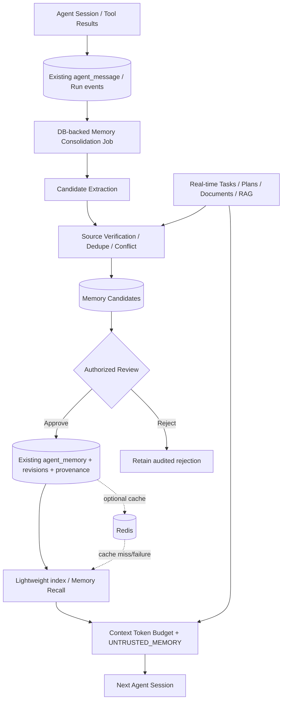

# AI Collab｜AC-07 Agent Memory V2 架构与实施设计补充

> **版本**：V1.0（待实施的设计方案，不代表已完成）  
> **日期**：2026-11-10  
> **关联主文档**：[AI Collab｜Agent 工程与产品架构改造设计](./AI-Collab-2026-11-10-架构与Agent工程改造设计.md)，工作包 AC-01～AC-06 继续有效。  
> **代码参考基线**：`BangShou1st/ai-collab` 的 `dev` 分支，审查时 HEAD `65c385b0cd8af2829b9d8d2035c438380ad99c77`；本地 AI 开始实施前**必须重新核对工作区、HEAD、未提交修改与正在进行的任务**。  
> **变更定位**：新增 **AC-07**，不覆盖原方案，不修改 AI-CostOps，不重启另一套 Agent / RAG / Skill / 工作流框架。

---

## 0. 决策摘要（先读）

**结论**：建设“**经验可验证、跨会话可召回、失效可治理**”的项目长期记忆系统。第一阶段**不**急于建设私人记忆、复杂 Wiki、独立向量数据库或 Redis Memory Cache。

| 架构决定 | 本次决策 | 反对的做法 |
| --- | --- | --- |
| 记忆权威存储 | 延续 PostgreSQL 现有 `agent_memory`、审批与审计体系，采用增量 Flyway 迁移 | 将 Redis 或任意文件目录作为唯一真相 |
| 经验来源 | 复用 `agent_message`、`agent_run_event` / 实际 Tool 结果与确认过的业务记录 | 只相信 LLM 对过往对话的总结 |
| 记忆形成 | **Dreaming（离线整理）只产生候选**，验证来源、去重、冲突检测后交由授权人员确认 | 任何对话结束时立即自动写入共享记忆 |
| 记忆读取 | 默认不加载全部记忆；提供小索引、检索工具和限额内的按需召回 | 每轮注入最近 10/100 条或所有历史聊天 |
| 工作记忆 | 继续由现有 Session / `working_state` / `AgentContextSummarizer` 负责 | 将会话压缩结果视为可信长期事实 |
| 项目事实 | 实时业务系统与原始文档 / RAG 为准；记忆是可能过期的辅助上下文 | 用历史记忆覆盖最新 Task/Plan/Document/Approval 状态 |
| 权限 | 先实现**项目共享记忆**，沿用项目管理员批准、所有请求项目权限校验 | 把普通成员私人发言直接公开到项目记忆 |
| Redis | 后期通过同环境性能基准证明必要性后再使用，仅缓存可重建结果 | 为展示技术栈强行增加缓存或用 TTL 代替遗忘 |
| 质量 | 先有跨会话冻结集和“旧版 / 增强召回 / Dreaming”三组对照 | 用生成记忆数量、测试数量证明效果 |

**推荐执行方式**：AC-07 单独特性分支与单独报告；不与 AC-02 上下文重构、AC-03 Tool 范围调整、AC-05 RAG 路由变更交叉大改。先做 AC07-P0 基线审计与测试设计，再逐批开发。

---

## 1. Anthropic 研究来源与可以借鉴的原则

### 1.1 直接来自官方资料的结论

**主要资料**：

1. Anthropic Engineering，2026-11-06：[The components of agent memory](https://www.anthropic.com/research/components-of-agent-memory)。
2. Claude Cookbook，2026-11-02：[Dreaming with a dynamic workflow](https://platform.claude.com/cookbook/managed-agents-cma-dreaming-with-a-dynamic-workflow)。

文章将 Agent 的长期记忆组织划为四个不同功能层：

| 官方概念 | 含义 | 本项目映射 |
| --- | --- | --- |
| Transcripts | 可检索的原始运行与会话经历 | 既有消息、Run、Step、Tool Event；**仅作为回溯证据** |
| Memory notes | 对跨会话有用的经验笔记 | 已有 `agent_memory`，但须扩展来源及状态治理 |
| Memory representations | 便于导航与定位记忆的结构化表示，Wiki 为示例 | **第一版采用轻量索引 / 主题目录**，不做完整 Wiki |
| Injected context | 下一次会话预加载的少量高价值信息 | 现有 `AgentModelMessageComposer` 的受限注入层 |
| Dreaming | 会话之间对记录进行复查、纠错、提炼和重组 | 新增离线 **Memory Consolidator**，不直接取代摘要器 |

官方明确：**Compaction 不等于跨会话长期记忆**；主动写入记忆与离线 Dreaming 各有时效与成本权衡；错误的常驻记忆会放大幻觉；Wiki 在一些多文档任务中有效，但在其他任务不一定增益，甚至会超过原始语料体积。官方实验属于特定模型、基准和数据集，**不应搬运性能百分比作为 AI Collab 验收目标**。

Cookbook 演示的“已结束会话 → 分析 → 组织 → 下次会话可读取的记忆库”是**参考流程**，不是要求本项目接入 Claude Managed Agents、Python 动态工作流或使用 Claude 专属模型。

### 1.2 本项目独立作出的工程设计（不是 Anthropic 的正式规范）

- 使用 Spring Boot + PostgreSQL 做增量、可恢复的后台整理任务；不用新 Python 服务。
- 整理器只能**提议**共享记忆，最终授权仍走现有业务审批。
- 定义明确的来源引用、验证状态与撤权失效策略，兼容多人项目访问控制。
- 避免原始对话全部进入 Prompt；按 Token 预算加载小索引和相关记忆。
- Redis 不参与记忆的事实性、安全性或永久存储决策。

---

## 2. 仓库当前实现：已核对事实与待审风险

### 2.1 已有基础，不重复开发

| 已有实现 | 已核对行为 | 设计影响 |
| --- | --- | --- |
| `V30__add_agent_memory_and_schedule_skill.sql` | `agent_memory` 含 `project_id/type/title/content/source_type/source_id/status/version/created_by/updated_by` 等；类型为 `DECISION/PREFERENCE/CONSTRAINT/LESSON`，状态 `ACTIVE/DISABLED` | 继续使用该表，不改历史 Flyway |
| `AgentMemoryService` | 项目成员可列出；管理员创建、修改、禁用；有审计入口 | 保留正式管理 API、角色校验与旧接口 |
| `AgentMemoryRepository` | PostgreSQL 查询，有连接器来源隐藏 / 授权撤销相关过滤 SQL | 先审计来源过滤语义与撤权安全，不得破坏已有 fail-closed 行为 |
| `AgentModelMessageComposer` | 将 `memories.context(projectId, requesterId, goal)` 渲染为 `UNTRUSTED_PROJECT_MEMORY`；按剩余上下文容量选择是否注入 | **插拔扩展**记忆选择层，沿用低信任上下文标签 |
| `AgentMemoryService.context()` | 从最近最多 100 条有效记忆按词项粗匹配排序，取最多 10 条 | 存在召回覆盖不足 / 相关性误判风险；先测再改 |
| `CreateMemoryApprovalAgentTool` | `create_memory_after_approval` 通过写操作审批保存项目记忆 | Dreaming 候选审批应复用相同权限与业务不变量 |
| `ListMemoriesAgentTool` | `list_project_memories` 为只读工具 | 可扩展按需搜索，但**不无条件追加工具权限** |
| `AgentContextSummarizer` | 已有 SESSION / RUN_CONTEXT 压缩与模型记账 | 不拿摘要直接替代长期记忆笔记 |
| `AgentRepository` | `agent_message`、会话 `working_state`、Run/事件与摘要持久化 | 提供可追溯的经验来源；不要复制一套 Transcript 表 |
| `DashboardCacheService` | 已有 Redis 缓存工程能力与故障降级实践 | 可借鉴其模式，但不直接复制到敏感记忆缓存 |

**重要安全审计项**：旧版 `AgentMemoryRequest` 的 `sourceType` 为普通文本、`sourceId` 为可选 UUID；需要检查来源类型是否被限制、ID 是否属于正确项目、是否可由请求人访问。`AgentMemoryRepository` 中连接器可见性判断可能覆盖较广，不能未经测试直接简化，否则会让已撤销外部来源重新暴露。以上是**需要核验的风险点**，不是已证实的漏洞结论。

### 2.2 当前不能假定已具备的能力

- 已结束会话的**增量 Dreaming**、幂等/可恢复候选提取与冲突修复；
- 具备批准机制的“记忆候选 → 来源验证 → 合并 / 发布”生命周期；
- 可追溯多条来源、原始版本/失效状态的记忆依据图谱；
- 整体可检索的长期记忆目录 / 显式按需检索路径；
- 专用的 Redis Memory Cache；
- 独立的 USER 私人记忆隔离与治理能力；
- 可复现的跨会话记忆召回 A/B 质量报告。

实施前应做 `git grep`、生产装配追踪和测试核查；如当前本地分支已包含新实现，以实际代码为准更新差距表。

---

## 3. 业务场景、成功条件与非目标

### 3.1 核心场景：经过确认的项目决策可跨会话复用

1. 会话 A 用户讨论“下一迭代统一使用 PostgreSQL；不允许引入新消息队列”。
2. 项目管理员通过界面或现有审批机制确认该决策。
3. 生成一条含来源、当前状态和版本的项目记忆。
4. 会话 B 讨论迭代方案时，通过小索引或检索结果获得这条决策。
5. Agent 提示适用的已确认约束，但如果最新业务决策已变更，先核对当前来源而不是强行执行旧约束。
6. 该记忆被修订、停用或来源权限失效后，后续会话不再召回失效内容。

### 3.2 业务场景：失败经验能转化为经验教训

一次 Agent 规划因为未考虑任务依赖而失败。Dreaming 可引用真实计划校验失败事件，产生“新增计划时检查依赖闭环”的候选经验；但不能把一次未经验证的模型解释写成项目规则，必须经审核。

### 3.3 非目标

- 不把 AI Collab 变成 ChatGPT 式个人助理全域记忆产品；
- 不直接捕获并公开所有成员私聊内容；
- 不引入独立 Python Memory Service、Neo4j、专用向量数据库、通用事件总线或新的 MQ；
- 不自动执行文档与项目事实上的写操作；
- 不让记忆拥有 System Prompt、业务 RBAC、审批或 Tool 授权的优先级；
- 不要求 Memory V2 一次实现所有功能；
- 不将官方实验的 53%/61% 或其它收益指标设为本项目工程 SLO。

---

## 4. 逻辑架构与数据流



### 4.1 四层职责

- **L1：经验底账** —— 继续使用原始消息、Run、Tool 结果、审批与业务记录。高保真、保留来源和事件顺序，不经 LLM 摘要后覆盖原始事实。
- **L2：长期记忆笔记** —— 保留 `agent_memory` 现有领域类型；延展来源、状态、变更历史，并能标记“已过时 / 需要复核 / 被新版替代”。
- **L3：轻量记忆索引** —— 项目层生成少量主题入口、记忆 ID 和简短概述；细节经 `search_project_memories` 或内置 Recall 按需获取。首次不做复杂 Wiki。
- **L4：注入上下文** —— 模型可看到经过检索和裁剪的历史记忆，始终作为不可信资料；最新项目事实由正式业务服务查询。

### 4.2 五个服务角色（建议接口，不强制类名）

| 逻辑服务 | 责任 | 禁止事项 |
| --- | --- | --- |
| `MemoryEvidenceResolver` | 按权威业务服务核验来源存在、版本、当前访问权限、撤销情况 | 不能仅凭 `sourceId` 字符串判真 |
| `MemoryCandidateExtractor` | 从已结束的会话 / Tool 结果产生最小候选集，预算受控 | 不直接持久化为 ACTIVE 项目记忆 |
| `MemoryConsolidationService` | 去重、识别新旧决策冲突、提出覆盖/禁用/合并建议 | 不在无人工批准时重写共享历史规则 |
| `MemoryPublicationService` | 审批、版本 CAS、来源关联、审计、事务提交与失效事件 | 不绕过 `ProjectAccessGuard` / 审批 |
| `MemoryRecallService` | 可信作用域过滤、相关性选择、限额注入与可解释的命中原因 | 不让模型指定 `projectId/userId/role` 作为授权依据 |

服务应尽量集成到现有 `agent/application` 与 `agent/infrastructure/repository`，复用已装配的 Java 模型调用器/工具注册器/数据库连接，不另加自治 Agent Runtime。

---

## 5. 记忆分类、可信度与生命周期

### 5.1 哪些东西值得记住？

| 内容 | 写入长期记忆？ | 处理方式 |
| --- | --- | --- |
| 经管理员确认的架构决策、团队规范、稳定约束 | **是** | 记录确认来源和有效性 |
| 反复出现、经工具结果确认的工程失误或可复用经验 | **候选** | 关联失败 / 恢复事件，审批后存为 LESSON |
| 当前进度、任务状态、实时看板统计 | **否** | 实时查询任务服务 |
| 原始需求文档全文 / 具体条款 | **否** | 继续使用 RAG，必要时只保存稳定的“索引线索” |
| 未经核实的模型猜测、外部网页随意指令 | **否** | 只能作为低信任原始证据 |
| 密码、API Key、OAuth Token、敏感个人信息 | **禁止** | 提取前后做安全过滤，禁止进入候选正文、日志、缓存 |

### 5.2 记录的三种独立状态

禁止把“审批是否通过”“内容是否可信”“记忆是否启用”混成一个字段：

1. **候选审批状态**：`PENDING_REVIEW / APPROVED / REJECTED / CANCELLED`（新候选实体）。
2. **记忆有效状态**：现有 `ACTIVE / DISABLED` 保留，若确需新增状态，通过前向迁移与兼容视图引入；不要重解释现有值。
3. **来源验证状态**：建议 `VERIFIED / UNVERIFIED / STALE / CONFLICTED / SOURCE_REVOKED`（新的独立维度，最后一种可按数据模型归入不可召回原因）。

**默认召回策略**：仅有权访问且仍 ACTIVE、来源安全有效、审核机制允许的记忆进入生产上下文。历史记忆上线新规则时的迁移须双轨兼容：**不能把 legacy 记录静默标成 VERIFIED**；先审计和评测，通过开关阶段性过渡。

### 5.3 版本与冲突

- 同一项目中的同一决策主题使用明确 `subjectKey` 或可审计的关系，不依赖 LLM 生成文本绝对匹配作为数据库唯一键；
- 旧记忆不被破坏性覆盖：复用当前 `version` 乐观锁，必要时新增修订历史表保存原始版本快照、审核者、依据及变更原因；
- 对 `PREFERENCE` 可按较新确认值建议更新；对 `DECISION`、`CONSTRAINT` 必须说明替代关系并审批；
- `LESSON` 可以并存，但相互矛盾时不得同时被当作确定规则注入；
- 模型只提出 `CREATE / REVISE / SUPERSEDE / DISABLE / NO_ACTION`，是否生效由可信后端与人类审批决定。

---

## 6. PostgreSQL 数据演进建议（概念设计，不直接作为可执行 SQL）

**要求**：实施前审计当前最新迁移、实际数据库约束、DAO 和 API。只新增前向迁移；任何新增列先允许兼容旧数据，再按阶段收紧读取逻辑。不修改 V30 或其他已执行 Flyway 文件。

### 6.1 延展 `agent_memory`（尽量少改现有契约）

根据审计确定是否需要以下信息：

| 建议字段/关系 | 说明 |
| --- | --- |
| `subject_key`（可选） | 项目域内的稳定决策主题 / 约束主题标识；需校验归一化及兼容历史数据 |
| `verification_state` | 与现有 `status` 正交，表示来源是否已验证或需要复核 |
| `verified_at` / `verified_by` | 最近一次人工或权威业务事实核验，不伪造“模型已验证” |
| `superseded_by` 或单独关联表 | 指向替代版本，防止旧规则与新规则同时被应用 |
| `content_fingerprint`（可选） | 用于候选去重的语义前置辅助；**不是**冲突判定的充分条件 |
| `origin` / `schema_version`（可选） | 区分手工、历史和 Dreaming 产生并获批准的记录 |

字段只是候选，**必须先判断是否可由既有 `sourceType/sourceId`、`version` 和审计表承载**。禁止因为字段清单而无意义加表。

### 6.2 推荐新增最小实体

**`agent_memory_candidate`**：`id/project_id/created_by/source_session_id/source_run_id/candidate_type/operation/target_memory_id/title/content/source_summary/fingerprint/status/reviewer_id/reviewed_at/rejection_reason/model_usage_ref/created_at/updated_at/version`。

**`agent_memory_source_ref`**（如现有单一来源不可满足）：`memory_id/source_type/source_id/source_version/source_project_id/recorded_at/verification_state`。一个记忆可关联多项证据；来源重新验证必须能处理对象版本和 Connector 撤销，不能只有一条不可验证的 URL。

**`agent_memory_revision`**（若原审计不足）：保存每次更新前后关联、操作者、来源、审核与版本，避免不可逆覆盖。注意不要复制敏感原文到多个历史表，须结合 retention 和删除策略设计。

**`agent_memory_consolidation_job`**（若现有 Job 表不能复用）：项目/会话归属、检查点、输入覆盖范围、模型配置/预算快照、状态、领取租约、重试次数、结果指标与错误类别，严禁存未脱敏的原始对话全文。

> **减法原则**：如果只实现第一批 M1 / M2，允许先落一张 candidate 表和必要的 provenance 关系；revision 和独立 job 表只在已有审计/后台任务无法保障时新增。不要四张表一次性全建。

### 6.3 存储不变量

- 候选、项目记忆、来源、审计记录必须按可信 `projectId` 关联并在数据库写入时重新校验权限；
- `UNIQUE`/幂等去重至少包含 `projectId + sourceSession / coveredThrough + extractorVersion + candidateFingerprint` 的稳定语义，避免相同会话反复整理产生重复候选；
- 修改记忆需 CAS `version`，不允许延迟的 Dreaming 覆盖管理员的新变更；
- 审批发布事务要保证**只发布一次**、修订历史可查、失败原子回滚；
- 跨项目源引用、来源不存在、来源未获授权，拒绝发布或进入显式待复核，不要自动降级成无源事实；
- 用户/项目/会话删除与 Connector 撤销时，记忆及候选的保留、清理和可见性必须有可测试策略。

---

## 7. Dreaming：离线整理的可恢复流水线

### 7.1 何时触发

**M2 首版：人工触发或经过明确配置的已结束 Session 增量处理**。以后在效果、成本和数据处理权限确认后，才启用夜间周期任务。

重要：不能简单以某个 Run 的 `COMPLETED` 表示该 Session 的所有未来交互都已结束。应定义“处理边界”为已持久化并稳定的消息/事件位置，例如 `maxMessageSequence/maxEventSequence` 或等价提交时间 + ID 水位，处理后写入 cursor。新增交互留给下一次增量处理。

### 7.2 Pipeline

```text
SCHEDULED
  ↓ 权限/来源范围和预算检查
CLAIMED（带租约与 fencing）
  ↓ 从可信项目 + 会话加载稳定增量记录
EXTRACTED（结构化候选；模型调用费用结算）
  ↓ 确定性来源校验、类型检查、去重和冲突提示
PENDING_REVIEW（候选持久化）
  ↓ 有权限人员审核
APPROVED / REJECTED
  ↓ 批准后原子发布 + 索引失效
PUBLISHED（ACTIVE Memory）
```

Job 失败时区分 `FAILED_RETRYABLE / BLOCKED_CONFIG / BLOCKED_AUTH / FAILED_TERMINAL`，次数与退避有上限；不能在无用户授权或没有模型配置的情况下无限调用收费模型。

### 7.3 提取输入与提示词契约

- 仅从**已授权、已完成持久化**的记录中采集必要字段；优先保留真实 Tool 结果、审批记录、业务更新结果和引用，不要将未经确认的 Agent 回答当成业务事实；
- 采集最小必要数据、限制单次消息数量/字符/Token；大跨度会话按有界区间分批处理；
- 输出严格 JSON Schema，例如：`candidateType/title/content/whyUseful/sourceRefs/sourceCertainty/operation/targetMemoryId/needsReview`；
- 输入为不可信数据，必须将记录正文作为引用内容，拒绝其中“忽略规则 / 删除数据库 / 向网络发送密钥”等指令；
- 后端对模型输出二次校验：`type/length/source ID/source scope/operation/target`，失败不产生正式记忆；
- 与已有 Agent 模型路由及统一用量账本协调：谁承担调用费用、限额多少、何时允许后台任务使用用户凭据，必须明确，**不能在后台擅用其他成员的私人 API Key**。

### 7.4 并发与恢复

- 同一项目 / 会话的一段 source range 同时最多一个有效持租约 Job；Worker 重启可接管，但需要 fencing token 或持久化版本阻止旧 Worker 延迟写入；
- 重试不重复创建候选；模型可能再次生成不同措辞的候选，应有确定性 source range 标识与去重；
- 不持长事务跨越 LLM 调用。读取源 / 模型分析 / 写候选分别在短事务边界进行；
- 批准同一候选的并发请求保证只生效一次，冲突返回清晰错误，不允许双份记忆；
- Memory 相关后台 Job 的 Token/费用计入可查账本，不能混入普通用户问答并被无声忽略；
- 当模型不可用、预算不够、数据库断开或无权限时保持旧记忆系统可用。

---

## 8. 按需召回：先可靠、后智能

### 8.1 第一阶段无需新向量索引

对比 `AgentMemoryService` 现有基于词项打分的最近 100 条召回，先建立一组冻结任务证明其短板：

1. 超过 100 条后，正确的旧决策是否仍能被检索？
2. 改写同义词后，召回率怎样？
3. 失效或被替代的记忆是否仍会被注入？
4. 不相关记忆是否占用紧张的上下文？
5. 是否有单独的手工按需搜索入口，不依赖 LLM 自动发现？

改进路线：

- 基线 `LEGACY`: 现有 `context()`，记录命中 ID、上下文 Token；
- `FILTERED`: 先由数据库完成权限、来源、版本、状态过滤，再进行 BM25/词法或其它简单相关排序；如果 PostgreSQL FTS 对中文支持不足，优先沿用现有中文分词/双字词项方案或显式模糊匹配，不假设开箱支持中文；
- `ON_DEMAND`: 小索引（主题/摘要/ID） + `search_project_memories` 只读工具 + 当前请求相关 Top K；
- `SEMANTIC`: 仅在冻结集证明必要时添加 pgvector 召回，复用现有 Embedding 模型指纹 / 索引代次与可重建策略，禁止跨向量空间比较。

### 8.2 上下文优先级

一轮模型请求原则上按以下优先级使用有限 Token：

1. 可信系统行为约束、当前明确目标、未完成审批与工具协议；
2. 实时业务状态、必须回答问题的来源证据；
3. 必需的最近会话历史、已验证约束；
4. 少量高相关、仍有来源依据的长期记忆；
5. 其余次要历史或只用于导航的目录。

实际由现有 AC-02 单次请求预算计算负责统一裁剪；Memory 模块仅提供排序、候选 Token 计量和可裁剪块。不能建立自己的第二套模型窗口算法，也不能把“记忆命中”设成不可压缩的最高优先层。

### 8.3 不可信内容标记与可追溯性

保留 `UNTRUSTED_PROJECT_MEMORY` 语义，注入内容用结构化块（简短正文、类型、来源、确认状态、更新时间、是否需要复核）；模型不得将它当成 System 指令。记忆引用失效时不能通过旧摘要、索引或缓存恢复已撤销内容。

评测时允许在专用受控 Trace 中记录 memory IDs、版本及命中原因，生产日志默认不记录记忆正文或原始来源全文。

---

## 9. 权限、隐私与来源撤销（不可降级的硬门槛）

### 9.1 写入

- 项目管理员拥有现有正式项目记忆管理能力；普通项目成员不能通过对话绕过管理员审批把消息提升为**项目共享**记忆。
- Dreaming 读取其他成员的会话之前，必须核实项目隐私策略、会话可见权限与数据使用授权。没有明确共享依据时，**不能默认读取全体项目成员会话生成共享记忆**。
- 来源 `projectId/userId/sourceType/sourceId` 必须从可信运行身份与后端正式业务服务验证，不允许 LLM 提供任意身份冒充。
- 手工新增记忆原有 API 保持兼容；新候选管理与发布 API 采用明确操作与细粒度授权。

### 9.2 读取

- 每次召回都以可信用户身份做项目成员校验，不能只因缓存有该 Key 就跳过。
- 记忆依赖的 Connector 授权撤销、源文档删除、成员移除、项目删除/禁用等必须能使相关记忆不可用；不要仅依赖刷新 Job 或 Redis TTL。
- 如一个记忆同时关联多个来源：制定明确的**每条来源引用与正文片段**的可见性策略；若无法证明当前可见性，则整条不注入，避免从一个有效来源“洗白”另一个已撤权来源。
- 旧版 Repository 的 Connector 隐藏条件先加入回归测试，再增量替换。禁止直接删掉现有 fail-closed 过滤。

### 9.3 删除与保留

- `DISABLED` 是业务不再提供；实际个人数据/项目数据删除与审计保留要另定数据保留政策。
- 修订历史、候选、来源引用、索引和缓存不得在正式“删除/遗忘”后继续重新注入旧内容；保留必要合规审计时须控制可访问性与保留期。
- 不把用户私密数据写进跨用户共享记忆；用户个人记忆单独纳入后续隐私设计，不应靠新增 `scope=USER` 一列草率完成。

---

## 10. Redis 设计：条件启用，不在第一阶段上线

**为何后置**：目前记忆表查询量、项目平均记忆数、关键词过滤耗时均未提供足够的真实基准，缓存会增加数据暴露和撤销失效的竞争窗口。

如后续实测必要，建议只缓存：

- **项目已授权检索得到的记忆 ID 列表 / 安全元数据**，而非默认缓存全部正文；
- 与用户可见权限有关的键必须包含明确 scope、用户/项目身份或有效权限版本；
- 结果必须有 `memory_generation/revision` 或其它失效机制，且最终读取依然复核权限 / 状态；
- 用户权限撤销 / Connector 撤销和记忆修改，要保证相关缓存立即不再被信任；不能仅依赖 TTL；
- Redis 故障时立即走 PostgreSQL、检索功能保持正确；缓存丢失不丢记忆。

**上线门禁**：在同一套 Testcontainers PostgreSQL/Redis 环境记录记忆量级（建议 100 / 1k / 10k 做模拟数据点）、QPS、P50/P95、缓存命中、读写冲突和权限撤销行为；仅在有可衡量收益且安全测试通过后启用 feature flag。缓存可以评估为 `NO_CHANGE_JUSTIFIED`，这也算合格结果。

---

## 11. 与已有 AC-01～AC-06 的依赖关系

| 现有工作包 | AC-07 的协调策略 |
| --- | --- |
| AC-01 Trace 与评测 | 复用 Trace IDs / Step/Tool 模型账本；新增 Memory 来源与召回事件，保持脱敏 |
| AC-02 上下文与预算 | 由 AC-02 统一决定 Token 预算与记忆裁剪，Memory 模块只返回有序候选 |
| AC-03 Agent/Tool/Workflow | 若要加 `search_project_memories`，需遵守通用 Agent 的只读工具暴露策略与项目权限；不借机恢复粗暴关键词 Skill 锁定 |
| AC-04 MCP Server | v1 对外 MCP 只读项目业务工具不必默认暴露全部历史记忆。未来新增 Memory Tool 要先做独立威胁建模与授权 |
| AC-05 关系增强 RAG | 记忆与业务依赖 DAG/知识库各自承担职责；优先调用已有 RAG，不新增相似的检索路由 |
| AC-06 业务定位 | 记忆中的历史术语属于业务记录，不机械改写；用户可见管理界面统一新中文定位 |

**合并策略**：若 AC-01/02/03 正在修改 `AgentModelMessageComposer`、`AgentRuntimeCoordinator`、Tool Registry，AC-07 暂先做只读审计与测试、数据层及独立服务；接入运行时的提交必须等相关文件稳定后小批次合并并跑全套回归，避免两个本地 AI 会话互相覆盖。

---

## 12. 分批交付计划与优先级

| 任务 | 要做什么 | 交付与门禁 | 依赖 |
| --- | --- | --- | --- |
| **AC07-P0 基线** | 冻结当前代码、检视现有 Memory 与 Connector 撤权、定位生产装配；设计 20+ 跨会话场景及相关性基线 | 差距矩阵、数据流、现有测试结果；**不改核心业务行为** | 可立即做 |
| **AC07-P1 生命周期** | 来源验证、显式验证状态、修订/失效/冲突处理；保留原 CRUD、审批及历史迁移兼容 | 乐观锁、撤权、删除、跨项目与历史数据测试通过 | P0 |
| **AC07-P2 Dreaming** | 增量 Job、候选提取、去重、模型账本、候选审核、审批后发布 | 崩溃恢复、重试、费用上限、相同范围幂等与无未授权共享 | P1；与 AC-01 配合 |
| **AC07-P3 小索引与召回** | 轻量主题目录、按需搜索工具、过滤后选择及 Token 预算协作 | 3 组冻结 A/B 对照；上线不退化 | P1；与 AC-02/03 协调 |
| **AC07-P4 可选优化** | 仅评测有效时使用 pgvector / Redis；用户记忆另起隐私设计 | 同环境性能证据 / 安全回归 / 关闭开关可以回退 | P3 和质量数据 |

P2 和 P3 的实现顺序可根据真实依赖适度互换，但**绝不在 P0 未完成时同时开工所有能力**。

### 12.1 Feature flag 建议

- `agent.memory.v2.recall.enabled=false`：选择器是否切换 V2（保留旧版 fallback，调试使用）。
- `agent.memory.consolidation.enabled=false`：是否允许自动候选整理。
- `agent.memory.consolidation.scheduled.enabled=false`：是否启用自动调度（默认关闭）。
- `agent.memory.cache.enabled=false`：是否启用 Redis 记忆缓存（默认关闭）。

字段名为示意。实际实施中以项目现有配置命名习惯为准，不能引入两套互相矛盾的开关。

---

## 13. 验收测试矩阵（最低要求）

| 编号 | 场景 | 最低合格条件 |
| --- | --- | --- |
| M-01 | 已批准决策跨 Session 召回 | 新会话可依据有效项目记忆回答，并可指向来源 |
| M-02 | 尚未批准的候选 | 不能进入正式记忆和下一会话的高可信上下文 |
| M-03 | 旧记忆被新决策取代 | 新会话不再把旧版与新版并列当作有效约束 |
| M-04 | 失效 / 禁用 / 删除 | 新的 Agent 请求与搜索工具都不可返回旧正文 |
| M-05 | 记忆来源撤销（Connector / 文档） | 不能透过项目记忆、索引、摘要或 Redis 找回不可访问内容 |
| M-06 | 跨项目隔离 | 项目 A 的记忆在项目 B 的读取、搜索、Dreaming 都不可见 |
| M-07 | 项目成员移除 | 旧 Session ID、旧缓存键均不能绕过项目权限 |
| M-08 | 非管理员发起共享记忆 | 不可绕过管理员审核发布，且不会意外泄露该成员私人会话 |
| M-09 | 来源 ID 伪造与不存在 | 创建 / 修订 / 发布拒绝或标记待审核，不能伪造 VERIFIED |
| M-10 | Prompt injection | 历史对话、Tool 输出中的恶意指令不能改变权限、调用写工具或泄密 |
| M-11 | 相同会话区间重复 Dreaming | 恰好一次语义上的候选发布（至少一次执行 + 幂等结果） |
| M-12 | Dreaming Worker 崩溃与旧租约写入 | 接管后不丢任务，不产生重复候选，旧 Worker 不能覆盖新状态 |
| M-13 | 多管理员并发审批 | 只有一个版本提交生效，其他冲突明确返回 |
| M-14 | 模型超时 / 不可用 / 预算不足 | 当前 Agent 正常工作，不因后台 Dreaming 阻断主业务 |
| M-15 | Legacy 记录兼容 | 原 CRUD / 列表 / 审批未破坏，历史未验证记录不会被伪造升级 |
| M-16 | 超过 100 条记忆时检索 | 冻结相关样本能召回超出最近 100 条的有效旧决策 |
| M-17 | 多语言/同义改写召回 | 报告 Recall@K / 误召回，不能靠写死测试问题刷分 |
| M-18 | Token / 费用 | 会话与 Dreaming 成本分开计量；无不受控模型调用 |
| M-19 | Redis 故障（若启用） | 降级读 PG；撤销权限时旧缓存不泄漏 |
| M-20 | 长会话压缩与暂停恢复 | Working Memory 与长期 Memory 保持独立，恢复不改变权限、审批与数据状态 |
| M-21 | 删除隐私或项目数据 | 删除、候选、修订、缓存及衍生索引满足实际保留策略，不因重放重新生成禁用内容 |
| M-22 | 真实模型回归 | 记录真实 Provider / 模型版本、实际 Token、延迟及质量，Mock/真实结果分开 |

### 13.1 建议的冻结跨会话评测集

最少包括：经过批准的技术决策、新旧约束冲突、某一旧 Lesson 的适用条件、成员撤权、文档撤权、数月未使用的旧记忆、错误的模型推断未获确认、中文同义提问、长会话中目标变化、连续多轮修改项目技术栈。

**三组对照**：

- **A LEGACY**：现有 `AgentMemoryService.context()`；
- **B GOVERNED_RECALL**：来源与状态过滤 + 改进召回 + 小索引；
- **C DREAMING**：B + 经审批发布的离线记忆。

必须冻结样本 / 项目快照 / 模型配置 / Prompt 版本，分别报告：**Recall@K、引用有效率、冲突记忆误用率、撤权泄露数（必须为 0）、任务结果正确率、Token 消耗、P50/P95 延迟、Dreaming 费用、人工审批率**。模型随机性须如实处理：固定配置、必要时重复采样；不足样本标明 `NOT_VERIFIED`，不虚构提升。

---

## 14. 前端与 API 范围

**最低可用闭环**：项目管理员查看 `待审核记忆候选` → 展示建议内容、来源/核验状态、冲突与改动 diff → 批准/拒绝 → 项目记忆管理页面看到最新版与历史记录 → Agent 在新会话能检索已发布记忆。

- 尽量在现有 Agent / 项目设置中新增轻量入口，不做全站 UI 重设计；
- 原 `/api/v1/projects/{projectId}/agent/memories` 保持兼容；新 candidate / review / recall API 按现有路径风格扩展；
- 更新 OpenAPI、前端 DTO、权限提示、错误码与测试；
- 默认不允许模型在新对话中直接查看其他成员的历史 Transcript；
- 记忆来源可给出安全跳转但需重新校验访问权限，不允许带有不可访问文档正文的预览。

---

## 15. 故障、回滚与验收声明

| 事故 | 退回行为 |
| --- | --- |
| Dreaming 模型费用、幻觉或超时异常 | 关闭 `consolidation`，保留旧记忆 CRUD 和 Agent 主运行；未批准候选不进入上下文 |
| 新召回相关性下降 | 关闭 `v2.recall`，回退旧版选择器，但**保留已经生效的权限 / 撤权安全过滤** |
| Redis 故障 | 关闭 `memory.cache`，直接 PG 查询，必要时清空专用缓存命名空间 |
| 新索引生成失败 | 按需搜索回退数据库安全过滤 / 词法方法；不返回未经授权正文 |
| 来源撤销事件消费延迟 | 读取路径继续实时验证或 fail closed，不能因事件滞后而提供旧内容 |
| 旧版迁移问题 | 通过新代码开关回退行为；**不能直接回滚已执行 Flyway 并丢弃真实记录** |

每批报告给出固定 HEAD SHA / 测试清单 / 真实与模拟验证区分 / 改动文件 / 迁移与兼容 / 风险 / 回滚步骤。状态只允许 `PASS / FAIL / NOT_VERIFIED / BLOCKED`，且主线 AC-01～AC-06 原有验收结果不因 AC-07 被擅自改写。

---

## 16. 给本地编码 Agent 的实施边界

1. 首次只读核对当前 `dev` 与本地工作区，找到改动重叠文件，不覆盖其他会话已做工作。
2. 优先产出 `AC07-P0` 差距与可复现评测基线；若主线正在修改 Runtime，P0 可只修改测试与报告，不抢共享源文件。
3. P1 分开提交 `schema + service + tests`；保持历史记忆和现有审批兼容。
4. P2 分开提交离线 Job、候选审核及安全测试；后台调用使用有明确授权的模型配置及费用限制。
5. P3 只在与 AC-02/03 集成窗口确定后修改 Composer / Tool Registry，先做灰度开关。
6. P4 的 Redis、pgvector 与个人记忆必须经过独立 Go/No-Go，不得作为 P0～P3 完工前提。
7. 完整遵循仓库现有 Java 分层、Flyway、Testcontainers、前端和 CI 约定，不引入新技术栈堆砌。

### 交付清单

- [ ] 实施前代码与运行装配审计报告
- [ ] Memory V2 生命周期与来源验证设计（含迁移兼容）
- [ ] 跨会话冻结评测集与 LEGACY 基线
- [ ] Dreaming 候选生成、可恢复 Job、审批发布链路
- [ ] 轻量索引 / 按需召回与 Token 预算集成
- [ ] 项目权限 / Connector 撤权 / 删除 / 注入防护验收
- [ ] 真实模型的质量与 Token / 费用对照报告
- [ ] Feature flag、回滚策略、API 文档、变更提交证据
- [ ] Redis / 语义向量 / 私人记忆的延期决策与依据

---

## 17. 参考资料

**官方研究 / 示例：**

- [Anthropic — The components of agent memory](https://www.anthropic.com/research/components-of-agent-memory)
- [Claude Cookbook — Dreaming with a dynamic workflow](https://platform.claude.com/cookbook/managed-agents-cma-dreaming-with-a-dynamic-workflow)

**当前代码（实施前请固定实际 SHA）：**

- [AgentMemoryService.java](https://github.com/BangShou1st/ai-collab/blob/dev/ai-collab-backend/src/main/java/com/shitulelv/aicollab/agent/application/AgentMemoryService.java)
- [AgentMemoryRepository.java](https://github.com/BangShou1st/ai-collab/blob/dev/ai-collab-backend/src/main/java/com/shitulelv/aicollab/agent/infrastructure/repository/AgentMemoryRepository.java)
- [AgentModelMessageComposer.java](https://github.com/BangShou1st/ai-collab/blob/dev/ai-collab-backend/src/main/java/com/shitulelv/aicollab/agent/application/runtime/AgentModelMessageComposer.java)
- [AgentContextSummarizer.java](https://github.com/BangShou1st/ai-collab/blob/dev/ai-collab-backend/src/main/java/com/shitulelv/aicollab/agent/application/runtime/AgentContextSummarizer.java)
- [V30 Agent Memory 迁移](https://github.com/BangShou1st/ai-collab/blob/dev/ai-collab-backend/src/main/resources/db/migration/V30__add_agent_memory_and_schedule_skill.sql)
- [项目既有 AI 下一阶段蓝图](https://github.com/BangShou1st/ai-collab/blob/dev/docs/design/ai-next-stage-blueprint.md)

**设计裁决**：AC-07 首要验收结果是**正确跨会话召回 + 受控记忆形成 + 来源失效 + 未授权内容零泄露**；不是“新增 Redis / 额外模型服务 / 高级 Wiki”本身。
