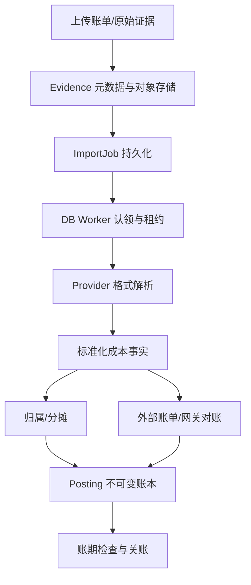

# AI-CostOps｜Java 后端核心链路、并发可靠性与工程质量改造设计文档

> 版本：V1.0（实施设计草案）  
> 编制日期：2026-11-10  
> 项目仓库：[`BangShou1st/AI-CostOps`](https://github.com/BangShou1st/AI-CostOps)  
> 代码基线：`main`，审查时 SHA `1fb5e74cff4b84081ff90a8717f8912b058aa793`；完整 CI 证据还涉及 `perf/ci-acceleration` SHA `e2aa26ece44eeda3517be0f91b27096b3e373590`。实施前须重新拉取与比较分支差异  
> 文档性质：**设计/改造任务，不是已完成或生产可用性声明**  
> 关联方案：[AI Collab Agent 工程与产品架构改造设计](./AI-Collab-2026-11-10-架构与Agent工程改造设计.md)

## 0. 决策摘要

AI-CostOps 不需要为了简历而新增 RabbitMQ/Kafka，也不需要重新发明一套成本平台。当前系统已经有独立的 Backend 与 Gateway、MySQL 财务事实、Redis 的认证/限流/缓存/熔断用途，以及较多单元、集成、并发和规模测试。**真正需要的是把高风险业务链路的状态与事务边界重新审计，用最新代码重跑故障/并发/安全验收，修复有证据的缺口，并把结论写成可复现的工程材料。**

本次并行于 AI Collab，按六个工作包推进：

1. **CO-00 代码、分支与安全基线**：处理 `main` 安全扫描失败，固定构建与依赖版本，比较各分支 CI 成果。
2. **CO-01 账单导入 / 财务账本 / 关账事务**：核实文件去重、任务领取、标准化、金额计算、Posting/Correction、账期写保护与失败恢复。
3. **CO-02 Gateway 实时预算与幂等**：以 Provider 代理完整调用链为核心，验证预算预占、Dispatch Intent、流式用量、未知用量、重试、对账和并发竞争。
4. **CO-03 Redis 正确性与故障行为**：审计会话、登录限流、Dashboard 缓存、网关令牌桶、每日配额和熔断状态；不把 Redis 当成财务最终真相。
5. **CO-04 SQL / 任务队列 / 性能**：复验 MySQL 索引、锁顺序、`SKIP LOCKED` 租约与可恢复任务，在真实样本上测 P95 和吞吐，并按证据优化。
6. **CO-05 可观测、端到端验收与交付**：统一 request/job/settlement 关联日志，完善故障注入、CI、文档和简历可引用的工程事实。

**交付底线**：财务事实正确、幂等不重复、预算并发不越过规则、未知费用不误判为零、异常可定位和恢复、Redis 故障不会篡改 MySQL 真相。任何优化必须不破坏这些不变量。

## 1. 已核对现状与证据等级

### 1.1 架构

```text
React / TypeScript 管理台
        │ HTTP
        ▼
Backend（Java 21 / Spring Boot 4.1）
  ├─ IAM / 组织权限
  ├─ Evidence / Ingestion / Provider 标准化
  ├─ Cost / Attribution / Allocation
  ├─ Budget / Ledger / Billing Period
  ├─ Reconciliation / Reporting / Audit
  └─ Provider / Gateway 管理
        │
        ├── MySQL 8.4（唯一正式财务真相）
        ├── Redis 7（会话、缓存、网关运行态）
        └── MinIO / S3（原始证据）

Gateway（独立 Java 部署服务）
  ├─ 凭证鉴权 / 路由 / 请求幂等
  ├─ Redis 限流 / 配额 / 熔断
  ├─ MySQL 预算预占 / DISPATCH_INTENT
  ├─ Provider 转发 / 流式用量识别
  └─ 结算、恢复与后续对账
```

这是同一 Monorepo 下的两个部署服务，不应误写成一组分布式微服务。核心金额以 `BigDecimal` / MySQL `DECIMAL` 运算；Redis 只是运行态和加速设施，不负责最终账本、预算或关账状态。

### 1.2 确认有代码和测试的能力

| 能力 | 源码/测试线索 | 证据边界 |
|---|---|---|
| 登录限流 | `backend/.../iam/infrastructure/RedisRateLimiter.java` + `RedisRateLimiterIntegrationTest` | 真实 Redis 集成测试存在；仍需审查非原子 TTL 边界 |
| 网关 Redis 令牌桶 | `gateway/.../ratelimit/RedisTokenBucketRateLimiter.java` + 对应集成测试 | 已有 Lua/并发/故障用例，不应当作纯设计 |
| Redis 熔断 | `gateway/.../resilience/RedisCircuitBreakerService.java` + 集成测试 | 已有半开争抢等用例；需核查超时与跨实例语义 |
| 每日额度 | `gateway/.../quota` | 有 Redis 用途及测试；需检查过日界线、时区、失败行为 |
| 预算预占 | `gateway/.../budget/BudgetReservationService.java` + `BudgetReservationConcurrencyIntegrationTest` | 已有并发测试；仍需覆盖流式失败、重复回调、金额未知的全链路 |
| 数据库后台导入 | `backend/.../ingestion`、M9 Benchmark | DB 任务队列与 Worker 已存在；不需要为了“异步”改成 MQ |
| 规模实验 | `docs/03-acceptance/milestones/m9-scale-evidence.md` | 单机 Testcontainers 条件：导入 10k/100k/500k，约 413–443 行/秒；非生产多实例吞吐 |
| Java 自动测试 | Backend/Gateway 大量 JUnit/Testcontainers；CI 工具链 | `perf/ci-acceleration` 最近一次完整 CI 成功不等于 `main` 所有用例当前重新通过 |

参考：[系统架构](https://github.com/BangShou1st/AI-CostOps/blob/main/docs/01-blueprint/architecture/10-system-architecture.md)、[M9 规模实验](https://github.com/BangShou1st/AI-CostOps/blob/main/docs/03-acceptance/milestones/m9-scale-evidence.md)、[预算并发测试](https://github.com/BangShou1st/AI-CostOps/blob/main/gateway/src/test/java/com/aicostops/gateway/budget/BudgetReservationConcurrencyIntegrationTest.java)。

### 1.3 CI 与安全实际状态

2026-11-09：

- [`perf/ci-acceleration` 的完整 CI](https://github.com/BangShou1st/AI-CostOps/actions/runs/42578509717)：Backend unit/integration、Gateway unit/integration、前端、浏览器 E2E 与 Docker 构建等完成并报告成功；该结论仅适用于对应提交。
- [`main` 的 Security 工作流](https://github.com/BangShou1st/AI-CostOps/actions/runs/42646521102)：CodeQL Java/JS 通过，**Trivy 文件系统扫描失败**。完整日志指向 `frontend/package-lock.json` 中 `follow-redirects` 1.16.1，报告 `CVE-2026-116689`（HIGH），修复版本 1.16.2。需查明依赖路径、修复是否适用，升级后重新扫描；不能简单忽略。
- Trivy 亦提示某些 Maven 子依赖版本未能解析，扫描结果中“后端 0 个发现”不能证明所有 Java 依赖绝对安全。

当前 README 状态包含 `MAINTENANCE_ONLY`，本次任务是**受控可靠性改进**，不将其解释为要求产品全面扩张。

## 2. 总体目标与财务不变量

### 2.1 必须由代码和数据库保障的业务规则

| 编号 | 不变量 | 证明方式 |
|---|---|---|
| F-01 | 金额计算禁止 `float/double`；币种不同不得直接相加 | 单位测试、字段映射、账期/汇率测试 |
| F-02 | 同一上传证据、同一导入逻辑记录/同一 Posting 不因重试重复入账 | 指纹/唯一约束与并发 Testcontainers |
| F-03 | 预算预占并发竞争必须原子判定；不能靠 Redis 缓存里的余额定夺 | MySQL 条件更新、事务测试、并发压测 |
| F-04 | Provider 已发生但 usage 未知的请求不能按零费用悄悄结清 | 未知状态持久化、恢复/对账用例 |
| F-05 | 账本冲正使用追加更正，不随意 UPDATE/DELETE 已确认事实 | API 拒绝、数据库约束/代码测试 |
| F-06 | 已关闭账期不得被普通写入口修改；重新开放走权限与审计 | 多写入口测试、并发关闭竞争 |
| F-07 | 任务/请求重试、超时、Worker 重启不重复触发不可逆副作用 | 幂等键、租约/fence、故障注入 |
| F-08 | 缓存或 Redis 故障不改变 MySQL 财务最终真相 | 缓存失效/断线测试 |
| F-09 | 每项财务变动能关联原始证据或 Gateway 事实与审计记录 | 端到端溯源和状态对账 |

**审核结果必须分三层**：`已在现有代码实现`、`有自动测试覆盖`、`本次在指定 SHA/环境重新运行并通过`；不能把其中之一替代另外两项。

### 2.2 非目标

本轮不增加 RabbitMQ、Kafka、微服务拆分、Redis 分布式财务锁、无需求的分库分表、不引入新的成本建模大平台、不盲目重写 SQL。若未来异步链路确实测出数据库队列成为瓶颈，再通过明确性能/交付/运维数据评估 Broker 与 Outbox。

## 3. CO-00：安全与代码基线（首批）

### 3.1 Git 基线与分支对账

在 `main` 和 `perf/ci-acceleration` 上分别列出 Git SHA、Maven/Node 锁定依赖、Flyway 历史、测试配置、CI 工作流步骤差异，防止出现“优化分支绿了、主分支依然失败”的证据混用。任务不允许把过时的归档测试记录写成当前结论。

### 3.2 Trivy 修复

1. 读取指定 Security job 详细日志，确认 `follow-redirects` 的父依赖及直接/间接引入路径；检查目前 main 的 lockfile 是否仍为受影响版本。
2. 使用包管理器正常升级到修复版本或上游依赖兼容版本，更新 `package-lock.json`；不得仅文本替换版本号、不得使用 `--force` 绕过 peer compatibility。
3. 运行 frontend 单测、build、必要的浏览器 E2E、依赖扫描，保存新结果；确认新变更没有扩大依赖安全面。
4. Trivy 和 CodeQL 独立判定；有环境故障要标 `BLOCKED`，不得改工作流成非阻断来掩盖真实风险。

### 3.3 交付物

`docs/acceptance/<date>/co-00-baseline/`：`manifest.json`（分支、SHA、依赖版本）、`findings.md`、`ci-results.md`、脱敏的 `security-results.md`，附一条最小安全修复 PR。P0 验收以**main 对应目标提交的 Security 重新通过**为目标，而非他分支的历史成功。

## 4. CO-01：账单导入、账本与关账事务

### 4.1 需核对的业务调用链



这是**目标核对顺序**；具体方法名、边界和状态以实际代码为准，不得假设流程中每一步都在同一数据库事务。对象存储与 MySQL 无共享 ACID 事务，需要明确“上传已成功但 DB 回滚 / DB 提交但对象缺失”的补偿逻辑。

### 4.2 导入及幂等设计

关键去重维度要分清：`file_hash` 只能证明字节内容相同，`provider + account + bill_identity` 与行记录指纹证明业务事实相同，`posting_key`/唯一约束保证入账幂等。明确“同一文件重传”、“账期内供应商更正后重导”、“不同文件包含相同记录”、“部分导入失败后续跑”四种语义；不能单凭文件 hash 删除合法更正。

对同一幂等键：相同请求重复应返回已有事实或明确处理中；相同键而不同参数必须有冲突策略；两线程同时提交由**数据库唯一约束和事务**裁决，不能仅靠 `synchronized` 或 Redis `SETNX`。

### 4.3 任务队列与事务边界

保留 `DB-backed Job + Spring TaskExecutor`、`SELECT … FOR UPDATE SKIP LOCKED` 或经验证等价的认领机制。重点审查 `lease_owner/lease_until/attempt/version`（实际列名以 schema 为准）、认领和状态更新是否原子、租约失效后旧 Worker 是否被 fencing、重试是否有指数退避/次数上限、成功结果是否重复写入。

用 Testcontainers 至少构造：双 Worker 抢同一个任务、Worker 领取后进程停止、处理成功但标记成功前崩溃、外部对象不可读、解析异常、部分批次失败、连续恢复后最终仅一份入账事实。审计事件不能被当成“事务发生了”证据，必须与业务表状态核对。

### 4.4 关账和账本

逐项检查账期关闭前置条件、闭账与写入口竞争、跨账期更正、冲正追加、审计提交顺序。测试确保：同一事务内若 Posting 第 N 条失败，已插入的本次 Posting 与状态改变按契约全部回滚；账期进入 CLOSED 后所有可写入口均受写栅栏约束，不能只在某个 Controller 校验。

### 4.5 实施原则

先画出真实 Controller → Application Service → Repository/Mapper → MySQL 调用图，标记 `@Transactional`、SQL 锁与约束。若当前代码符合要求，只加验收与文档，不为“重构”改动稳定路径。

## 5. CO-02：Gateway 预算预占、幂等和未知用量

### 5.1 生命周期及状态要求

对一次 Gateway 请求记录**事实级生命周期**：鉴权 → 限流/额度 → 幂等识别 → 预算预占 → Dispatch Intent 持久化 → Provider 出站 → 响应或流式消费 → Usage 分类 → 预算释放/转实际成本 → 结算/对账。

现有具体数据库枚举须先核对；以下 `RESERVED` / `DISPATCHED` / `USAGE_UNKNOWN` 等词只是本设计中的**语义阶段**，不能不经审查就作为新枚举覆盖生产表。

### 5.2 必须验证的异常矩阵

| 故障位置 | 期待的业务结果 | 禁止行为 |
|---|---|---|
| 预算预占前数据库错误 | 明确拒绝出站或遵守已定义的安全失败策略 | 未持久化预占却无条件放行产生费用 |
| 预占成功、尚未发送 Provider | 可确认未发送时安全释放；状态可恢复 | 无证据地标记真实 usage 为零 |
| Intent 已持久化、Provider 超时 | 区分“确定未发送”和“可能已发送”；后者保留待核对状态 | 盲目重试造成两次收费或重复结算 |
| 流式响应中途断开 | 已观察用量与未知剩余量分开记录 | 未观察完整 usage 却结算零费用 |
| Provider 返回 usage 缺失或格式异常 | 保留 UNKNOWN/ESTIMATE 与后续 reconciliation 路径 | 把 null 转 `BigDecimal.ZERO` 并宣称准确 |
| 客户端重复提交同一幂等键 | 相同业务参数只认领一个真实请求/结算 | 发生两个 Provider 出站或两个有效 Posting |
| 重复结算回调/重启补偿 | 最终仅有一次生效结算；审计可追溯 | 重复释放承诺、重复扣预算 |
| 不同请求竞争同一预算 | MySQL 条件更新原子约束，不突破预算策略 | 依赖先读后写导致并发超额 |
| Provider 成本高于预占 | 真实成本必须记录，差额及超额可见 | 把实际成本压到预算剩余而隐藏财务事实 |

这部分的核心区别是**预算管理**与**成本事实入账**：预算可以拒绝未来请求，但已经真实发生的费用不应为保证“预算不超”而被丢弃。

### 5.3 并发与幂等设计

复用现有 `BudgetReservationService` 和 MySQL 原子条件更新；核验是否存在跨服务的重复请求并发、不同顺序锁获取、长事务调用外部 Provider、重试事务隔离级别差异等问题。上游请求绝不在持有财务数据库长锁的事务中等待。每个生命周期写入口定义幂等键和唯一约束，单次 Provider 出站与结算关联稳定 request/intent ID。对允许重试的 Provider 错误，明确提供者幂等支持情况；无法判断首次请求是否执行时，优先等待核对而非无条件重发。

### 5.4 必须新增/复跑的测试

现有 `BudgetReservationConcurrencyIntegrationTest` 是起点，不必重写。新增或补足：同键 50/100 并发竞争（数量按资源条件可配置）、跨 Gateway 实例竞争、预算刚好等于可用额、不同币种/小数精度、断流后 Usage Unknown、恢复重试、双重 settle 与放款对账。所有指标报告为特定环境的实际测试；不能用 100 线程成功冒充高生产 QPS。

## 6. CO-03：Redis 正确性与降级行为

### 6.1 按实际业务划分 Redis 职责

| Redis 场景 | 可靠性预期 | 实施审查重点 |
|---|---|---|
| Refresh Token / 会话 | Redis 不可用时通常拒绝敏感认证操作；不从缓存错误推断用户权限 | TTL、撤销、轮换、并发刷新、故障时的身份安全 |
| 登录/IP 限流 | 必须明确 Redis 不可用时 fail-open 或 fail-closed 的实际规则 | `INCR` + `EXPIRE` 非原子窗口、键 TTL、跨日与 IPv6 等 |
| Dashboard Cache | Redis 故障时可回源 MySQL；不能返回错误的其他租户数据 | Cache Aside、失效顺序、热键、缓存穿透与旧值窗口 |
| Gateway 令牌桶 | 多实例限流一致；预算与鉴权不依赖单进程内计数 | Lua 原子性、恢复补令牌、失败时是否拒绝出站 |
| Gateway 日配额 | 统一时区、边界/过期与回收规则 | `TIME` 来源、跨午夜、重复请求、故障行为 |
| 网关熔断 | 状态切换对实例一致；半开试探不能全部同时放行 | CLOSED/OPEN/HALF_OPEN 竞争、超时与过期键 |
| IAM 权限上下文缓存 | 最终权限由 MySQL 证实 | 成员禁用/权限变更后的失效与 TTL |

### 6.2 已识别值得检查的具体边界

`RedisRateLimiter` 若首次计数采用分离的 `INCR` 和 `EXPIRE`，两命令之间进程失败会有计数键无 TTL 的理论窗口；先在真实代码中确认当前实现，再用故障注入复现或证明不存在，必要时调整为 Lua 原子设置。**不要仅因为代码外观看起来非原子就声称线上已发生故障。**

Dashboard 缓存需要在写操作之后验证正确失效；若读并发与写并发存在旧值覆盖新值的窗口，需要明确可接受一致性等级及保护方式。网关限流与熔断则需继续使用真实 Redis Testcontainers，而非以模拟 Map 替代所有并发测试。

### 6.3 故障分级

Redis down、超时、慢响应、主从切换、重复连接、序列化异常分别测试。每个服务应列出“是否放行请求、是否允许缓存回源、是否需要记录风险审计”，并给出代码证据。**财务预算永远以 MySQL 决定是否可出站**，Redis token bucket 不得成为预算最终真相。

## 7. CO-04：SQL、数据库队列与性能

### 7.1 基线不应被误读

M9 验收基于本地 Windows / Docker Desktop / Testcontainers MySQL 8.4，在单 Worker、给定数据规模下报告导入吞吐约 413–443 行/秒；Reporting 对 10k/100k 有数据和 `EXPLAIN ANALYZE`，**未完成 500k Reporting 全量验证**。这不是生产高并发保证，也不构成必须替换数据库队列的证据。

### 7.2 具体检查项目

- SQL：`EXPLAIN ANALYZE`、索引选择性、范围扫描、分页方案、批处理、JOIN 顺序、事务内查询量；特别是工作台聚合、归属/对账、任务认领与预算锁更新。
- 事务：隔离级别、锁顺序、锁等待、死锁重试、唯一约束竞争、主从（如有）读写一致性。
- Worker：认领批大小、租约时长、失败重试、同一个 Job 多 Worker 并发、崩溃恢复、资源限制。
- 应用：JVM 堆、GC、连接池等待、线程池饱和、Redis 连接超时、HTTP 上游连接池。
- 观测：同时记录 p50/p95/p99（样本量充足时）、吞吐、错误率、CPU/内存、数据库连接数与慢 SQL 样本。

### 7.3 先确定性能目标再谈 MQ

设定经业务确认的容量目标（如单实例日导入量、网关目标请求率、允许的用户可感知延迟）。如数据库队列在重复负载下持续成为明确瓶颈，先比较索引、批处理和 Worker 并发扩容；只有 Broker 能解决**可量化的削峰/跨服务投递/消费者隔离**问题且运维成本可接受时，才单独设计 `Transactional Outbox + Broker`。本轮不为 RabbitMQ 预留无用接口，也不写“已使用 MQ”。

### 7.4 验收数据方式

在相同版本、资源和种子下跑至少三次，不只记录最好一轮。输出 `environment.json`、数据库 `EXPLAIN` 原文、参数、重复次数、p50/p95、错误分类和配置版本。优化需满足“结果正确性不下降 + 测得的关键查询/链路有稳定收益”；若没有，就保留原 SQL。

## 8. CO-05：Trace、监控、故障注入与运维

### 8.1 端到端关联标识

一次外部账单导入使用稳定 `import_batch_id`、`import_attempt_id`、`job_id`、`evidence_id`、`posting_key`；一次 Gateway 请求使用 `gateway_request_id`、`idempotency_key`（日志脱敏/哈希）、`dispatch_intent_id`、`reservation_id`、`provider_request_id`、`settlement_id`。不同系统间必须能用公开的稳定业务键追到事实，但不能把原始 API Key 写入日志。

| 事件 | 记录内容 |
|---|---|
| `import.claimed` / `import.completed` | 任务、租约、尝试次数、记录数、失败原因 |
| `gateway.reserved` / `gateway.dispatched` | 请求、预算承诺、出站状态和延迟 |
| `gateway.usage_observed` / `settlement.completed` | usage 确切性、金额/币种、实际 vs 估算、幂等结果 |
| `ledger.posted` / `period.closed` | 审计事件、来源身份、版本及事务结果 |
| `redis.degraded` / `provider.failed` | 失败模式、降级策略，不包括敏感凭据和正文 |

优先用现有 Micrometer、Actuator 与结构化 JSON 日志；必要时增加 OpenTelemetry Trace 适配，但不新建一套业务事件存储来替换数据库事实。监控必须区分**失败率、待处理补偿数、未知用量金额、预算拒绝、长时间租约、对账差异**；仅有请求成功率不足以描述财务正确性。

### 8.2 建议的运行验收矩阵

| 故障注入 | 预期可观察结果 |
|---|---|
| MySQL 暂时不可用 | API 正确失败；无半提交财务状态；恢复后重试语义明确 |
| Redis 暂时不可用 | 会话/网关/缓存按各自约定处理；不伪装为预算充足 |
| MinIO PUT 成功而 DB 失败 | 有补偿/清理记录，可追查孤儿对象 |
| DB 成功但 MinIO GET 失败 | 导入任务进入可恢复失败状态，不生成虚假成本事实 |
| Gateway Provider 408/504/断流 | Usage 不确定性被保留，Intent/Reservation 可对账 |
| Worker 认领后崩溃 | 租约到期由新 Worker 安全恢复，旧执行者不能二次落账 |
| 关账同时提交 Posting | 一致的先后顺序，不能在 CLOSED 账期中写入 |
| 同一 Idempotency-Key 并发 | 一份可见业务事实，冲突与重复响应分类正确 |
| 前端依赖被扫描出 HIGH | 安全工作流阻断，修复后重新报告 PASS |

上述用例分为 Unit、Testcontainers Integration、故障注入、Browser E2E 和可选规模实验。CI 默认跑可重复的较小规模；500k 规模按资源和时间独立 opt-in，绝不假装每次提交都跑过。

## 9. 分批实施计划（与 AI Collab 并行）

| 批次 | 目标 | 最小可交付代码 / 证据 | 合并门槛 |
|---|---|---|---|
| CO-P0 | 修复安全扫描与固定构建基线 | 锁文件修复、前端测试、Security 重新运行、branch diff | `main` 目标提交 Security 无未解释失败 |
| CO-P1 | 财务不变量与导入链路 | 真实调用图、导入/Posting/关账事务集成测试、缺口修复 | F-01/F-02/F-05/F-06/F-07 可复现通过 |
| CO-P2 | Gateway 预算与未知 usage | 出站意图/结算状态审计、重复请求/并发/断流测试 | F-03/F-04/F-07/F-09 通过 |
| CO-P3 | Redis 故障与缓存正确性 | Redis 实例级集成/故障测试、必要 Lua/失效修复 | 多实例与 Redis down 行为明确 |
| CO-P4 | SQL/Worker 性能复验 | EXPLAIN、基线与优化对照、崩溃恢复报告 | 正确性守住；性能收益有数据支撑 |
| CO-P5 | 可诊断和发布证据 | 关联日志/指标、端到端故障矩阵、最终验收说明 | CI、Security、恢复、人工验收均标状态 |

**并行编排**：与 AI Collab 的 AC-P0 同时开始 CO-P0；AC-P1/P2 期间做 CO-P1/P2；AC-P3/P4 期间做 CO-P3/P4；最终各自发布与验收。两项目禁止共享尚未稳定的运行时服务或数据库；只复用测试理念、业务术语和文档模板。

## 10. 工程任务与验收用例的最小粒度

编码助手每个 PR 必须同时交付：

1. `scope.md`：列明本 PR 只改哪些入口、服务、Mapper、数据库、测试；旧功能的明确不动区。
2. `call-chain.md`：真实 Controller → Service → Repository/SQL → 副作用图，标出 `@Transactional`、锁、唯一约束与缓存边界。
3. `test-matrix.md`：既有测试复用、补充单测/集成/故障注入、运行命令、真实通过与跳过原因。
4. `evidence.md`：固定 SHA、环境、日志脱敏摘要、测试输出、失败或未验证事项；不得只留下漂亮截图。
5. `decision.md`：具体修复了哪个可复现问题、替代方案、没有引入 MQ/Redis 分布式锁等技术的理由。

至少要求能手动展示两条完整链路：

- **账单链**：上传测试 CSV → 导入 Worker → 标准化 → 分摊/确认 → 账本/关账核验；运行中至少注入一次解析错误或重试。
- **Gateway 链**：从客户端发起模拟 Provider 请求 → 预算预占 → Intent → 接收/断开流式响应 → usage / unknown → settle / recovery；至少演示一次重复幂等键和并发预算竞争。

这两条演示用于验证真实工程理解。**本项目已经有大量测试，不要求在每个模块再写一套重复测试。**

## 11. 回滚、数据兼容与安全部署

- 所有 schema 变更只通过新增 Flyway 文件，绝不编辑已部署迁移；金额字段、Posting 身份、账期状态属于高风险迁移，优先不动表结构。
- 对导入 Worker、Gateway 幂等和预算修复，部署前备份/验证恢复；先在测试数据或影子路径复验，渐进开启并保留必要的 feature flag。
- Redis key/schema 或 Lua 变更需要兼容老 key 与 TTL，必要时双读单写或设计短暂过渡；不能靠清空生产 Redis 解决迁移。
- 发生 Ledger 变动错误，不允许通过直接手动 UPDATE 历史流水“修数据”；采用经审计的补偿/冲正与明确操作记录。
- 若新优化导致性能退化或安全失败，按版本回滚代码并保留现场证据；若数据库结构已前向迁移，要证明旧版本可兼容再回滚。
- 生产部署和真实 Provider 调用需要独立批准；**CI / 本地 Testcontainers 通过不代表生产安全或成本零风险**。

## 12. 不做项、后续判定与简历边界

明确不做：

- 不引入没有需求与基准的 RabbitMQ、Kafka、RocketMQ。
- 不把现有 DB 队列改成没有幂等/租约审查的消息消费者。
- 不把 Redis 认作金融账本或预算最终真相。
- 不为“微服务经验”拆服务、引入 K8s 或分布式事务框架。
- 不编造 500k Reporting、生产高 QPS、真实多云 Provider 对账都已验收。
- 不因为 AI 辅助生成了代码就声称自己实现并深入理解了所有底层原理。

建议的简历可陈述范围，在**对应最新证据验收后**才成立：

> 基于 Java/Spring Boot/MyBatis/MySQL 实现并验证账单导入、数据库任务认领、预算预占与幂等结算；使用 Redis 完成网关限流、配额与熔断，并以 Testcontainers 验证并发/故障恢复；通过 GitHub Actions 持续运行核心集成测试与安全扫描。

不要写成“基于 RabbitMQ 的高吞吐分布式异步架构”。性能数据只写明实际规模、运行环境和版本，不用“生产级百万并发”之类无证据措辞。

## 13. 完成判据与负责人复盘

每个批次必须达成：代码评审、自动测试、CI、安全状态、异常恢复、可复现证据、变更及回滚策略。对于不能执行的真实环境测试，明确 `BLOCKED/NOT_VERIFIED`，不阻止整理已有可靠成果，但不能对外冒充通过。

项目负责人应能独立解释以下问题，并在代码中指出路径：

- 为什么预算需要 MySQL 条件更新，而不能依赖 Redis 缓存？
- 一次 Gateway 请求何时可以安全重试？什么时候必须标记为“是否真正发送未知”？
- 什么是 `DISPATCH_INTENT`，为何需要先持久化意图？
- 导入 Worker 为什么要租约、`SKIP LOCKED` 和幂等结果？
- `INCR + EXPIRE` 与 Lua 原子操作的区别是什么？
- Redis 故障时登录、工作台缓存、网关限流各应怎样表现，为什么不能统一 fail-open？
- 账本不可变、冲正和账期关闭如何通过事务和 SQL 体现？
- Testcontainers 成功和线上系统稳定之间还差哪些验证？

## 14. 关键参考路径

- [README / 当前功能与维护状态](https://github.com/BangShou1st/AI-CostOps/blob/main/README.md)
- [系统架构与 MySQL/Redis/DB 队列设计](https://github.com/BangShou1st/AI-CostOps/blob/main/docs/01-blueprint/architecture/10-system-architecture.md)
- [Gateway 预算服务](https://github.com/BangShou1st/AI-CostOps/blob/main/gateway/src/main/java/com/aicostops/gateway/budget/BudgetReservationService.java)
- [Gateway 预算并发集成测试](https://github.com/BangShou1st/AI-CostOps/blob/main/gateway/src/test/java/com/aicostops/gateway/budget/BudgetReservationConcurrencyIntegrationTest.java)
- [Redis 令牌桶集成测试](https://github.com/BangShou1st/AI-CostOps/blob/main/gateway/src/test/java/com/aicostops/gateway/ratelimit/RedisTokenBucketRateLimiterIntegrationTest.java)
- [Redis 熔断集成测试](https://github.com/BangShou1st/AI-CostOps/blob/main/gateway/src/test/java/com/aicostops/gateway/resilience/CircuitBreakerRedisIntegrationTest.java)
- [登录限流集成测试](https://github.com/BangShou1st/AI-CostOps/blob/main/backend/src/test/java/com/aicostops/iam/infrastructure/RedisRateLimiterIntegrationTest.java)
- [M9 本地规模与 SQL 证据](https://github.com/BangShou1st/AI-CostOps/blob/main/docs/03-acceptance/milestones/m9-scale-evidence.md)
- [2026-11-09 CI 成功（perf 分支）](https://github.com/BangShou1st/AI-CostOps/actions/runs/42578509717)
- [2026-11-09 Security 失败（main 分支）](https://github.com/BangShou1st/AI-CostOps/actions/runs/42646521102)

---

**执行起点**：第一张可直接派给 AI 编码助手的任务是 `CO-P0`：只读核对 main/perf 分支、修复当前 Trivy 扫描所证实的前端依赖漏洞、重跑对应 CI/Security，并交付可追溯的安全验收记录。第二张 `CO-P1` 从导入到 Posting 画出事务和 SQL 边界，优先通过测试证明现有机制正确，再对真正的缺口改代码。
