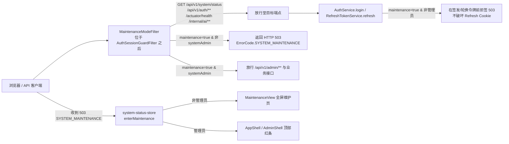
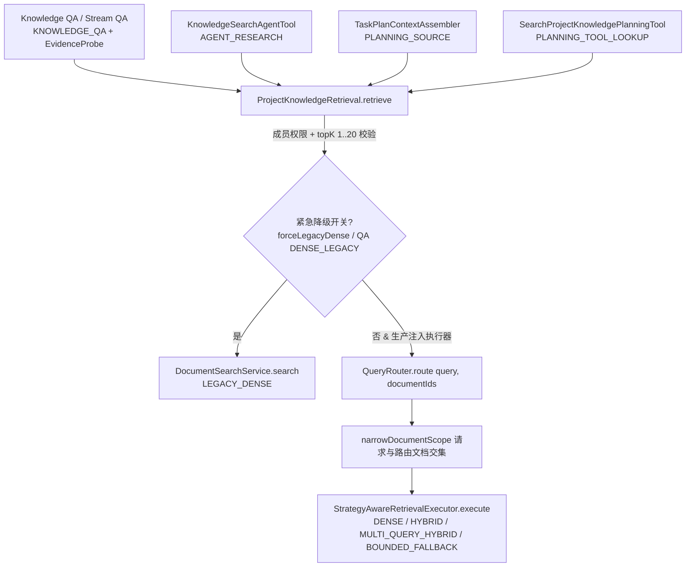

# AI Collab 全链路架构融合、维护停站闭环与 Staging 重建设计

> **文档状态**：已冻结待实施（Design Frozen · Ready for Execution）
> **编制日期**：2026-11-24
> **源码基线**：`dev @ 5fc0a007`（审查对照基线 `main @ 19763c7`，Flyway 迁移基线 `V1–V102`，下一迁移版本固定为 **`V103`**）
> **前置暂存说明**：设计冻结前已在本地演练过 Stage 1 及 Stage 2.1–2.4 的部分编码（未提交未推送），现已完整保存至本地 stash `wip-pre-design-freeze-2026-11-24`；新会话执行时可选择从干净 `dev` 按本设计分阶段实现，或在充分对比复核后 `git stash pop` 继续补全。

---

## 1. 背景与源码审查核心问题清单

基于对后端（Java / Spring Boot 4.1.0）、Python Cognitive Worker（`ai-collab-ai-worker`）、部署编排（`ai-collab-deploy`）及前端（Vue 3.5 / Vite 7）的逐链路核查，当前系统存在 **6 项核心架构割裂与产品缺陷**，本设计旨在一次性形成完整、安全、可落地的融合改造与测试服干净重建方案。

| 序号 | 优先级 | 问题摘要 | 源码实锤与现网影响 |
| --- | --- | --- | --- |
| **1** | **P0** | **知识检索存在三套执行路径，且 `RAG_V2` 仅部分消费 `QueryRouter`** | `KnowledgeQuestionApplicationService` / `KnowledgeStreamQuestionService` 默认走 `DENSE_LEGACY`（仅 local profile 切到 `STRATEGY_AWARE`）；`KnowledgeSearchAgentTool` 固定 `RAG_V2`；`TaskPlanContextAssembler` 与 `SearchProjectKnowledgePlanningTool` 固定 `DENSE_LEGACY`。更关键的是 `ProjectKnowledgeRetrieval.retrieveRagV2()` 调用无文档范围的 `queryRouter.route(request.query())`，仅取 `semanticQuery` 与 `filters`，直接丢弃 `decision.subQueries()`、`decision.strategy()` 和 `decision.documentIds()`。 |
| **2** | **P0** | **Agent → Planning 业务链已通，但知识证据未贯通** | `AgentPlanningOperationService` → `TaskPlanCommandService` 已打通幂等与状态同步，但 `start_task_plan` 仅接收可选 `documentIds`；若未传 `documentIds`，`TaskPlanContextAssembler` 的初始 `SOURCES` 直接为空；即便传入也会重新检索而非复用 Agent 已获高价值 chunk。同时 Planning 详情阶段内 `SearchProjectKnowledgePlanningTool` 仍走 `DENSE_LEGACY`，只返回截断文本而不返回 `documentId`/`chunkId`/`sourceRef`，且明确禁止模型引用为正式 `sourceRefs`。 |
| **3** | **P0** | **Python `ai-worker` 命名与 Staging 部署矩阵割裂** | `application.yml`、各 `*Properties`（`PlanningDraftProperties`、`PromptRegistryProperties`、`QueryPlanProperties`、`RerankProperties`、`DecideProperties`）、`AiJobDispatcher` 与 `docker-compose.yml` 默认指向 `http://ai-worker-api:9100`，而 `compose.staging.yml` 服务名为 `ai-worker` 且缺少 `RERANK_*`、`DECIDE_*`、`PLANNING_DRAFT_*` 等环境变量透传，导致测试服多套 Compose 栈重叠混跑（`ai-collab-deploy` / `ai-collab-devstaging` / `ai-collab-staging`）、Unused RocketMQ 占用内存。 |
| **4** | **P1** | **Java ↔ Python 模型调用身份与监控指标未统一** | `InternalModelCallController` 当前强依赖临时配置 `RERANK_MODEL_USER_ID`（缺失直接 `503`），未优先消费 Ed25519 短令牌声明或全站已发布共享模型档案（`SharedAiProviderRepository`）；监控指标硬编码名为 `rerank.model.duration`，未区分 `purpose` 与 `caller_type`。 |
| **5** | **P1** | **页面上下文（`AgentPageContext`）未进入工具执行上下文，跨模块衔接与记忆容量不一致** | 前端与 `AgentContextAssembler` 已校验 `AgentPageContext` 并写入 `<VERIFIED_PAGE_CONTEXT>` 提示文本，但 `AgentToolContext` 与 `AgentToolRegistry.toToolContext()` 未携带 `AgentPageContext`，导致 `get_task`、`get_task_plan`、`search_project_knowledge`、`start_task_plan` 无法确定性回退或收窄范围；`ListMemoriesAgentTool` 宣称读 10 条实际无 10 条截断；`TaskPlanContextAssembler` 未注入项目长期记忆；前端缺少文档/问答向 Planning/Agent 的清晰跳转与真实实体上下文标签。 |
| **6** | **P1** | **“系统维护停站”为空壳，管理设置页存在多处交互与契约 Bug** | 后端 `SystemConfigService.isMaintenanceMode()` 无任何过滤器或业务拦截调用方，也无匿名系统状态查询接口；前端缺少维护页、双向壳层切换及确认门禁；`AdminSettingsView.vue` 的审计列映射错位（读 `version`/`operatorUsername` 而非 `configVersion`/`changedByName`）、`workerConcurrency`（1–16 vs 后端 1–4）与 `workerDelayMs`（100–60000 vs 后端 200–60000）校验越界、缺少配置恢复交互；`PublicRegistrationService` 运行时被环境变量优先覆盖 DB 配置。 |

---

## 2. 已拍板的四项关键决策

在正式施工前，以下四项产品与工程决策已经最终确认，实施时不得再反复分叉：

1. **维护模式下的管理员体验**：
   - 系统管理员在维护模式下可自由通过顶栏在 **`/admin` 与 `/home`（及项目业务区）间双向切换**，不被锁死在管理台。
   - `/admin` 与主工作区壳层（`AdminShell` / `AppShell`）在维护开启时**均在顶部展示红色全局维护横幅**；非管理员已登录用户与匿名用户统一拦截并返回 `503 SYSTEM_MAINTENANCE`，前端切入全屏维护遮罩页。
2. **系统配置单一事实源边界**：
   - `publicRegistrationEnabled` 以数据库 `SystemConfigService` 为运行时唯一事实源；环境变量 `auth.public-registration.enabled` 仅作为空库初始化种子（`SystemConfig.createDefault(publicRegistrationEnabled)`）与异常兜底。
   - 管理员设置的 `ragRetrievalThreshold` 与 `ragMaxSources` **仅接入 `TaskPlanContextAssembler`**，严禁覆盖知识问答 `KnowledgeContextBuilder.MIN_SIMILARITY`（保持 `0.15`）以免误杀 QA 正常召回。
3. **Agent 页面上下文（`AgentPageContext`）策略**：
   - 对文档上下文默认采用 **软聚焦（Soft Focus）**，并在前端聊天输入框上方上下文芯片条提供明确开关切换 **`strictDocumentScope`**（仅限当前文档 vs 全项目检索并优先当前文档）。
   - 单对象读取工具 `get_task` / `get_task_plan` 在缺省 `taskId` / `planId` 时**确定性回退**至已校验的 `pageContext` 选中对象；`start_task_plan` 缺省 `documentIds` / `seedEvidence` 时自动继承已校验的 `selectedDocumentId` 与本轮/同会话核验证据。
4. **交付与测试服（`box-aae54f`）重构策略**：
   - 按 **6 个阶段顺序** 推进代码落地 → 本地全量测试与构建全绿 → 提交并仅推送至 **`dev`**（严禁自行合并 `main`）。
   - 登录 `box-aae54f` 先完成 PostgreSQL 与 `.env` 安全备份，然后**推翻清理重叠的 `ai-collab-deploy` 与 `ai-collab-devstaging` 两套冗余 Compose 栈**，保留核心数据卷与模型文件，拉起**唯一、干净的单栈 `ai-collab-staging`** 并用 `bsk` 完成端到端验收。

---

## 3. Stage 1：维护停站端到端闭环与管理台交互修复

### 3.1 目标架构流



### 3.2 后端设计细节

1. **错误码与系统状态出口**：
   - `ErrorCode.java` 新增 `SYSTEM_MAINTENANCE(HttpStatus.SERVICE_UNAVAILABLE, "系统正在维护中，请稍后再试")`。
   - 新建 `PublicSystemStatusView(boolean maintenanceMode, String maintenanceMessage, boolean publicRegistrationEnabled)` 与匿名接口 `PublicSystemStatusController`（`GET /api/v1/system/status`），在 `SecurityConfig` 显式 `permitAll`。
   - `SystemConfigService` 注入 `@Value("${auth.public-registration.enabled:true}")` 作为默认种子传递给 `SystemConfig.createDefault(boolean)`，并提供 `effectiveMaintenanceMessage()`；保留 5 参旧构造器兼容现有单测。
2. **认证状态与请求拦截链**：
   - `UserSessionStateService.UserSessionState` 扩展 `boolean systemAdmin` 字段（保留 2 参旧构造器兼容既有测试），并在 `cache()` 阶段写入管理员标志。
   - 新建 `MaintenanceModeFilter` 注册于 `AuthSessionGuardFilter` 之后（确保会话与 `UserSessionState` 已完成解析），通过 `ObjectProvider<SystemConfigService>` 懒读取（保证 `AgentActuatorSecurityTest` 等不含 `SystemConfigService` 的安全切片测试零冲突）：
     - 放行白名单：`/api/v1/system/status`、`/api/v1/auth/**`、`/actuator/**`、`/internal/ai/**`、非 `/api/` 静态资源及 `UserSessionState.systemAdmin() == true`；
     - 拦截非管理员请求，使用 Jackson 3 (`tools.jackson.databind.ObjectMapper`) 输出统一 `ApiResponse` JSON（HTTP `503`，`code = "SYSTEM_MAINTENANCE"`）。
   - `AuthService.login(...)` 与 `RefreshTokenService.refresh(...)` 在核验用户身份、尚未轮换/签发新令牌前判定：若开启维护且用户非 `systemAdmin`，立即抛出 `BusinessException(ErrorCode.SYSTEM_MAINTENANCE)`。
   - `PublicRegistrationService` 以 `SystemConfigService.isPublicRegistrationEnabled()` 作为唯一运行时开关（`SystemConfigService` 未装配时退回环境默认值）。
3. **后台作业停站保护与规划配置接线**：
   - `AgentRuntimeJob`、`AgentRecoveryJob`、`AgentImmediateWakeListener` 检查 `SystemConfigService.isMaintenanceMode()`，维护期间停止认领/唤醒新 Run（不影响已触发中断的幂等恢复边界）。
   - `TaskPlanContextAssembler` 通过可选注入读取 `systemConfigService.getRagMaxSources()` 与 `getRagRetrievalThreshold()`，替代硬编码配置兜底值。

### 3.3 前端与管理台修复

1. **全局状态与容错拦截**：
   - 新增 `src/api/system-status-api.ts` 与 `src/stores/system-status-store.ts`，提供 `useSafeSystemStatusStore()`（内部经 `getActivePinia()` 判空，避免未挂载 Pinia 的单测报错）。
   - `api-result.ts`、`http-client.ts`、`authenticated-fetch.ts` 统一识别 HTTP `503` + `SYSTEM_MAINTENANCE`，即时写入维护态；`router.ts`、`App.vue`、`LoginView.vue` 根据角色分流至 `MaintenanceView.vue` 或顶栏横幅 `MaintenanceAdminBanner.vue`。
2. **双向入口与管理设置页修复**：
   - `AppShell.vue` 顶栏与用户下拉菜单补充「进入管理台 (`/admin`)」；`AdminShell.vue` 顶栏补充「返回工作台 (`/home`)」与「个人设置 (`/account`)」。
   - `AdminSettingsView.vue` 修复项：
     - 开启维护模式保存前强制调用实时运行状态接口弹窗确认（展示当前活跃任务/Agent 数与影响提示）；
     - 修正参数校验与表单边界：`workerConcurrency` 改为 `1..4`，`workerDelayMs` 改为 `200..60000`（补充 `scheduleDelayMs` 展示/编辑）；
     - 修复审计表格字段绑定（使用后端真实字段 `configVersion`、`changedByName`）；
     - 接入历史版本「恢复此版本」按钮并调用 `system-config-api.ts#restoreConfig`。
     - 明确 RAG 阈值文案为“仅用于 AI 任务规划来源准入（不影响知识库问答）”。

---

## 4. Stage 2：统一知识检索意图与跨模块证据契约

### 4.1 检索意图统一与修复 `RAG_V2` 部分路由问题（Stage 2.1）



1. **接口演进（保持测试与回放兼容）**：
   - `ProjectKnowledgeRetrieval` 新增：
     - `public enum RetrievalIntent { KNOWLEDGE_QA, AGENT_RESEARCH, PLANNING_SOURCE, PLANNING_TOOL_LOOKUP }`
     - `public record IntentRequest(UUID projectId, UUID userId, String query, List<UUID> documentIds, int topK, RetrievalIntent intent)`
     - `Result` 扩展 `RetrievalStrategy appliedStrategy`（保留 4 参兼容构造）。
   - `Mode.RAG_V2` 兼容处理：注入 `StrategyAwareRetrievalExecutor` 后统一委托 `retrieveStrategyAware(...)`；仅当 4 参旧单元测试（如 `ProjectKnowledgeRetrievalTest`、`ProjectKnowledgeRetrievalTestSupport`）未注入执行器时退回 `retrieveRagV2Pipeline(...)`；而显式请求 `Mode.STRATEGY_AWARE` 且无执行器时仍保持 fail-closed 抛出 `IllegalStateException`（兼容 `ProjectKnowledgeRetrievalStrategyAwareTest`）。
   - 调用方切换：`KnowledgeQuestionApplicationService`、`KnowledgeStreamQuestionService` 移除本地 `retrievalMode()` 与 `RetrievalQaProperties` 依赖，与 `KnowledgeSearchAgentTool`、`TaskPlanContextAssembler`、`SearchProjectKnowledgePlanningTool` 一并改传 `IntentRequest`。
   - 默认配置收敛：`RetrievalQaProperties`（注意保留多构造器时 canonical constructor 必须标注 `@ConstructorBinding`）与 `application.yml` 默认 `retrieval.qa-mode=STRATEGY_AWARE`，并增加全局紧急降级键 `retrieval.force-legacy-dense: "${RETRIEVAL_FORCE_LEGACY_DENSE:false}"`。

### 4.2 共享 `EvidenceRef` 契约与服务端实时重验（Stage 2.2）

1. **公共契约包** `ai-collab-backend/src/main/java/com/shitulelv/aicollab/common/retrieval/`：
   - `EvidenceRef(UUID projectId, UUID documentId, UUID chunkId, String contentHash, String filename, String heading, String excerpt, double similarity, String sourceOrigin)`
   - `EvidenceBundle(List<EvidenceRef> items, String retrievalCore, String strategy)`
   - `SeedEvidenceInput(UUID documentId, UUID chunkId, String contentHash, Double similarity, String origin)`
2. **服务端强制重验** `EvidenceVerificationService`：
   - 先调用 `ProjectAccessGuard.requireMember(projectId, userId)`；去重并封顶 20 条候选。
   - 使用 `NamedParameterJdbcTemplate` 联查 `document_chunk dc JOIN project_document pd ON pd.id = dc.document_id LEFT JOIN connector_document_visibility v ON v.id = pd.id AND v.project_id = pd.project_id`：
     - 约束：`pd.project_id = :projectId AND pd.status = 'READY' AND COALESCE(pd.access_blocked, false) = false AND COALESCE(v.readable, true) = true AND dc.id IN (:chunkIds)`；
     - 核对 `dc.document_id == candidate.documentId()`，且若提供非空 `contentHash` 则 `trim()` 比对 `dc.content_hash`；
     - 严禁信任外部/客户端提交的 `filename`/`heading`/`excerpt`，严格按数据库当前行重建权威 `EvidenceRef`，对已删除、未就绪、撤权或跨项目条目标记失效并 fail-closed 剔除。

### 4.3 Flyway `V103` 与 Agent → Planning 种子证据交接（Stage 2.3）

1. **数据库迁移**：新建 `ai-collab-backend/src/main/resources/db/migration/V103__task_plan_seed_evidence.sql`（绝不修改 `V1–V102`）：
   ```sql
   ALTER TABLE ai_task_plan
       ADD COLUMN IF NOT EXISTS seed_evidence_json JSONB NOT NULL DEFAULT '[]'::jsonb;
   ```
2. **规划创建与仓储同步**：
   - `CreateTaskPlanRequest` 增补可选 `@Size(max = 20) List<SeedEvidenceInput> seedEvidence`（canonical constructor 显式加 `@JsonCreator`，并保留 7 参兼容构造）。
   - `TaskPlanRecord` 增补 `String seedEvidenceJson`（保留 19 参兼容构造）并在 `TaskPlanRepository`（读写列与 `plan()` mapper）和 `PlanGenerationMqConsumer.withDispatchIdentity()` 全链路透传。
   - `TaskPlanCommandService.create(...)` 在落库前调用 `EvidenceVerificationService` 对 `seedEvidence` 验真后写入；`EvidenceVerificationService` 缺失（无 DB 注入的纯单测）时安全清空为 `List.of()`。
3. **Agent 操作接力与初始上下文装配**：
   - `PlanningAgentTools` 的 `start_task_plan` Schema 开放可选 `seedEvidence` 数组（同步加入允许字段白名单）。
   - `AgentPlanningOperationService` **严格保持在 `agent_tool_invocation` 参数一致性检验之后**调用 `enrichStartRequest`：
     - 自动收集显式 `seedEvidence`、本轮 `agent_step`（`TOOL_CALL_COMPLETED` / `DELEGATION_COMPLETED` 的 `output_json->'citations'`）以及同会话近期 `agent_message.citations_json`；
     - 经 `EvidenceVerificationService` 实查库表并重验，转为权威 `SeedEvidenceInput`（上限 10）；
     - 若请求 `documentIds` 为空，优先继承已校验的页面选中文档与上述已核验种子文档（最多 10 个去重 `READY` 文档）；
     - `OPERATION_SELECT` 与 `operationJson` 输出 `seedDocumentCount` 与 `seedEvidenceCount` 供前端卡片展示。
   - `TaskPlanContextAssembler.assemble(...)` 对 `plan.seedEvidenceJson()` 再次执行实时重验，将有效证据注册为 **`S1..Sk`**；仅当 `sources.size() < maxSources` 且存在 `documentIds` 时再走 `PLANNING_SOURCE` 补充检索填满 `S(k+1)..Sn`（遵循 `retrievalThreshold`、`contentHash`/`chunkId` 去重与字符预算）。

### 4.4 Planning 详情阶段动态来源注册（Stage 2.4）

1. 新建线程安全注册表 `AttemptSourceRegistry`（基于初始 `PlanningContext.sources()` 初始化，受 `maxSources <= 20` 与 `sourceCodepointBudget` 双重约束，按 `contentHash` 与 `(documentId, chunkId)` 去重并按顺序生成 `S(k+1)..Sn`）。
2. `PlanningReadOnlyTool` 新增 `default JsonNode execute(JsonNode arguments, UUID projectId, UUID userId, AttemptSourceRegistry sourceRegistry)`，保持既有实现与单测桩零破坏。
3. `PlanningToolLoop` 与 `TaskPlanGenerationOrchestrator` 全路径（单批 `generateDetailWithOneRepair`、多批 `generateDetailBatchesWithOneRepair`、批内截断拆分 `splitTruncatedDetailBatch`、`detailPrompt`、补丁修复 `repair`、`mergeDetailIntoSkeleton` 与最终版本提交）统一持有 `sourceRegistry`，并以 `sourceRegistry.snapshot()` 作为权威 `sources` 清单进入 `TaskPlanDraftValidator` 与版本持久化。
4. `SearchProjectKnowledgePlanningTool` 接入 `PLANNING_TOOL_LOOKUP` 与 `sourceRegistry`，将命中实时登记进 `AttemptSourceRegistry` 后在结果项返回 `sourceRef`、`documentId`、`chunkId`，并允许模型在后续任务 `sourceRefs` 中直接引用。

---

## 5. Stage 3：Python `ai-worker` 统一命名与部署矩阵

1. **统一服务地址默认值**：
   - 将以下位置默认值统一由 `http://ai-worker-api:9100` 改为 **`http://ai-worker:9100`**：
     - `ai-collab-backend/src/main/resources/application.yml`（`planning.draft.worker-base-url`、`prompt.registry.base-url`、`rerank.worker-base-url`、`decide.worker-base-url`、`query-plan.worker-base-url`、`memory.job.worker-base-url`）并同步更新过时的 QueryPlan 注释（第 283–284 行）；
     - 对应 Java 配置类与客户端：`PlanningDraftProperties.java`、`PromptRegistryProperties.java`、`RerankProperties.java`、`DecideProperties.java`、`QueryPlanProperties.java`、`AiJobDispatcher.java`。
2. **Compose 拓扑与 Staging 对齐**：
   - `ai-collab-deploy/docker-compose.yml` 与 `ai-collab-deploy/compose.staging.yml` 中 Worker 服务同时挂网络别名 `[ai-worker, ai-worker-api]`（平滑兼容存量外部 `.env` 覆写）。
   - `compose.staging.yml` 的 `app` 服务补全透传：`RETRIEVAL_QA_MODE`（默认 `STRATEGY_AWARE`）、`RETRIEVAL_FORCE_LEGACY_DENSE`（默认 `false`）、`RERANK_MODE`、`RERANK_WORKER_BASE_URL`、`RERANK_SERVICE_TOKEN`、`RERANK_DEADLINE_MS`、`RERANK_MAX_CANDIDATES`、`RERANK_SHADOW_TOP_K`、`RERANK_SHADOW_SAMPLE_RATE`、`DECIDE_MODE`、`DECIDE_WORKER_BASE_URL`、`DECIDE_DEADLINE_MS`、`DECIDE_SAMPLE_RATE`、`PLANNING_DRAFT_MODE`、`PLANNING_DRAFT_WORKER_BASE_URL`、`PLANNING_DRAFT_DEADLINE_MS`、`PLANNING_DRAFT_SAMPLE_RATE`。
   - 将 `compose.staging.yml` 中的 RocketMQ 三个服务（`rocketmq-namesrv`、`rocketmq-broker`、`rocketmq-topic-init`）统一归入 `profiles: ["mq"]`，避免 `MQ_ENABLED=false` 时无谓消耗服务器内存。
   - **契约约束**：`ai-collab-deploy/docker-compose.yml` 严禁重新引入 `compose-config-contract.sh` 禁止的遗留环境变量（`EMBEDDING_ENABLED/PROVIDER/BASE_URL/API_KEY/MODEL/DIMENSIONS/BATCH_SIZE/PATH` 与 `PLANNING_ENABLED/PROVIDER/BASE_URL/API_KEY/MODEL/TEMPERATURE`），须通过 `node --test ai-collab-deploy/scripts/prod-config-check.test.mjs` 与 Compose 渲染校验。
3. **文档与示例同步**：同步更新 `.env.example` 与 `docs/capability-matrix.md` 中的默认模式与能力矩阵台账。

---

## 6. Stage 4：统一模型调用身份、工具页面上下文、记忆治理与前端跨模块联动

### 6.1 Java ↔ Python 模型调用身份与指标治理（Stage 4.1）

1. **Ed25519 短令牌携带调用方声明**：
   - `InternalTokenIssuer` 新增扩展 claim 常量 `CLAIM_CALLER_USER_ID = "callerUserId"` 与 `CLAIM_PROJECT_ID = "projectId"`，提供 `issueServiceTokenForCaller(UUID callerUserId, UUID projectId)`。
   - `InternalTokenProvider` 增加 default 方法 `tokenForCaller(UUID callerUserId, UUID projectId)`，`Ed25519InternalTokenProvider` 落地实现；`DecideGatewayClient` 与 `PlanningDraftGatewayClient` 等内部出站网关按调用上下文传递调用人/项目声明。
2. **`InternalModelCallController` 身份解析与观测拆分**：
   - 解析优先级（严格遵循 **密钥只写不读、失败可区分、fail-closed**）：
     1. **Ed25519 声明**（从 `InternalAiTokenFilter.VERIFIED_CLAIMS_ATTRIBUTE` 提取 `callerUserId` 与可选 `projectId` 核对）→ `caller_type = "ed25519_claim"`；
     2. **系统共享模型档案**（当无用户声明时查询 `SharedAiProviderRepository.findAllPublished()` 选用启用的共享配置，调用 `RoutingChatModelGateway.completeWithSnapshot(...)`）→ `caller_type = "shared_provider"`；
     3. **历史兼容兜底**（仅前两项均不可用且显式配置 `RERANK_MODEL_USER_ID` 时使用，并输出结构化 WARN 废弃告警，绝不打印密钥）→ `caller_type = "legacy_fallback"`；
     4. **均不可用时 fail-closed 返回 `503 MODEL_UNAVAILABLE`**。
   - 观测指标拆分：统一发射 `internal.ai.model.duration`（Tag：`purpose`、`provider`、`model`、`outcome`、`caller_type`）；仅对 `KNOWLEDGE_CHAT` 保留兼容指标 `rerank.model.duration`。

### 6.2 `AgentPageContext` 进入工具层与软/严作用域（Stage 4.2）

- `AgentPageContext`（及 DTO `AgentPageContextRequest`）增补可选字段 `boolean strictDocumentScope`（保留旧构造重载兼容既有测试），`AgentContextAssembler` 透传校验结果。
- `AgentToolContext` 增加 `AgentPageContext page`（保留 6 参/8 参构造重载），`AgentToolRegistry.toToolContext()` 与 `AgentToolCallExecutor` 完整注入。
- 四个高频工具确定性升级：
  - `get_task`（`TaskGetAgentTool`）：`taskId` 在 Schema 中改为可选；未传时回退 `context.page().selectedTaskId()`，仍为空则抛 `VALIDATION_ERROR`；同步更新 `AgentToolContractTest`。
  - `get_task_plan`（`PlanningAgentTools`）：`planId` 改为可选，未传时回退 `context.page().selectedPlanId()`，仍为空则抛 `VALIDATION_ERROR`。
  - `search_project_knowledge`（`KnowledgeSearchAgentTool`）：支持 `strictDocumentScope`（请求参数或 `context.page().strictDocumentScope()`）；仅当开启严格模式且未传 `documentIds` 但存在 `selectedDocumentId` 时硬收窄至 `[selectedDocumentId]`；默认软聚焦允许跨文档发现并回传 `focusedDocumentId` 元信息。
  - `start_task_plan`（`AgentPlanningOperationService`）：当请求 `documentIds` 为空且 `ctx.page().selectedDocumentId()` 非空时，校验后优先继承该文档。

### 6.3 记忆条数修复与规划共享 `<PROJECT_MEMORIES>`（Stage 4.3）

- `ListMemoriesAgentTool`：严格对齐 Schema 说明“读取当前项目最多 10 条有效记忆”，对返回列表进行 `.stream().limit(10)` 截断。
- `TaskPlanContextAssembler`：通过可选注入引入 `AgentMemoryService`，提取最多 10 条已发布有效项目记忆（按约 2000 codepoints 上限裁剪），经 `PlanningPromptText.escapeUntrusted(...)` 转义后追加 `<PROJECT_MEMORIES>...</PROJECT_MEMORIES>` 到 `PlanningContext.promptText()`。

### 6.4 前端跨模块闭环体验（Stage 4.4）

1. **Agent 工作区上下文芯片重构**：
   - `AgentContextChips.vue` 从页面顶部移至输入框（`.composer`）正上方，并在 `use-agent-workspace.ts` 解析并显示真实文档名/任务标题/里程碑名/规划标题（而非占位文案或裸 UUID）。
   - 存在聚焦文档时提供清晰的Scope 切换标签：「全项目检索（优先当前文档）」↔「仅限当前文档」，随请求体 `pageContext.strictDocumentScope` 提交。
2. **跨模块无缝流转**：
   - `AgentPlanningCards.vue`：操作卡片展示 `seedDocumentCount`（引用文档数）与 `seedEvidenceCount`（继承证据条数）。
   - `DocumentView.vue`：非 `READY` 状态禁用「交给 Agent」并给明原因提示；为 `READY` 文档新增「去知识问答」(`/projects/:id/knowledge?document=<docId>`) 与「去 AI 规划」(`/projects/:id/ai-planning?document=<docId>`) 入口。
   - `KnowledgeView.vue` & `use-knowledge-view.ts`：解析 `?document=` 查询参数预选资料范围；针对带可信引用的回答增加「交给 Agent 推进」按钮，跳转到 Agent 并带入主引用文档参数。
   - `PlanningView.vue` & `use-planning-view.ts`：解析 `?document=` 查询参数，在无 `?planId=` 时自动预选该 `READY` 文档并弹出新建规划弹窗。

---

## 7. Stage 5：旧工具收敛、测试矩阵与交付门禁

1. **淘汰重复工具暴露**：
   - 从 `AgentToolRegistry.BASE_READ_ONLY_TOOLS` 与 `DocumentResearchDelegateAgentTool.CHILD_ALLOWED_TOOLS` 移除 `"answer_project_question_with_sources"`。
   - 保留 `ProjectQuestionAgentTool` Spring Bean，使 `AgentToolRegistry.find("answer_project_question_with_sources")` 继续向后兼容历史 Run 回放，但新会话模型列表不再出现重复检索工具；同步更新对应工具契约与评价断言测试。
2. **新增自动化测试覆盖**：
   - `InternalModelCallControllerTest`：验证 Ed25519 claim 优先 → `SharedAiProviderRepository` 已发布共享模型 → `RERANK_MODEL_USER_ID` 兼容降级 → `503` fail-closed 全四分支及 `internal.ai.model.duration` 指标标签。
   - 维护停站集成测试：覆盖匿名 `GET /api/v1/system/status`、非管理员 `login`/`refresh`/业务接口 `503 SYSTEM_MAINTENANCE` 与管理员放行全路径。
   - 跨层 Postgres Testcontainers 集成测试：串联真实 `QueryRouter` → `StrategyAwareRetrievalExecutor` → `RetrievalPipeline` → `EvidenceVerificationService` → Agent `start_task_plan` 种子证据交接 → Planning `SearchProjectKnowledgePlanningTool` 动态登记 `S(k+1)` 与 `AttemptSourceRegistry` 校验落库。
3. **本地全量校验与分支提交门禁**：
   - 启动 Docker Desktop 主程序（严禁 `net start com.docker.service`），在 Windows 原生 PowerShell 执行：
     - 后端全量（含 Testcontainers）：`cd ai-collab-backend; .\mvnw.cmd -B -ntp verify`
     - 前端全套：`cd ai-collab-frontend; cmd /c "pnpm lint && pnpm typecheck && pnpm test && pnpm build"`
     - 部署契约校验：`node --test ai-collab-deploy/scripts/prod-config-check.test.mjs`
   - 清理本地临时 `*.log`，按工作包拆分为清晰 Conventional Commits 提交在 **`dev`** 并推送 `git push origin dev`（**严禁推送或合并到 `main`**）。

---

## 8. Stage 6：测试服 `box-aae54f` 推翻重建与 `bsk` 端到端验收

### 8.1 现网已核实基线与操作红线

根据对 `box-aae54f` 的只读勘察（截至 2026-11-24）：
- 当前存在三套重叠 Compose 项目：`ai-collab-deploy`、`ai-collab-devstaging`、`ai-collab-staging`；`/data/home/repo` 停留在旧提交且含本地未干净合并改动的 `compose.staging.yml` 与 `nginx/staging.conf`。
- 宿主机资源：`/dev/vdb`（挂载 `/data`）总量 20G（约 12G 可用）；内存 7.8Gi（无 Swap）；宿主机 **3425 端口运行着 `magpie` 服务**。
- 关键存量资产：`/data/ai-collab-staging/models/qwen3-reranker-0.6b-q8_0.gguf`（624MB）与 `/data/ai-collab-staging/config/.env`。

**四条绝对红线**：
1. 严禁停止、修改或占用宿主机 **3425 端口上的 `magpie`**。
2. 严禁删除 **`/data/ai-collab-staging/models/qwen3-reranker-0.6b-q8_0.gguf`** 与 `/data/ai-collab-staging/{postgres,minio,redis}` 持久化数据。
3. 严禁回显、打印、外泄 `/data/ai-collab-staging/config/.env` 内任何口令、私钥或 API Key。
4. 先备份后推翻，且验收结束后**必须关闭维护模式**并确保 `GET /api/v1/system/status` 恢复 `maintenanceMode: false`。

### 8.2 干净单栈重建流程

1. **安全备份**：通过 `pg_dump` 压缩备份测试服 Postgres 至 `/data/ai-collab-staging/backups/`，并加密权限备份 `/data/ai-collab-staging/config/.env`（`chmod 600`）。
2. **清理冗余旧栈**：`docker compose -p ai-collab-deploy down`、`docker compose -p ai-collab-devstaging down`，清理悬空无用镜像释放 `/data` 空间。
3. **同步干净代码**：在 `/data/home/repo` 执行 `git fetch origin && git checkout -B dev origin/dev && git reset --hard origin/dev`，清理残留 `*.bak-*`。
4. **重构建镜像与前端产物**：构建 `ai-collab-frontend` 生产静态资源（`pnpm install --frozen-lockfile && pnpm build`），构建最新 `ai-collab-backend:staging-<sha>` 与 `ai-collab-ai-worker:staging-<sha>`。
5. **就地更新 `.env` 并启动单一栈**：更新镜像 Tag 与 `RETRIEVAL_QA_MODE=STRATEGY_AWARE`、`RERANK_WORKER_BASE_URL=http://ai-worker:9100` 等参数，以单一项目名拉起：
   ```bash
   docker compose -p ai-collab-staging --env-file /data/ai-collab-staging/config/.env -f /data/home/repo/ai-collab-deploy/compose.staging.yml up -d --remove-orphans
   ```
6. **健康与迁移核验**：
   - `docker ps` 仅见 `ai-collab-staging-*` 容器且全部 healthy（无未请求的 RocketMQ）；
   - 查询 `flyway_schema_history` 确认 `103` 迁移执行成功；
   - `curl -sS https://8443-agqyc3kteqehqgazwefpmhwulu.instabox.tech/api/v1/system/status` 返回 HTTP 200 且 `maintenanceMode=false`；
   - 确认宿主机 `3425` 端口健康未受影响。

### 8.3 `bsk` 端到端浏览器验收清单

统一使用 `browser-skill`（`bsk` CLI，PowerShell 中 `@eN` 加单引号，全部验收完毕后再 `bsk close`）针对 `https://8443-agqyc3kteqehqgazwefpmhwulu.instabox.tech` 完成：

- [ ] 管理员登录 → `/admin` 与 `/home` 顶栏/下拉菜单双向自由跳转。
- [ ] `/admin/settings`：审计表格真实显示版本号与操作人名称；`workerConcurrency` / `workerDelayMs` 边界修正生效；历史版本恢复按钮可用。
- [ ] 维护停站完整闭环：点击开启维护弹出带运行状态的二次确认弹窗 → 确认开启 → `/admin` 与 `/home` 均出现红色维护横幅 → 匿名与普通用户访问均被拦截至全屏维护页 → **恢复关闭维护模式**并确认全站回归正常。
- [ ] 跨模块业务流：文档管理非 `READY` 禁用「交给 Agent」，`READY` 文档验证「去知识问答」「去 AI 规划」预选跳转；问答引用卡片验证「交给 Agent 推进」；Agent 输入框上方 `AgentContextChips` 展示真实实体名称与软/严范围切换芯片。

---

## 9. 新会话执行指南与已实测避坑清单

### 9.1 已在当前环境实测确认的技术陷阱

| 领域 | 陷阱 / 约束 | 正确做法 |
| --- | --- | --- |
| **Windows Maven** | 直接执行 `bash ./mvnw` 会唤起 WSL 并卡死 | 必须在原生 PowerShell 中执行 **`.\mvnw.cmd -B -ntp ...`** |
| **PowerShell 5.1** | 不支持 `&&` 链式操作符 | 使用分号 `;` 或 `cmd /c "pnpm lint && pnpm typecheck && pnpm test && pnpm build"` |
| **Jackson 双版本并存** | Spring Boot 4 HTTP 过滤器使用 `tools.jackson.databind.ObjectMapper`，业务/Domain 层使用 `com.fasterxml.jackson.databind.ObjectMapper` | 编辑 `common/security/*Filter` 与业务 Service 时严格保持各自包名，切勿混用 |
| **Java `record` 与 Spring 绑定** | `RetrievalQaProperties` 等 `@ConfigurationProperties` record 增加兼容多构造器后 Spring 绑定会报 `No default constructor found` | 在规范全参构造器（canonical constructor）上显式标注 **`@ConstructorBinding`**；Jackson 反序列化同理显式标注 **`@JsonCreator`** |
| **Pinia 与 MockMvc 测试** | `AppShell.test.ts` 等组件测试未挂载 Pinia；`AgentActuatorSecurityTest` 未注入 `SystemConfigService` | 组件/拦截器统一调用 `useSafeSystemStatusStore()`（`getActivePinia()` 判空）；`SecurityConfig` 中依赖注入使用 `ObjectProvider<SystemConfigService>` |
| **Docker Desktop 启动** | 严禁用 `net start com.docker.service` 启动 Docker | 若引擎未启动，执行 `Start-Process "Docker Desktop"` 并轮询 `docker info` |
| **Instabox CLI（Windows）** | PowerShell 会吞掉裸 `--` 参数 | 执行远端脚本必须管道传入：`@' ... '@ \| npx --yes instabox@latest exec box-aae54f --timeout 300 --stdin bash`；长耗时构建使用 `npx --yes instabox@latest ssh box-aae54f -- '...'` |

### 9.2 若发现异常需立即停止并重新评估的条件

1. `retrieval.qa-mode=STRATEGY_AWARE` 全面启用后，导致与本次改造无关的既有检索/评测大面积异常失败；
2. 测试服 `box-aae54f` 镜像构建出现磁盘不足、内存 OOM 或 Flyway `V103` 迁移出现未预期的结构漂移；
3. `prod-config-check.test.mjs` 或 `compose-config-contract.sh` 与新增 Worker 环境变量产生不可调和冲突。
