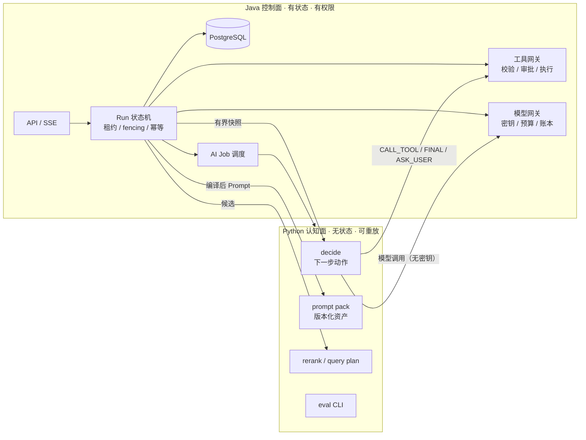
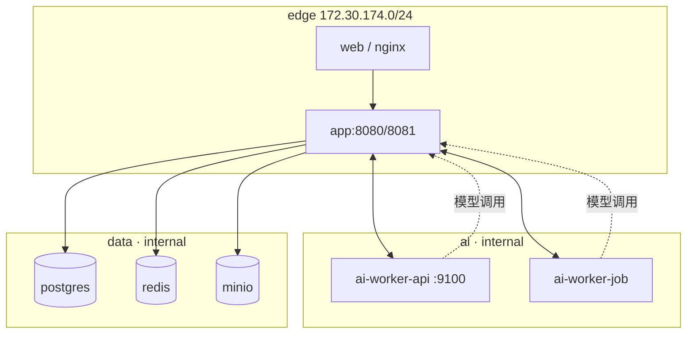

# AI Collab｜Java 控制面 + Python 认知面：目标架构与双轨实施规划

> **版本**：V2.1（定稿设计，取代 V1.0 ADR 的归属表与波次；V2.1 修订 §1.4 边界，见 §13 D9）
> **日期**：2026-11-11
> **代码基线**：W2/J2 交付后 `dev`，迁移最新 **V90**；下一版本 V91
> **性质**：设计定稿；**不是**已完成/已上线声明。落地证据仍按 `IMPLEMENTED / TESTED / LIVE_VERIFIED / NOT_VERIFIED / BLOCKED` 分层记录。
> **取代关系**：本文取代 `AI-Collab-2026-11-10.md` §1.3「不增加 Python 微服务」、§5.1「Skill 为可选未来概念」，以及 `docs/backend-agent-redesign.md` 第 9 行的单语言结论。这三处必须按 §14 修订，不得并存。
> **关联**：[Python AI 旁路评估](../archive/research/python-ai-sidecar-evaluation-20261111.md)、[架构评审 Prompt](../archive/prompts/python-ai-architecture-review-prompt-20261111.md)、[AC-07 Memory V2 设计补充](AI-Collab-AC-07-Agent-Memory-V2-设计补充-2026-11-10.md)

---

## 1. 决策

### 1.1 一句话

**Java 保留产品运行时与所有不可逆动作；Python 承担模型侧的认知计算。在线 Agent 的状态机仍在 Java，Python 只做无状态的一轮决策。**

这不是"再建一套 Agent Runtime"，而是把"大脑"和"手脚"分开：



### 1.2 三条判据（唯一裁决标准）

| 判据 | 归属 |
| --- | --- |
| 触碰业务真相、权限、审批、写操作、DB 事务、租约、SSE、密钥、模型账本 | **Java** |
| 无状态、可重放、失败可重来、只产出候选/建议/报告 | **Python** |
| 跨语言 | Java 编排并落库，Python 计算，契约版本化，Java 对输出二次校验 |

"和 AI 有关"不构成迁移理由。按此判据，Java 侧约 5 万行 AI 相关代码中，真正该迁的是 **20 个含提示词的文件 + 3 个模型输出解析器 + 2 处检索认知逻辑**，约 2–4k 行；其余是运行时不变量。

### 1.3 业务不变量（任何迁移都不得破坏）

1. `ProjectAccessGuard` 项目隔离；`AgentHistoryVisibilityService` 撤权即时生效。
2. 写操作必须 `AgentApprovalService` 审批后执行；approve 前无副作用。
3. Run 租约/fencing、事件序号、`Last-Event-ID` 续传、幂等结算。
4. Provider 密钥只在 Java；出网策略只在 Java。
5. Memory 的 create/update/disable/supersede 走 `requireAdmin` + CAS + 来源核验。
6. 未知即未知：`usage` 缺失标 `UNKNOWN`，价格缺失标 `UNKNOWN_PRICE`，不填 0。

### 1.4 边界：Python 扩范围，不扩真相与密钥

> V2.1 修订（见 §13 D9）：本节区分「认知范围」（可以大方交给 Python）与「真相/密钥授权」（不能当权限发放）。§1.3 的业务不变量不因本节放宽。

**红线（工程不变量，不可交易）**

- **单一写者**：Python 不连 PostgreSQL / Redis / MinIO，不装 `psycopg`/`asyncpg`/`SQLAlchemy`/`redis`/`boto3`/`minio` 等客户端，不写任何业务表。
- **密钥只在 Java**：Provider API Key、`JWT_SECRET`、KMS/Ed25519 私钥都不进 Python；模型调用一律经 Java 网关（无密钥）。
- **不可逆动作只在 Java**：审批、写操作执行、租约/fencing、事件序号/`Last-Event-ID`/SSE 顺序、幂等结算、模型账本、Run 状态机都留 Java；Python 不接收 `leaseEpoch` 写权，只回显，Java 用它 fence 迟到结果。
- **撤权即时**：Python 不缓存权限结论；结果回到 Java 由 `AgentHistoryVisibilityService` 复核。
- **不引入第二套生产运行时**：LangGraph / LangChain / LlamaIndex / CrewAI / AutoGen / OpenAI Agents SDK / PydanticAI 等不得进入请求链路（eval 与研究中可试用）。Agent Loop、审批、SSE、租约不迁 Python。
- **本轮不做 L3**（Python 持 Run 状态）。作为有条件未来项保留，前提是先设计出"单一状态权威"；在此之前不焊死为永久红线。

**范围（明确放开给 Python）**

- 全部提示词资产与渲染、全部模型输出解析与修复。
- Neural Rerank、Query Understanding、Agent 单轮决策（**允许一轮内有界多步推理**，仍只输出建议）、Planning 草稿、Memory 候选提取、MCP 工具目录归一化、离线 `ai-eval`。
- 数据获取：**有界快照 + 按需调用 Java 只读内部 API**（短时效、最小 scope、`aud` 绑定的 scoped token；Java 侧强制项目边界与限流），仍不直连 DB。
- 模型调用：每轮可**多次**调用模型（Java 网关卡预算与账本），可在 `modelAlias` 白名单内选择。

**仍然不做（非目标）**

- Prompt 管理 UI、插件市场、向量库替换、无谓微服务拆分。

---

## 2. 术语裁定：Skill 退场

### 2.1 为什么必须改名

`AgentSkill` 现在同时承担 7 种职责，且"Skill"在 2025-12 后已被 `agentskills.io` 的 `SKILL.md` 标准占用（目录 + YAML frontmatter + 渐进披露 + 模型按 description 自主选择）。本项目的实现恰好相反：硬编码 Java 类、关键词选择、无加载资产。

代码已证明名实分离：

- `AgentToolRegistry.java:113-119`：主运行工具 = `BASE_READ_ONLY_TOOLS ∪ skill.allowedTools() ∪ 澄清工具`，只读工具**只能加不能减**，`AgentSkill.java:8` 的"只决定工具白名单"不再成立。
- `AgentRuntimeCoordinator.java:832-857`：运行时匿名 record 造出 `CHILD_DOCUMENT_RESEARCH`，场景退化为运行时投影。
- 同文件 `:853`：`skill instanceof AgentRuntimeCoordinator ChildResearchSkillViewMarker` 实为模式变量写法，对场景视图恒 false，真正生效的是字符串比较。

### 2.2 三层拆分

| 概念 | 定义 | 归属 | 数量 |
| --- | --- | --- | --- |
| **Scenario** | 产品预设：身份、入口、工具授予、写/外部开关、输入 Schema | Java | 6（现有 code 不变） |
| **PromptPack** | 模型指令资产：`instruction`、`outputContract`、推荐语、few-shot | Python（版本化文件） | 每 Scenario 1 个 |
| **Workflow** | 有确定性步骤与确认的状态机 | Java 服务 | 2（`MEETING_TO_TASKS`、`ITERATION_PLANNING`） |

Scenario 目录里用 `category: SCENARIO | WORKFLOW` 区分，不建两套注册表。

### 2.3 改名范围（只改类型与语义，不改数据）

| 现在 | 改为 | 说明 |
| --- | --- | --- |
| `AgentSkill` | `AgentScenario` | 接口 |
| `AgentSkillRegistry` | `AgentScenarioRegistry` | 注册表 |
| `allowedTools` | `grantedTools` | 语义是"追加授予 + 写工具必须显式列出" |
| `recommendedRoutes` | `entryRoutes` | 仅 UI 推荐，不参与选择 |
| DB `agent_run.skill_code` | 不改 | 历史值兼容 |
| API `/agent/skills`、字段 `code` | 不改 | 响应增加 `scenario`、`category` 别名 |

前端仅 3 个文件引用：`ai-collab-frontend/src/modules/agent/{agent-api.ts,types.ts,use-agent-workspace.ts}`。

---

## 3. 部署拓扑



| 项 | 决策 |
| --- | --- |
| 可部署单元 | **1 个**：`ai-collab-ai-worker`；两个进程角色 `api`（同步认知）与 `job`（异步提取） |
| 网络 | 新增 `ai: internal: true`（如 172.30.175.0/24）；`app` 加入 `ai`，worker 只挂 `ai` |
| 为什么不用 `data` | 会让 Python 在网络上可达 PG/Redis/MinIO 端口，与红线冲突 |
| 出网 | worker 无公网出口；唯一出站是 `app` 的内部端点 |
| 生产默认 | `AI_WORKER_ENABLED=false`；开关打开才创建容器 |
| 资源 | `mem_limit 768m`、`cpus 1.0`、`pids_limit 256`、`read_only`、`tmpfs /tmp`、`cap_drop ALL`、`no-new-privileges` |
| 端口 | 不发布宿主端口；`9100` 仅 `ai` 网内供 Prometheus 抓取 |

---

## 4. 能力归属总表

| 能力 | Python | Java | 生效批次 |
| --- | --- | --- | --- |
| PromptPack（RAG/场景/规划/重排/摘要） | 模板、版本、变量渲染、manifest | 拉取、缓存、`promptVersion` 记录、输出安全校验 | J2/P0 |
| Neural Rerank | 打分 Prompt、模型调用、分数解析 | 候选身份、权限、超时、降级、证据不可变 | J3/P1 |
| Query Understanding | 意图、指代、改写、子查询 | 长度上限、过滤参数白名单、最终检索执行 | J3/P2 |
| Agent 单轮决策 | 下一动作建议（`CALL_TOOL/FINAL/ASK_USER/NO_OP`） | 工具校验、权限、审批、执行、状态机 | J4/P2 |
| Context 规划与摘要 | 摘要 Prompt、裁剪建议 | Token 预算、持久化、恢复、CAS、账本 | J4/P3（后置） |
| Planning 草稿与修复 | 骨架/详情/补丁 Prompt、格式修复 | Schema、成员/来源校验、版本、确认、落库 | J5/P3 |
| Memory 候选提取（Dreaming） | 无状态提取器 | Job 表、租约、候选审核、发布、撤权 | J5/P3 |
| MCP Host/Client 与工具目录 | `initialize/tools/list/tools/call`、Schema 归一化、自动展开 | MCP Gateway、凭据、出网、schemaHash、清洗、审计 | J6/P4 |
| MCP Server（对外） | 第二个互通测试客户端 | 实现与鉴权 | 不在本轮 |
| 检索执行（pgvector/过滤/重排落地） | 不迁 | 全部 | — |
| Provider HTTP/SSE/密钥/重试 | 不迁 | 全部 | — |
| SSE/BFF/续传 | 不迁 | 全部 | — |
| 审批、租约、幂等、账本、事务 | 不迁 | 全部 | — |
| 文档解析（Tika）/MinIO/索引状态机 | 不迁 | 全部 | — |
| 离线评测 | `ai-eval` CLI、统计、报告 | 冻结集与导出、真实调用预算 | P0 |
| 本地 Embedding/Rerank 模型 | 可选 extra，独立镜像 | 模型配置、出网、预算 | 条件性，暂不做 |

---

## 5. Java 侧规划

### 5.1 删除 / 简化 / 保留

**删除（按优先级）**

| 优先级 | 对象 | 原因 | 前置条件 |
| --- | --- | --- | --- |
| 最高 | `TokenEstimator`、`PlanningTokenEstimator`、Composer/Summarizer 的 `chars/3`（`AgentModelMessageComposer.java:236`、`AgentContextSummarizer.java:355/464/983`） | 同一业务量四套口径 | 新计量服务与差异报告 |
| 最高 | `AgentScenarioRegistry`（现 `AgentSkillRegistry`）的 `:25-74` 关键词表与 `select()` 关键词分支 | 用 `contains` 模拟意图分类 | 场景分布统计 + 一个发布周期兼容 |
| 高 | `LegacyReadOnlyAgentExecutor`、`AgentDecisionParser`、`legacyMode`、`RoutingAgentModelExecutor` 的 Legacy 分支（`:96-108`） | 第二套 Agent 协议：不同消息格式、500 字符截断（`:194-197`） | CHAT-only 真实调用量为 0 + 配置迁移 |
| 高 | `DocumentSearchService.java:31-43、147-173` 中文来源正则 | 自然语言正则不可靠 | 前端文档选择器 + `documentIds` |
| 高 | `KnowledgeQuestionApplicationService`/`KnowledgeStreamQuestionService`/`KnowledgePromptProvider` 三份问答 Prompt | 同一 Prompt 三份副本，且两处保留 `promptProvider == null` 回退 | PromptPack 上线 + 一致性回归 |
| 高 | `AgentContextProperties.java:18` 的 `composerV2=false` 回退 | 双路径长期并存 | 全量 Run 迁移 + 恢复回归 |
| 中 | 六个 Scenario 类中的 `instruction/outputContract` 正文 | 迁 PromptPack | J2 完成 |
| 中 | `NeuralModelReranker.java:33-38、112-165、186-230` 的 Prompt 与解析 | 迁 Python | P1 rerank 灰度通过 |
| 中 | `McpAgentToolProvider` 的 MCP→`AgentTool` 包装、`AgentToolRegistry` 外部 MCP 分支 | 统一 `ToolDescriptor` | J6 双客户端互通 |
| 低 | 项目级 Embedding 配置接口/表（若仍存在） | 与全局模型档案重复 | 兼容窗口 + 数据归档 |

**简化**

| 对象 | 现状 | 目标 |
| --- | --- | --- |
| `AgentModelMessageComposer` | 800+ 行、6 种职责、双路径 | 拆 `ContextPlanner`（选什么）/`ContextRenderer`（怎么排）/`ContextBudgeter`（装不下怎么办）三个纯函数；行为不变 |
| 检索入口 | QA/流式/Agent/规划四套装配，`KnowledgeSearchAgentTool:149-153` 静默降级 | 唯一 `ProjectKnowledgeRetrieval` 门面：权限、READY、撤权、Embedding 快照、候选池、引用身份统一 |
| `AgentRuntimeCoordinator` | 子场景用 `instanceof` + 字符串识别 | 显式 `Scope` 值对象，删除 `ChildResearchSkillViewMarker` |
| Tool 目录 | 内部工具与 MCP 工具两套构造 | 统一 `ToolDescriptor`（name/description/inputSchema/risk/execution/schemaHash） |

**保留（不得借迁移删除）**

`ProjectAccessGuard`、`AgentHistoryVisibilityService`、`AgentApprovalService`、租约/fencing、事件序号与 `Last-Event-ID`、幂等结算、`ModelSecretCipher`、`McpEndpointPolicy`、`McpResultSanitizer`、`KnowledgeOutputSafetyGuard`、`KnowledgeCitationValidator`、写工具审批链。

### 5.2 批次总表

| 批次 | 主题 | 交付 | 退出条件 |
| --- | --- | --- | --- |
| **J0** | 地基 | 统一 `TokenMeasurement`（优先复用现有 `TokenCount/TokenCountSource`，**默认不新增迁移**）、取消 256K 绝对顶、Scenario 改名、检索门面 | `mvnw verify` 全绿；历史 Run 可恢复；新旧 Token 口径差异报告；**行为变化可控且可解释**：用近 30 天真实请求回放对比场景分布与压缩触发点，每一处差异有归因与开关 |
| **J1** | 清理 | Legacy 退出、文档范围结构化、`composerV2` 回退删除、重复 Prompt 收敛到临时单例 | 回归全绿；误路由/误范围样例会签 |
| **J2** | PromptPack 接入 | `PromptCatalogClient` + 本地缓存 + manifest 校验；删除 Java 内 Prompt 正文 | 同文本一致性测试通过；`promptVersion` 可在 Run 中追溯 |
| **J3** | 检索认知接入 | rerank shadow→canary；query plan shadow | Recall 不降、引用支持率不降、P95 在预算内 |
| **J4** | Agent 单轮决策 | 只读场景 decide shadow→canary | 决策一致率 ≥98%、无效工具调用不增、恢复/审批回归全绿 |
| **J5** | 规划与记忆 | planning draft、memory dreaming（Job + 提取器影子） | Schema/来源/审批零绕过；重复候选率达标 |
| **J6** | MCP 平面 | Java MCP Gateway + Python Host/Client | 两客户端互通、越权/限流/撤权用例通过 |

### 5.3 关键批次说明

**J0（必须先做，否则不要迁）**

1. `TokenMeasurement(input, output, source, provider, model, requestId)`，`source ∈ PROVIDER | EXACT_TOKENIZER | ESTIMATE | UNKNOWN`；删两个 domain 估算器与全部 `chars/3`。
2. 先核对 `AgentRunEventRecorder.usageBasis(...)`（`:1700-1715`）：现状只落 `PROVIDER / ESTIMATED / UNKNOWN` 三值，由"有没有 provider tokens"推导。**优先在应用层做映射，不新增迁移**；只有确需持久化 `TOKENIZER` 时才新建 V90 扩 CHECK。已在代码中的 `TokenCount/TokenCountSource` 是既有抽象，应扩展或映射，**不要另造平行类型**。
3. 单次输入上界改为 `H = verified_window - reserved_output - safety_margin`；删除 `AgentContextBudget.java:33` 的 `256_000`；窗口未知时进保守模式并可见告警。
4. Scenario 改名 + `grantedTools` 语义化；删关键词表；`DOCUMENT → MEETING_TO_TASKS` 硬映射删除（前端显式选择）。
5. 检索门面 `ProjectKnowledgeRetrieval`，四个调用方改为依赖它；删除 `KnowledgeSearchAgentTool` 的可选注入与静默降级（缺 Bean 即启动失败）。

**J1 的删除纪律**：Legacy 先用一个发布周期统计 CHAT-only 的 Agent 调用量，非 0 则先做配置迁移与用户通知；删代码与删配置分开两次发布。

**J2 的失败语义**：Prompt 不可用 → AI 请求**快速失败**（`AI_PROMPT_UNAVAILABLE`），不得静默使用旧 Prompt；但 Java 保留"上次成功版本"的内存缓存，避免 Python 抖动放大成全站不可用。

**J4 的边界**：Python 返回 `CALL_TOOL` 只是建议。Java 仍执行：工具名存在性、JSON Schema、项目权限、`grantedTools`、写审批、预算、幂等。**Python 的返回值不构成任何授权。**

---

## 6. Python 侧规划

### 6.1 仓库与模块

独立仓库 `ai-collab-ai-worker/`（与后端同版本节奏，独立镜像发布）：

```text
ai-collab-ai-worker/
  pyproject.toml  uv.lock  .python-version  Dockerfile  .dockerignore
  src/ai_collab_worker/
    main.py            # FastAPI 装配
    config.py          # pydantic-settings，env allowlist
    api/               # prompts / rerank / rag / decide / planning / jobs / health
    auth/              # job token 公钥校验；内部调用签名
    clients/           # java_gateway（模型+快照+结果）
    contract/          # Pydantic 模型 + JSON Schema 快照
    prompts/           # PromptPack 文件（唯一来源）
    cognition/
      rerank/          # 打分、解析、截断
      query/           # 意图、改写、子查询
      decide/          # 单轮决策
      planning/        # 草稿与修复
      memory/          # 候选提取
    eval/              # 冻结集读取、指标、报告
    observability/     # OTel / Prometheus / structlog
    security/          # 脱敏、长度限制、注入防护
  tests/{unit,contract,integration}
```

`api` 与 `job` 共用镜像，用启动参数区分角色（`--role api|job`），不拆两个镜像。

### 6.2 技术栈与禁入清单

采用：CPython 3.13（ML 轮子阻塞则整体 3.12）、uv、FastAPI + Pydantic v2、httpx + tenacity、structlog、OTel SDK、prometheus-client、pytest/respx/hypothesis、ruff + mypy --strict。

禁入（生产镜像）：LangChain/LangGraph/LlamaIndex/CrewAI/AutoGen/OpenAI Agents SDK/PydanticAI；`psycopg/asyncpg/SQLAlchemy/redis/boto3/minio`；Celery/RQ/Dramatiq/APScheduler；`openai/anthropic/google-genai`；torch/transformers。

### 6.3 批次

| 批次 | 交付 | 退出条件 |
| --- | --- | --- |
| **P0** | 仓库骨架、`/healthz` `/readyz` `/metrics`、contract 快照、PromptPack 文件与 manifest、`ai-eval` CLI（读冻结集，输出 canonical JSON + SHA256） | `uv sync --frozen` 可复现；ruff/mypy/pytest 全绿；零 DB/零密钥；与 Java 同输入产出可比 |
| **P1** | `/v1/rag/rerank`（经 Java 网关调模型；超时/降级/幂等） | shadow 对比：NDCG/引用支持率不降；P95 ≤ 800ms |
| **P2** | `/v1/rag/plan`、`/v1/agent/decide` | shadow 决策一致率 ≥98%；JSON 合法率 ≥99.5% |
| **P3** | `/v1/planning/draft`、Memory 提取器（Job 模式） | Schema 校验一次通过率 ≥95%；影子候选与人工判断一致率达标 |
| **P4** | MCP Host/Client（只连 Java Gateway） | `tools/list` 与 Java 发现结果逐项一致；禁用/撤权/超时语义一致 |

### 6.4 契约纪律

- 所有响应带 `schemaVersion`；**只加字段，不改语义**；破坏性变更必须新端点。
- 所有请求带 `deadlineMs`；Python 必须在 deadline 前返回，超时返回 `DEADLINE_EXCEEDED`，不得返回半成品。
- 所有模型调用带 `callId`（`runId:attempt:turnNo:kind:index`），Java 侧幂等去重与计费。
- Python 不写业务表、不生成预签名 URL、不代理 SSE、不读 Cookie。

---

## 7. 跨语言契约

### 7.1 通用约定

| 项 | 约定 |
| --- | --- |
| 传输 | HTTP/1.1 + JSON（orjson），内部网络；`traceparent` 透传 |
| 编码 | UTF-8；单请求体上限 2 MiB；响应上限 4 MiB |
| 超时 | 客户端 connect 2s / read = `deadlineMs + 5s`；服务端硬 deadline |
| 重试 | 仅 Java 侧重试瞬时失败（连接失败/502/503/504），指数退避 ≤2 次；**非幂等端点不重试** |
| 幂等 | 请求头 `Idempotency-Key`；服务端按 key 缓存 10 分钟结果 |
| 错误 | 统一 `{code, message, retryable, details?}`；`code` 为大写下划线 |
| 版本 | 路径带 `/v1`；响应带 `schemaVersion` |

错误码：`INVALID_REQUEST`、`DEADLINE_EXCEEDED`、`MODEL_UNAVAILABLE`、`MODEL_RATE_LIMITED`、`PROMPT_UNAVAILABLE`、`BUDGET_EXCEEDED`、`SCHEMA_VIOLATION`、`CONTENT_BLOCKED`、`INTERNAL`。

### 7.2 PromptPack

```http
GET /v1/prompts/manifest
→ {"schemaVersion":1,"prompts":[{"key":"knowledge.system","version":"2026-11-11.1","sha256":"…","chars":3180}]}

GET /v1/prompts/{key}/{version}
→ {"key":"knowledge.system","version":"2026-11-11.1","sha256":"…","text":"…","variables":["locale","docScope"]}
```

规则：Java 启动时拉 manifest 并预取所需 key；`sha256` 与文本不匹配即拒绝；运行期刷新失败保留上次成功版本但打点告警；**不做在线编辑**，改 Prompt 走代码评审 + 发布。

### 7.3 Rerank

```http
POST /v1/rag/rerank
{"schemaVersion":1,"query":"…","topK":8,
 "candidates":[{"id":"c1","title":"…","text":"…"}]}
→ {"schemaVersion":1,"scores":[{"id":"c1","score":0.83}],"modelAlias":"rerank-default","usage":{…}}
```

约束：候选 ≤50、单条 ≤2000 字符、`deadlineMs` 默认 3000；返回分数必须覆盖全部输入 id；缺失 id 由 Java 记 `PARTIAL_SCORE` 并使用启发式分数。

### 7.4 Query plan

```http
POST /v1/rag/plan
{"schemaVersion":1,"query":"…","locale":"zh-CN","historySummary":"…","documentIds":["…"]}
→ {"schemaVersion":1,"rewrittenQuery":"…","subQueries":["…"],"filters":{"documentIds":["…"]},"confidence":0.78}
```

约束：`filters` 只允许 `documentIds`、`docTypes`、`dateRange`；Java 校验 id 属于本项目且用户可见；`confidence < 0.5` 时 Java 使用原查询。

### 7.5 Agent decide（核心）

```http
POST /v1/agent/decide
{
  "schemaVersion":1,
  "runId":"…","attempt":2,"turnNo":5,"snapshotHash":"sha256:…",
  "scenario":{"code":"PROJECT_RESEARCH","category":"SCENARIO","promptPack":"scenario.project_research@2026-11-11.1"},
  "goal":"…","locale":"zh-CN",
  "context":{"facts":[…],"messages":[…],"observations":[…]},
  "tools":[{"name":"search_project_knowledge","description":"…","inputSchema":{…},"risk":"READ_ONLY"}],
  "policy":{"allowWrite":false,"allowExternal":false},
  "budget":{"maxInputTokens":24000,"maxOutputTokens":2000,"deadlineMs":90000}
}
→ {
  "schemaVersion":1,
  "decision":"CALL_TOOL",
  "toolCall":{"name":"search_project_knowledge","arguments":{"query":"…"}},
  "usage":{"inputTokens":8123,"outputTokens":96,"source":"PROVIDER"},
  "promptVersion":"2026-11-11.1","modelAlias":"agent-main","latencyMs":2140
}
```

规则：

1. `decision` 只允许四个值；未知值 → Java 422 并记 `CONTRACT_VIOLATION`，不猜测执行。
2. `toolCall.name` 必须在本次下发的 `tools` 内且通过 Schema；否则丢弃并让模型重试一次（有上限）。
3. 幂等键 `(runId, attempt, turnNo, snapshotHash)`；重复请求返回缓存结果。
4. Python 不接收 `leaseEpoch` 的写权限，只回显；Java 用它 fence 迟到结果。
5. 流式输出仍由 Java 从模型网关直接消费；**decide 端点不返回 token 流**，避免双通道。

### 7.6 Planning draft

```http
POST /v1/planning/draft
{"schemaVersion":1,"goal":"…","projectFacts":{…},"template":"ITERATION","constraints":{"maxTasks":30}}
→ {"schemaVersion":1,"plan":{"milestones":[…],"tasks":[…]},"warnings":[…],"usage":{…}}
```

Java 必须重跑 `TaskPlanDraftValidator`：成员存在性、来源 id、日期、依赖环、数量上限、版本。Python 输出的 `warnings` 只作提示，不能替代校验。

### 7.7 异步 Job（Memory Dreaming）

| 方向 | 端点 |
| --- | --- |
| Java → Python | `POST /v1/jobs`（仅 jobId/type/deadline/schemaVersion，不含快照） |
| Python → Java | `GET /internal/ai/v1/jobs/{id}/snapshot`、`POST .../model-calls`、`POST .../heartbeat`、`POST .../results` |

Job 状态机在 Java：`QUEUED → LEASED → RUNNING → SUCCEEDED/FAILED_RETRYABLE → FAILED/CANCELED/EXPIRED`。Python 无调度器、无重试决策权。

### 7.8 鉴权

- 内部调用使用 job-scoped token（Ed25519，Java 持私钥、Python 只持公钥），claims 含 `jobId/attempt/leaseEpoch/projectRef/scopes/snapshotHash`。
- 同步端点（prompts/rerank/plan/decide）使用**短期服务令牌**（5 分钟，`aud=ai-worker`，`sub=backend`），不复用用户 JWT、不复用 `JWT_SECRET`。
- 所有内部端点只允许来自 `ai` 网络的 `app` 容器；nginx 不代理 `/internal/**`。

---

## 8. 数据归属

| 表 | 写者 | 说明 |
| --- | --- | --- |
| `agent_run` / `agent_step` / `agent_event` | Java | Python 不写 |
| `agent_usage_settlement` / `model_cost_ledger` | Java | 唯一账本 |
| `ai_model_profile`（V89） | Java | Python 只读 `modelAlias` |
| `ai_job` / `ai_job_attempt` / `ai_job_model_call` / `ai_job_result`（V90 起；若 J0 需要扩 `usage_basis` 则顺延为 V91） | Java | Python 通过 API 读写 |
| `agent_memory*` | Java | Python 只提交候选 |
| Prompt | 仓库文件（Python） | Java 缓存，不入库 |

---

## 9. 双轨路线图

| 波次 | Java | Python | 依赖 | 回滚 |
| --- | --- | --- | --- | --- |
| **W0** | J0 地基 | — | 无 | 关开关即回旧口径（保留旧估算器一个版本） |
| **W1** | J1 清理 | P0 骨架 + PromptPack + eval CLI | W0 | 停止 Python 进程，Java 用临时单例 Prompt |
| **W2** | J2 PromptPack 接入 | P0 收尾（manifest/缓存契约） | W1 | `prompt.registry.enabled=false` |
| **W3** | J3 rerank 接入 | P1 rerank | W2 | `rerank.mode=java` |
| **W4** | J4 decide 接入（仅 `PROJECT_RESEARCH` 只读） | P2 plan + decide | W3 | `decide.mode=java` |
| **W5** | J5 规划/记忆 | P3 planning + memory | W4 | 关 `AI_WORKER_ENABLED`，Java 保留原路径 |
| **W6** | J6 MCP Gateway | P4 MCP Host | W5（可与 W5 并行） | 关 Gateway，恢复 `McpAgentToolProvider` |

**顺序理由**：J0 不完成就迁 Python，会把"四套 Token 口径"变成"跨语言两套账"；rerank 先于 decide，因为它是无状态纯函数、失败易降级，可以最低成本验证跨语言链路；MCP 放最后，因为它的收益依赖 decide 已经接管工具选择。

**每一波都必须满足**：上一波线上稳定 ≥5 个工作日、无 P1 事故、Java 旧路径已删或明确标记待删。

---

## 10. 质量门禁

### 10.1 上线前（每批）

1. Java：`mvnw verify` 全绿；前端 typecheck/build；Flyway 前向迁移在空库与生产快照各跑一次。
2. Python：`uv sync --frozen`、ruff、mypy --strict、pytest、契约 fixture 双向校验。
3. 契约：JSON Schema 快照入库；破坏性字段变更直接失败。
4. 安全：Python 环境变量 allowlist 校验（出现 `JWT_SECRET`/`POSTGRES_*`/`*_API_KEY` 即启动失败）；容器网络断言（无 `data` 网）。
5. 恢复：Python 崩溃、超时、502、部分响应 5 种故障各跑一次，Java 侧行为符合预期且不重复计费。

### 10.2 灰度门禁

| 能力 | shadow 指标 | canary 条件 |
| --- | --- | --- |
| rerank | NDCG@8、引用支持率、P95 | 三项不降，P95 增量 ≤300ms |
| query plan | Recall@10、无效过滤率 | Recall 不降，误改率 <2% |
| decide | 决策一致率、工具参数合法率、无效调用数 | 一致率 ≥98%，合法率 ≥99.5%，无效调用不增 |
| planning | Schema 一次通过率、人工驳回率 | 通过率 ≥95%，驳回率不升 |

### 10.3 止损线

任一项触发即回滚并冻结该波次：跨项目数据泄露、审批被绕过、重复计费、P95 增幅 >50%、错误率 >0.5%、Python 故障导致主站 AI 不可用。

---

## 11. 成本与容量

| 项 | 取值 |
| --- | --- |
| worker 副本 | 3（`api` ×2 + `job` ×1；`job` 单副本避免重复提取） |
| 并发 | `api` 每副本 8；模型调用并发受 Java 网关卡口约束 |
| 单轮额外开销目标 | P95 ≤ 150ms（不含模型），P99 ≤ 400ms |
| 快照大小 | ≤256 KiB；超限则 Java 裁剪并记 `SNAPSHOT_TRUNCATED` |
| Token 账本 | 仍由 Java 按 Provider usage 结算；Python 上报的 usage 仅作对账 |
| 成本观测 | 每能力独立指标：调用数、token、延迟、失败率、降级率 |

---

## 12. 风险与止损

| 风险 | 影响 | 缓解 |
| --- | --- | --- |
| 范围漂移（在线 Loop 搬 Python） | 两套状态机 | 本文 §1.4 + 契约 CI 断言；PR 模板要求引用批次 |
| 跨语言延迟叠加 | 首字延迟上升 | decide 只在工具轮之间调用，不进入流式主路径；P95 门禁 |
| Prompt 双份漂移 | 行为不一致 | 单一来源 + sha256 校验 + 一致性测试 |
| Python 成为影子权限中心 | 越权 | Python 不落库、不下发授权；Java 每次重校验 |
| 快照后撤权 | 数据泄露 | 结果接收复核 `AgentHistoryVisibilityService`；快照 TTL 5 分钟 |
| 双计费 | 客户投诉 | `callId` 幂等 + `(job,attempt,call)` 唯一键 |
| 供应链 | 镜像风险 | 生产不装 eval/local-ml extra；pip-audit/trivy/SBOM |

---

## 13. 决策记录

| # | 决策 | 被否方案 | 理由 |
| --- | --- | --- | --- |
| D1 | L2.5：Python 只做单轮无状态决策 | L3：Run 状态机迁 Python | 会产生两套租约、两套恢复语义、两套账本 |
| D2 | Python 不连 DB、不持密钥 | Python 直连 pgvector + 自建 Job 表 | 安全边界与账本会分裂；运维成本翻倍 |
| D3 | `Skill → Scenario`，`skillCode` 保留 | 全量改名含 DB 列 | 历史 Run、定时任务、前端契约成本高、收益低 |
| D4 | Prompt 为版本化文件，不做管理 UI | 数据库 Prompt CMS | 数千客户产品更需要可审计的 Git 变更，而非在线编辑 |
| D5 | rerank 先于 decide | 同时上线 | 纯函数、易降级，可先验证跨语言链路 |
| D6 | MCP：Python Host + Java Gateway | MCP 全给 Python | 否则要复制凭据、出网、schemaHash、撤权四套控制 |
| D7 | Dreaming 用 Java Job + Python 提取 | Python 自建调度 | 避免第二套重试/租约/幂等 |
| D8 | 不引入 LangGraph 等生产运行时 | 用框架重写编排 | 会绕过审批、预算与租约 |
| D9 | V2.1 修订 §1.4：认知范围放开给 Python（全部提示词/解析/rerank/query/decide/planning/memory/MCP/eval；单轮内可有界多步、快照+按需只读内部 API、每轮多次模型调用），但真相与密钥授权不变（不连 DB、不持密钥、不写业务表、不执行不可逆动作、不持 Run 状态机） | 原 §1.4 把"认知范围"与"授权边界"混为"非目标" | 扩脑力不扩手权：每一条"给 Python 更多活"都不制造第二个写者或第二份密钥；§1.3 业务不变量保持不变 |

---

## 14. 对既有文档的修订义务

本设计获批后，必须同批修订，否则文档互相矛盾：

| 文档 | 需改内容 |
| --- | --- |
| `docs/design/AI-Collab-2026-11-10.md` | §1.3 非目标删除"不增加 Python 微服务"；§5.1 用 §2 术语替换；§9 批次表标注被本文 W0–W6 取代 |
| `docs/backend-agent-redesign.md` | 第 9、28、29、58 行的单语言结论加"已被 2026-11-11 V2.0 设计取代" |
| `docs/architecture.md` | §6「6 个固定 Skill」改为 Scenario，并补 Python 认知面一节（J0 完成后） |
| `AGENTS.md` | 若存在"仅 Java"约束，改为本文 §1 的三条判据 |
| `docs/design/python-ai-capability-plane-2026-11-11.md` | 本文件即其 V2.0 |

---

## 15. 需要外部输入（不阻塞开工）

1. Job token 私钥托管方式（KMS / Secret Manager / 环境变量 + `kid` 轮换）。
2. 生产是否已有 OTel Collector；没有则先只承诺 Prometheus + 结构化日志。
3. 是否允许 CI 定时调用真实模型跑 holdout；建议不允许，holdout 只在发版前人工解锁。
4. Dreaming 的保留天数与单 Job 预算上限（建议 30 天 / 单 Job 50 万 token）。
