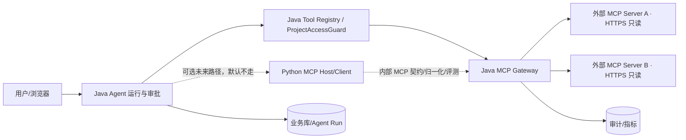

# W6：Java MCP Gateway + Python MCP Host 前置设计

> 日期：2026-11-12（Asia/Shanghai）
> 基线：`dev @ 79e4839b`（泳道冻结提交；共同代码基线 `d4247c34`）
> 性质：**前置评估与设计，不是实现**。W6 实现仍为 `BLOCKED`。
> 依据：[泳道冻结](../archive/handoffs/next-block-freeze-20261112.md)、[Python AI 能力平面](python-ai-capability-plane-2026-11-11.md) §4/§7.8/§9/§10、[W3.5 收口](../archive/report/w3-5-blockers-20261112.md)、[AC-07 Memory V2](AI-Collab-AC-07-Agent-Memory-V2-设计补充-2026-11-10.md) §9/§10

> **2026-11-13 P2-B2 实施增补**：G1（pinned DNS/真实 TLS）、G2（描述/Schema 清洗）、
> G4（在途撤权 fence）已在 default-off 切片中实现并有真实进程证据；Provider 人工准入
> 见 [MCP Provider 只读准入](mcp-provider-admission-2026-11-13.md)。生产 Ed25519 部署、
> 生产 TLS/ingress、监控告警和 canary 仍未完成，生产 W6 仍为 `NOT_READY`。

---

## 0. 结论先行

1. **推荐职责拆分**：Java MCP Gateway 是唯一的外部 MCP 连接、凭据、出网、工具目录、Schema 冻结、参数/授权复核、结果清洗与审计平面；Python MCP Host 只是内部 MCP 协议适配与 Schema 归一化客户端，**不直接连接外部 MCP、不持有凭据、不拥有授权判断**。
2. **推荐首版调用路径**：Java Agent 仍通过 Java Gateway（或其内部 Tool Catalog 接口）直接执行 MCP 工具；Python MCP Host 作为契约互通/归一化/评测客户端，不在 Java Agent 的同步执行主路径上增加一跳。若产品要求 Python Host 进入执行主路径，必须单独立项并给出延迟预算与故障隔离证据。
3. **默认关闭**：W6 实现在得到批准前必须保持 `agent.mcp.gateway.enabled=false`（名称待实现冻结）并保留现有 `McpAgentToolProvider` 回退；不改变本波六个默认开关。
4. **实现仍 BLOCKED**：W3 真实模型 3s 预算/canary、W5 Job 与候选发布闭环未清零；本设计即使评审通过，也不能开始写 W6 代码。
5. **现有 Java MCP 能力不是从零开始**：已有只读工具、两级白名单、Schema Hash 确认、加密凭据、HTTPS allowlist、结果清洗与审计；W6 应抽出 Gateway 边界并修复下述前置缺陷，而不是平行再造一套。

---

## 1. 当前代码事实与差距

### 1.1 已存在的实现（代码级事实）

| 能力 | 当前实现 | 设计判断 |
| --- | --- | --- |
| MCP 连接管理 | `McpAdministrationService` 创建/编辑/测试/发现/启停；`ProjectMcpController` 管项目绑定 | 保留，迁到 Gateway 控制面 |
| 凭据 | `ModelSecretCipher` 加密入库；接口不回明文；Bearer/OAuth 类型枚举 | 保留；Python 永不接触 |
| 出网策略 | `McpEndpointPolicy` 只允许 HTTPS 精确 host、拒绝 user-info/fragment/私网/回环/元数据地址 | 保留并修复 DNS 重绑定窗口 |
| HTTP 传输 | `HttpMcpClientFacade` 不跟随重定向、限制响应字节、支持 Bearer | 保留；补连接级 egress 与在途取消 |
| 只读边界 | `McpAgentToolProvider` 要求 `annotations.readOnlyHint=true` + 连接白名单 + 项目白名单 | 保留；补工具描述/参数上限与更强的只读证明 |
| Schema 冻结 | 发现工具排序后 SHA-256；`schemaHash` 与 `confirmedSchemaHash` 不一致即禁用/拒绝 | 保留并扩展为逐工具 Hash + 聚合 Hash |
| 结果清洗 | `McpResultSanitizer` 标记 `untrusted`、脱敏敏感字段、控制字符清理、数组/字节上限、注入 warning | 保留；以结构化不可信通道为第一道防线 |
| 审计 | 管理操作与 Schema 变化写 `AuditService` | 保留；工具调用审计移到 Gateway 统一出口 |

### 1.2 现有缺口（W6 实现前必须处理）

| 编号 | 缺口 | 影响 | 前置动作 |
| --- | --- | --- | --- |
| G1 | `McpEndpointPolicy.validate()` 解析 DNS 后，`HttpMcpClientFacade` 仍按 hostname 发起连接，存在解析到连接之间的 DNS 重绑定窗口 | 攻击者可把已校验域名解析到私网/元数据地址 | 使用固定解析结果 + TLS SNI/Host、受控 egress proxy，或等价的连接期校验；补重绑定测试 |
| G2 | 当前 Agent 暴露的是发现结果中的原始 `description`/`inputSchema`，没有上下文侧 Unicode/长度/深度/恶意指令处理 | 恶意 MCP Server 可通过工具描述或 Schema 注入模型上下文，造成工具选择/参数误导 | 在进入模型上下文前做归一化、限长、结构校验与不可信标记；原始值仍用于 Hash 审计 |
| G3 | `McpResultSanitizer` 的注入检测是正则 warning，不是权限边界 | 不能把“未命中正则”当成安全 | 结果始终作为不可信数据包装；不得让数据段获得 system/tool 指令权威 |
| G4 | 撤权/停用会使内存客户端失效，但已开始的外部调用没有网关级取消/fence | 撤权后在途调用可能完成并返回 | 每个调用带 catalog/version/lease fence；撤权时取消连接，结果回传前再次校验版本；明确在途结果语义 |
| G5 | 现有 Schema Hash 是聚合 Hash，缺少逐工具 Hash 与目录版本 | 难以精确定位漂移、做工具级审计与灰度 | 增加 `toolSchemaHash`、`catalogVersion`；聚合 Hash 保留兼容 |
| G6 | 现有 Java MCP Host 无 Python Host 契约、无内部工具目录 API、无统一调用审计字段 | 无法验证 Python Host 与 Java 发现结果一致 | 先冻结内部契约与双客户端 fixture，再实现 Host |
| G7 | OAuth 只保存凭证，未设计刷新/撤销/最小 scope 的 Gateway 行为 | 凭据轮换与撤权语义不完整 | W6 实现前明确 OAuth 只支持只读 scope、不得在 Python 展开 |

> 以上是设计输入，不代表本波已修复；G1/G2/G4 是 W6 实现的硬前置。

---

## 2. 目标拓扑与信任边界

### 2.1 推荐拓扑（v1，Python Host 不进入 Java Agent 同步主路径）



关键点：

- Java Gateway 是唯一发起外部 MCP 网络连接的组件；Python 容器没有外部 MCP 出口。
- Python Host 只通过内部网络访问 Gateway；它拿到的是 Java 已授权的只读工具目录，不是外部凭据。
- Java Agent 的工具暴露与执行仍由 `ProjectAccessGuard`、工具白名单、Schema 确认和审批边界控制。
- Python Host 不作为权限中心；即使 Python 返回“可调用”，Java 仍必须重新校验。

### 2.2 信任分区

| 区域 | 组件 | 信任假设 |
| --- | --- | --- |
| 用户/浏览器 | Web、SSE | 不可信输入；只持用户会话 |
| 应用控制面 | Java Agent、Tool Registry、审批、Run 状态机 | 可信业务权威 |
| 安全数据面 | Java MCP Gateway | 可信边界执行点；唯一凭据/出网/审计出口 |
| 认知辅助面 | Python MCP Host | 可信度有限；无密钥、无业务写、无授权；输出只作建议/归一化 |
| 外部 | MCP Server | 默认不可信；可被攻陷、可漂移、可返回恶意文本 |

---

## 3. 职责矩阵

| 能力 | Java MCP Gateway | Python MCP Host | Java Agent |
| --- | --- | --- | --- |
| 外部 MCP `initialize/tools/list/tools/call` | **唯一执行者** | 只对 Gateway 做协议客户端 | 不直连 |
| MCP 凭据/OAuth refresh | **持有、加密、轮换、审计** | 不持有、不读取 | 不持有 |
| 出网 allowlist/SSRF/重定向 | **强制** | 无外部出口 | 不参与 |
| 工具白名单与项目绑定 | **权威校验** | 只做形状/归一化 | 请求前选择工具 |
| Schema Hash/漂移 | **生成、冻结、确认、拒绝** | 归一化后回传；不能自行确认 | 只使用已确认目录 |
| 参数 Schema 校验 | **权威校验** | 可做前置形状检查，不构成授权 | 不能跳过 Gateway |
| 项目/用户/run 权限 | **以可信上下文复核** | 不能裁决 | 传入真实 run 上下文 |
| 审批/写操作 | 写工具不进入 MCP 白名单 | 不实现写 | 走现有审批链 |
| 结果清洗/注入边界 | **最终清洗与包装** | 可做第一次结构化清洗 | 只消费不可信结果 |
| 审计/指标 | **完整调用与管理审计** | 仅本地指标，无敏感正文 | 记录业务事件 |
| 默认关闭/回滚 | Gateway 开关 | Host 开关 | 保留旧 Provider |

### 3.1 明确禁止

- Python 直接连接外部 MCP、直接持有 Bearer/OAuth/cookie、直连 PG/Redis/MinIO。
- Python 决定项目权限、工具授权、是否审批、是否发布。
- 任何 MCP 工具进入写路径或 `ApprovalWriteAgentTool`/`ControlledWriteAgentTool`。
- 自动信任 `readOnlyHint` 或自动确认新 Schema。
- 通过缓存把已撤权工具继续暴露给模型。

---

## 4. 工具生命周期

```text
ADMIN_REGISTERED
  -> TESTED（仅连通性）
  -> DISCOVERED（原始目录快照 + Hash）
  -> REVIEWED（人工确认只读白名单与 Schema）
  -> ENABLED（连接级确认）
  -> PROJECT_BOUND（项目 OWNER 绑定子集）
  -> EXPOSED（Agent 可见）
  -> CALLED / DENIED / FAILED / REVOKED
```

| 状态 | 进入条件 | 失败/退出 |
| --- | --- | --- |
| `DISCOVERED` | 成功 `initialize` + `tools/list` + 基本结构校验 | 网络/协议错误保持未发现 |
| `REVIEWED` | 管理员检查工具名、描述、输入/输出 Schema、只读声明 | 任一写风险或非法名称拒绝 |
| `ENABLED` | `schemaHash == confirmedSchemaHash` 且允许工具非空 | Hash 漂移、停用、凭据失败立即关闭 |
| `PROJECT_BOUND` | 项目 OWNER 显式绑定且项目级白名单非空 | 解绑/成员移除/项目停用立即关闭 |
| `EXPOSED` | 连接、绑定、工具、Hash、权限全部有效 | 任一条件失效则不暴露 |

**人工确认不可由模型代替**。`test` 只证明连通性，不证明只读、安全或质量。

---

## 5. 只读工具白名单

### 5.1 暴露必须同时满足

1. 连接为 `STREAMABLE_HTTP`（或未来明确批准的 HTTPS 传输），`STDIO` 一律拒绝。
2. 远端服务本身是只读端点/只读账号；例如 GitHub 使用 `/readonly` 路径和最小只读 scope。
3. 发现结果 `annotations.readOnlyHint=true`；缺失或 `false` 一律不暴露。
4. 管理员连接级白名单包含该工具，且人工审核通过。
5. 项目 OWNER 项目级白名单包含该工具。
6. 工具 Schema 与确认 Hash 一致，连接/绑定均启用。
7. 工具不声明写能力，不匹配任何写/审批/发布关键字或能力标记。

### 5.2 命名与冲突

- 对外名：`mcp.<connectionCode>.<normalizedServerToolName>`。
- 规范化为小写 `[a-z0-9_]`，长度上限 128；规范化后冲突、空名、重名一律拒绝整个发现结果。
- 工具名、连接 code 与项目绑定必须在同一 `projectId` 下解析；禁止仅凭工具名跨项目猜测连接。
- 工具参数不得包含调用方自报的 `projectId`、`userId`、`role`、`approvalId` 等授权字段；如需项目过滤，由 Gateway 注入并校验。

### 5.3 写工具与审批

- MCP 白名单是**只读白名单**，不是“先调用再由 Java 审批”的写通道。
- 创建/修改任务、里程碑、记忆、发布候选等写操作只能走现有 Java 审批工具；MCP 永远不提供写路径。
- 若未来要支持外部写工具，必须另立威胁模型与产品决策，不得复用本设计。

---

## 6. Schema、Hash 与漂移

### 6.1 归一化

Gateway 对每个发现工具生成稳定的规范对象：

```json
{
  "server": {"connectionCode": "github-readonly", "protocolVersion": "2025-03-26"},
  "tool": {
    "name": "get_file_contents",
    "description": "归一化后的描述",
    "inputSchema": {},
    "outputSchema": null,
    "annotations": {"readOnlyHint": true}
  }
}
```

- Unicode NFC、键排序、无多余空白；数组按工具名/键稳定排序。
- 不把健康状态、时间戳、请求 ID 等易变字段纳入 Hash。
- 原始发现快照单独保存用于审计；Hash 基于规范化对象，避免 JSON 字段顺序抖动。

### 6.2 两层 Hash

| Hash | 内容 | 用途 |
| --- | --- | --- |
| `toolSchemaHash` | 单个工具规范对象的 SHA-256 | 工具级审计、精确漂移定位、白名单绑定 |
| `catalogHash` | 全部已发现工具（按名称排序）及协议/连接 code 的 SHA-256 | 连接级冻结、兼容现有 `schemaHash` |

**规则**：

1. `catalogHash`/`toolSchemaHash` 只在发现时写入候选值；不得直接作为已确认值。
2. 管理员人工检查后写入 `confirmedCatalogHash`/`confirmedToolSchemaHash` 并启用。
3. 任何一次 `tools/list` 或调用前校验发现 Hash 不同，立即：
   - 关闭连接/工具暴露；
   - 清空 Gateway 与 Python Host 缓存；
   - 记 `SCHEMA_DRIFT` 审计与指标；
   - 要求重新发现、人工确认，禁止自动迁移或自动放行。
4. 工具级 Hash 变化不能靠“聚合 Hash 相同”掩盖；聚合 Hash 也不能因新增无关工具而自动批准。
5. Hash 算法与字段清单必须有契约 fixture 和跨语言测试；Python 归一化结果必须与 Java 冻结结果逐字节可比。

---

## 7. 参数校验与授权

### 7.1 分层

| 层 | 做什么 | 不做什么 |
| --- | --- | --- |
| Python Host | JSON 形状、字段名、大小/深度初筛、Schema 归一化 | 不判断用户/项目授权；不擅自补默认值 |
| Java Gateway | 用已确认 Schema 做最终 JSON Schema 校验；工具/连接/项目白名单；run 上下文；语义校验 | 不信任 Python 的“已校验”声明 |
| Java Agent | 工具选择、审批、预算、幂等、状态机 | 不绕过 Gateway 直连外部 |

### 7.2 JSON Schema 校验

- 只允许本地解析的 JSON Schema；禁止远程 `$ref`、网络加载或动态代码。
- 限制 Schema 大小、递归深度、数组项数、字符串长度；超限拒绝，不截断后继续执行。
- 参数总大小建议上限 64 KiB；工具返回仍受连接 `maxResultBytes` 限制。
- `additionalProperties` 按 Schema 执行；对高风险只读工具默认拒绝未声明字段，除非冻结契约明确允许。
- 参数中的路径/URL/仓库标识必须由具体工具适配器做语义校验；禁止把任意 URL 直接传给远端。

### 7.3 授权上下文

- 每个 Gateway 调用必须携带可信 `runId`、`projectId`、用户/项目绑定引用、`catalogVersion`、工具白名单版本。
- Gateway 通过 `ProjectAccessGuard` / Run 状态重新校验项目成员、绑定、审批与租约；不能只依赖 Python 传来的字符串。
- Python Host 使用内部身份（短期 Ed25519 服务令牌或 mTLS）访问 Gateway；静态 token 模式下必须至少绑定来源网络、audience 和 server-side run 上下文，不能仅靠 bearer 字符串。
- 任何“工具存在但当前用户无权”的情况统一返回不泄露存在性的拒绝，不返回工具参数或远端正文。

### 7.4 内部 MCP 契约草案（仅设计，不实现）

Java Gateway 在 `ai` 内部网络暴露一个**仅供 Python Host 使用**的 MCP JSON-RPC 端点，例如 `POST /internal/ai/v1/mcp`；不发布宿主端口、不经 nginx、不接受浏览器/用户 JWT。

| 项 | 草案 |
| --- | --- |
| 方法 | `initialize`、`ping`、`tools/list`、`tools/call`；本波不开放 `resources/*`、`prompts/*` |
| 身份 | 短期 Ed25519 服务令牌，`aud=mcp-gateway`、`sub=backend`，claims 含 `runRef/projectRef/scopes/catalogVersion` |
| 网络 | 仅 `ai` 网络；Python 无外部 MCP 出口；Gateway 不信任来源 IP 作为唯一授权 |
| 幂等/追踪 | 每次调用带 `X-Mcp-Call-Id`；只读调用可重放，但不得据此重复产生外部请求 |
| 超时 | Python 请求 deadline 必须小于 Gateway 的外部 deadline；任一层超时都返回明确错误，不返回半成品 |

`tools/list` 成功结果至少包含：

```json
{
  "schemaVersion": 1,
  "catalogVersion": "project-scoped-version",
  "tools": [{
    "name": "mcp.github-readonly.get_file_contents",
    "description": "已净化、限长的描述",
    "inputSchema": {},
    "toolSchemaHash": "sha256:...",
    "annotations": {"readOnlyHint": true}
  }]
}
```

`tools/call` 成功结果使用显式状态，而不是空对象冒充成功：

```json
{
  "schemaVersion": 1,
  "catalogVersion": "project-scoped-version",
  "outcome": "SUCCEEDED",
  "untrusted": true,
  "data": {},
  "truncated": false,
  "latencyMs": 120
}
```

错误至少区分：`UNAUTHORIZED`、`TOOL_DISABLED`、`SCHEMA_DRIFT`、`PARAM_INVALID`、`NOT_EXECUTED`、`DEADLINE_EXCEEDED`、`RATE_LIMITED`、`PARTIAL`、`TRUNCATED`、`TOOL_REVOKED`、`OUTCOME_UNKNOWN`、`INTERNAL`。`outcome` 与错误码不得合并成只有一个 boolean。

Python Host 只做透传和归一化：不增加默认授权、不重试、不把 `description` 拼成系统指令、不缓存超出 `catalogVersion` 生命周期的工具目录。

---

## 8. 凭据、出网与 SSRF

### 8.1 凭据

- MCP 凭据仅由 Java Gateway 持有，使用 `ModelSecretCipher` 加密；接口、日志、异常、指标、审计均不得出现明文。
- 每个连接独立凭据与 key version；轮换时先验证新凭据，再原子切换；失败保留旧凭据但不得扩大 scope。
- Python Host 只收到“工具目录 + 调用句柄”，不收到 Bearer/OAuth refresh token。
- OAuth 若实现，只允许只读 scope；refresh token 不落 Python 缓存，撤销必须经 Gateway。

### 8.2 出网策略

| 项 | 规则 |
| --- | --- |
| scheme | 仅 `https` |
| host | 精确 allowlist；不带 scheme/port/path/通配符；必要时支持明确后缀策略但需单独审批 |
| port | 仅 443；自定义端口拒绝 |
| user-info/fragment | 拒绝 |
| DNS | 每次连接前解析；拒绝 loopback、私网、链路本地、组播、CGNAT、保留/元数据地址 |
| 重绑定 | 固定解析结果到连接（Host/SNI 正确）或经受控 egress proxy；不能只在 `validate()` 时解析一次 |
| redirect | 不跟随；Location 重新校验后仍拒绝，要求管理员保存最终 URL |
| 出口 | Gateway 专用 egress 网络/代理；Python 无外部出口；阻断非 allowlist 域名与 IP |
| 请求 | 连接/读取超时、响应字节上限、并发上限、无任意 header 透传 |

### 8.3 外部服务前置

- 仅连接已审核的 MCP Provider；记录 owner、数据范围、保留策略、ToS、只读端点与最小 scope。
- GitHub 等 Provider 必须同时使用官方只读端点和最小只读 token，不把工具注解当作唯一写保护。
- 外部服务返回 3xx、401/403、429、5xx、超时分别映射；不得静默改用其他 endpoint。

---

## 9. 提示注入与数据边界

1. **默认不可信**：工具描述、输入/输出 Schema、资源、工具结果全部标记为 `UNTRUSTED_EXTERNAL_CONTENT`；不得获得 system/developer/tool 指令权威。
2. **结构化包装**：进入模型上下文时使用带来源、连接、工具、schemaHash、截断标记的结构化块；正文放在数据字段，不拼接成系统指令。
3. **上下文侧净化**：
   - 去除控制字符、二进制/路径字段按不可支持处理；
   - 敏感字段名/值脱敏；
   - 数组、深度、单条文本和总字节有上限；
   - 工具描述/参数说明限长，禁止把外部文本渲染为可执行指令。
4. **检测只是辅助**：注入正则命中加 warning，未命中也仍然是不可信数据；不能以“未检测到 injection”作为放行条件。
5. **结果语义**：`isError=true` 不代表没有副作用；只读工具也必须区分“未执行/部分结果/结果未知”。截断结果必须显式 `truncated=true`，不得伪装完整。
6. **不回灌**：MCP 正文不得写入长期记忆、审计正文或指标标签；如业务确需保存，必须另做权限、保留与删除设计。

---

## 10. 撤权、停用与审计

### 10.1 撤权触发

- 项目解绑、连接停用、工具从白名单移除、成员被移除、项目停用、凭据失败/轮换、Schema 漂移、Provider 主动撤销。
- 触发后：Gateway 原子更新版本并清缓存；关闭对应连接；Python Host 缓存按 `catalogVersion` 失效；Agent 下一轮不再暴露该工具。
- 在途调用：Gateway 在发送前和结果返回前各校验一次 `catalogVersion + bindingVersion + lease`；撤权后返回 `TOOL_REVOKED` 或 `OUTCOME_UNKNOWN`，不得作为成功结果写入上下文。

### 10.2 审计

每次 `tools/list`、`tools/call`、管理操作至少记录：

```text
timestamp, actorType/actorId, projectId, runId, connectionId/code,
toolName, catalogVersion, schemaHash, decision(ALLOW/DENY),
reason(SCHEMA_DRIFT/TOOL_DISABLED/UNAUTHORIZED/...),
latencyMs, requestBytes, responseBytes, outcome, egressHost
```

- 不记录完整参数、完整结果、凭据、cookie、Prompt 或文档正文。
- 审计只追加；管理操作与工具调用使用同一 correlation/runId，便于追责。
- 审计查询本身需管理员权限；不得通过普通项目 API 暴露其他项目。

---

## 11. 失败、降级与回滚

### 11.1 失败分类

| 类别 | 示例 | 是否可重试 | 对 Agent 的语义 |
| --- | --- | --- | --- |
| 前置拒绝 | 未授权、工具停用、Schema 漂移、参数非法 | 否 | `DENIED`/`SCHEMA_CHANGED`，不调用外部 |
| 连接前失败 | DNS/TLS/连接拒绝 | 可有限重试 | `NOT_EXECUTED` |
| 超时 | connect/read/网关 deadline | 视是否已发送 | 可能 `OUTCOME_UNKNOWN`，不得当成功 |
| 远端错误 | 4xx/5xx/429 | 429 单列；其余按契约 | `FAILED`，不伪造空结果 |
| 部分/截断 | 部分 content、超 bytes | 不重试 | `PARTIAL`/`TRUNCATED` |
| 结果未知 | `isError`、连接中断、撤销竞态 | 不自动重试 | `UNKNOWN`，要求核对 |
| 取消 | 用户取消、Run 取消 | 否 | `CANCELED`，无副作用声明 |

### 11.2 重试与熔断

- 只允许 Gateway 对**连接前**瞬时失败做有界重试（建议最多 1 次，指数退避）；一旦请求可能已到达外部，不自动重试。
- Python Host 不重试、不调度、不做熔断决策。
- 每个连接有独立并发上限、连接池、超时和熔断；熔断只隐藏该连接工具，不影响内置工具。
- 外部 MCP 不可用不阻断 Java Agent 主流程；只减少可用工具并明确告警。

### 11.3 降级与回滚

- W6 Gateway 默认关闭；关闭时回退到现有 `McpAgentToolProvider`，不改变用户可见的已绑定只读工具语义。
- Python Host 故障：Gateway 直接路径不受影响；若未来 Python Host 进入主路径，必须能一键绕过并回到 Java 直连。
- 撤权失败/审计失败：安全优先，拒绝新调用；不能以可用性为由继续使用旧目录。
- 回滚不删除已确认 Hash 或审计记录；版本回退后重新确认，不自动信任。

---

## 12. 可观测性

| 指标 | 类型 | 低基数标签 | 用途 |
| --- | --- | --- | --- |
| `mcp.gateway.requests` | Counter | `method`(list/call), `outcome` | 总调用/错误 |
| `mcp.gateway.latency` | Timer | `method`, `outcome` | P50/P95/P99 |
| `mcp.gateway.tool_calls` | Counter | `connectionCode`, `outcome` | 连接级可用性 |
| `mcp.gateway.denied` | Counter | `reason` | 授权/白名单拒绝 |
| `mcp.gateway.schema_drift` | Counter | `connectionCode` | 漂移与停用 |
| `mcp.gateway.egress_blocked` | Counter | `reason` | SSRF/allowlist 拦截 |
| `mcp.gateway.result_bytes` | DistributionSummary | `truncated` | 结果大小与截断 |
| `mcp.gateway.inflight` | Gauge | `connectionCode` | 并发与在途撤权 |
| `mcp.gateway.revocation_age_seconds` | Gauge | 无 | 撤权传播延迟 |
| `mcp.gateway.circuit_state` | Gauge | `connectionCode` | 熔断状态 |

- 不在指标标签放工具参数、文档 ID、用户输入或错误正文。
- 每个调用带 `runId`、`catalogVersion`、`schemaHash`、`connectionCode` 的 trace 关联；日志只记录结构化元数据。
- 告警至少覆盖：Schema 漂移、撤权延迟超阈值、egress 拦截激增、429/5xx、P95 超预算、审计写入失败。

---

## 13. 威胁模型与风险表

| 编号 | 威胁 | 影响 | 设计控制 | 残余风险 |
| --- | --- | --- | --- | --- |
| T1 | SSRF/DNS 重绑定 | 访问内网/元数据/密钥服务 | 精确 allowlist、每次解析、连接期固定、egress proxy、私网拒绝 | 代理配置错误仍需测试 |
| T2 | 凭据外泄 | 第三方账号被接管 | 仅 Java 加密存储；Python 无凭据；日志/审计不落明文 | 运维读取 secret 的权限风险 |
| T3 | Schema rug pull | 旧白名单执行新工具 | 逐工具/聚合 Hash、人工确认、漂移自动停用 | 人工确认质量 |
| T4 | Prompt injection（描述/Schema/结果） | 工具误选、参数误导、泄密 | 不可信结构化包装、限长、清洗、权限二次校验 | 语义注入无法完全检测 |
| T5 | 混淆代理/越权 | Python 代表用户调用未授权项目 | Gateway 用可信 run/project 上下文复核，不接受 Python 自报授权 | 内部 token 被盗用 |
| T6 | 撤权竞态 | 已撤权工具仍返回数据 | 版本 fence、连接取消、结果前复核 | 网络在途不可撤回，只能标记 unknown |
| T7 | 部分/未知结果被当成功 | 错误结论/重复操作 | 显式状态枚举，不自动重试，不伪造空结果 | 远端语义不一致 |
| T8 | 结果过大/二进制 | 上下文污染、成本/DoS | 字节/数组/深度限制、截断标记 | 极端压缩内容 |
| T9 | 工具名冲突 | 覆盖内置工具或跨项目串线 | 命名空间、规范化冲突拒绝、项目绑定 | 代码回归风险 |
| T10 | 外部服务不可用 | Agent 工具能力下降 | 熔断、隐藏工具、内置工具继续 | 用户体验下降 |
| T11 | 合规/数据驻留/ToS | 数据越境或违规使用 | Provider 审核、最小 scope、数据保留决策 | 需人工/法务决策 |
| T12 | 审计不可用 | 无法追责 | 审计失败安全拒绝，告警 | 可用性与安全取舍 |

---

## 14. W6 实现前置条件与阶段门

### 14.1 前置条件（全部满足才可从设计转为实现）

| # | 条件 | 当前状态 |
| --- | --- | --- |
| 1 | W3 真实模型 3s 预算与真实用户 canary 达标，或人工明确接受降级口径 | **未清零**：3s FAIL；canary NOT_VERIFIED |
| 2 | Ed25519 staging 双端联调与轮换演练通过 | **已清零**（14/14，staging） |
| 3 | W5 Job dispatcher/recovery/`/v1/jobs` E2E 与候选审核发布闭环通过 | **未清零**：NOT_VERIFIED / 未实现 |
| 4 | 内部调用身份与 run/project 绑定方案批准（mTLS 或 Ed25519；static 不作为长期唯一依据） | **待决策** |
| 5 | G1 DNS 重绑定、G2 描述/Schema 上下文净化、G4 在途撤权完成设计与测试 | **未实现** |
| 6 | 只读 Provider 清单、最小 scope、数据保留/合规审核通过 | **待人工** |
| 7 | 默认关闭开关、旧 `McpAgentToolProvider` 回退路径与回滚演练确认 | **设计已定义，未实现** |
| 8 | 审计、指标、告警和撤权演练的可验收 fixture | **待实现** |

### 14.2 推荐阶段（只描述，不执行）

| 阶段 | 内容 | 退出条件 |
| --- | --- | --- |
| P0 契约 | 冻结内部 MCP Gateway 契约、逐工具 Hash、双客户端 fixture | 契约测试通过；无生产调用 |
| P1 只读目录 | Gateway 发现/目录/消毒/审计；Python Host 只读归一化 | 双客户端 `tools/list` 一致；无工具调用 |
| P2 只读调用 shadow | Gateway 执行只读工具，Agent 只观测不改变决策 | 零越权、零 schema 漂移放行、失败可区分 |
| P3 canary | 小流量只读工具启用 | 指标/审计/撤权/回滚达标；人工批准 |

---

## 15. 明确不做

- 不实现 MCP Gateway/Host 代码、迁移、配置或部署。
- 不实现对外的 MCP Server。
- 不实现 STDIO MCP 或本地进程执行。
- 不允许 Python 直接出网、持有 MCP 凭据、读写业务库、审批或发布。
- 不允许 MCP 写工具；不把 MCP 调用包装成审批写操作。
- 不自动确认 Schema、不自动放行白名单、不自动启用连接。
- 不改前端、不改六个生产默认开关、不碰服务器。

---

## 16. 待人工决策

| # | 决策 | 推荐 | 影响 |
| --- | --- | --- | --- |
| D1 | Python Host 是否进入 Java Agent 同步执行主路径 | 首版不进入；仅做契约/归一化/评测客户端 | 进入会增加一跳、故障面与延迟 |
| D2 | 内部身份方案 | Ed25519 服务令牌 + 来源网络；条件成熟再加 mTLS | static 仅作过渡，不能绑定 run/租户 |
| D3 | MCP Provider 准入清单与最小 scope | 先只接官方只读端点和最小 token | 合规/数据驻留 |
| D4 | 结果是否可持久化到 Agent 历史/记忆 | 默认不持久化；如需持久化另做保留/删除 | 撤权与隐私 |
| D5 | 在途调用撤权语义 | 结果返回前复核；撤权后标 `TOOL_REVOKED/UNKNOWN` | 可用性与确定性 |
| D6 | W6 是否可在 W3/W5 未清零时开始实现 | 不；保持 BLOCKED | 路线图纪律 |

---

## 17. 未来实现验收矩阵（本波不执行）

| 编号 | 场景 | 预期 |
| --- | --- | --- |
| M-01 | HTTPS allowlist 外主机/私网/元数据地址 | 拒绝，零外部连接 |
| M-02 | DNS 在 validate 后改解析 | 连接仍被固定/代理拒绝 |
| M-03 | 工具描述含 injection | 仅作为不可信数据，不改变系统规则 |
| M-04 | 结果含假 system/tool 指令 | 不可执行，结构化包装，warning |
| M-05 | Schema 变化 | 自动停用、审计、不可调用，等待人工确认 |
| M-06 | 未确认/未白名单/未绑定工具 | 不暴露；直调被拒 |
| M-07 | Python 伪造 project/user | Gateway 以可信 run 上下文拒绝 |
| M-08 | 撤权后的新调用/在途结果 | 新调用拒绝；在途结果标记 revoked/unknown |
| M-09 | 429/timeout/5xx/部分结果 | 分类记录，不混算，不伪造成功 |
| M-10 | 结果超 bytes/二进制/路径 | 截断/拒绝/脱敏，带标记 |
| M-11 | Python Host 与 Java `tools/list` | 逐项一致，Hash 一致 |
| M-12 | Gateway 关闭 | 回退现有 Provider；默认路径无行为变化 |

> 本矩阵是未来实现验收草案；当前没有执行任何一项，不能据此宣称 W6 已实现或可灰度。
